# Dokumentacja Konstrukcyjno-Inżynieryjna (Whitepaper): Mechanizmy Ruchomego Oka w Druku 3D

> [!NOTE]
> Niniejszy dokument to kompletna dokumentacja badawczo-techniczna (Whitepaper) opracowana na podstawie analizy poklatkowej filmów konstrukcyjnych z YouTube (ponad 660 wyodrębnionych klatek wideo i stykówek) oraz dokumentacji technicznej z repozytoriów *Instructables*, *Printables*, *Thingiverse* i *Stan Winston School*.
>
> Dokumentacja opisuje dwa **całkowicie odrębne konstrukcyjnie i wymiarowo warianty**:
> 1. **Wariant 1 (Pełny druk 3D – Duże Oko $\varnothing 70\text{–}80\text{ mm}$):** Mechanizm, w którym gałka oczna jest drukowaną na drukarce 3D **półsferą o średnicy $7\text{–}8\text{ cm}$ ($\varnothing 70\text{–}80\text{ mm}$)** poruszającą się w osi lewo–prawo (z opcją rozbudowy), wyposażony w powieki, z których co najmniej jedna się otwiera i zamyka.
> 2. **Wariant 2 (Uproszczony – Piłeczka Pingpongowa $\varnothing 40\text{ mm}$):** Mechanizm poruszający standardową piłeczką pingpongową o średnicy **$4\text{ cm}$ ($\varnothing 40,0\text{ mm}$, masa $2,7\text{ g}$)** pełniącą rolę gotowej gałki ocznej.

---

## 1. Klasyfikacja Rozwiązań Konstrukcyjnych (Poziomy Komplikacji)

Analiza projektów doświadczonych twórców animatroniki pozwala uporządkować spotykane na YouTube konstrukcje według poziomu złożoności kinematycznej i technologicznej – od najprostszych układów jednoosiowych po zaawansowane mechanizmy wieloserwowe i bezśrubowe (*Snap-Fit*).

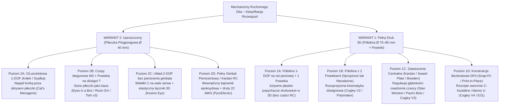

### Macierz porównawcza przeanalizowanych architektur

| Architektura / Poziom | Wariant zastosowania | Stopnie swobody (DOF) | Liczba serw (na 1 oko) | Sposób przeniesienia napędu | Główne zalety i ograniczenia | Źródła referencyjne (YouTube / Dokumentacja) |
| :--- | :--- | :--- | :--- | :--- | :--- | :--- |
| **Oś przelotowa + korba zewnętrzna** | Wariant 2 ($\varnothing 40\text{ mm}$) | 1-DOF (ruch gałki lub mruganie) | 1× serwo | Drut stalowy z haczykiem zaczepiony o gwóźdź w kołku | Nie obciąża cienkiej ścianki $0,4\text{ mm}$ piłeczki; tylko 1 oś ruchu | *Cat's Menagerie* (`gDrjgVRJONA`) |
| **Czopy biegunowe M3 / Słupek tylny + Powieka T** | Wariant 2 ($\varnothing 40\text{ mm}$) | 1-DOF gałka + 1-DOF powieka | 1–2× serwo | Wyprostowany spinacz biurowy + dźwignia pod kątem $27^\circ\text{–}30^\circ$ | Pozostawia puste wnętrze piłeczki (np. na diodę LED); bardzo prosta kalibracja | *Rock On!* (`Instructables`), *Eyes in a Box*, *Tioh v3* (`Printables 95892`) |
| **Widełki C na wale serwa + Flexure Link** | Wariant 2 ($\varnothing 40\text{ mm}$) | 2-DOF (Lewo–Prawo + Góra–Dół) | 2× serwo | Oś 1: bezpośrednio z wału serwa; Oś 2: cienki pasek 3D (*flexure*) | Brak zewnętrznego pierścienia gimbala i przegubów kulowych; druk łącznika w 2 min | *LOOK MUM NO COMPUTER – Kosmo* (`fufVeOHFu5Q`) |
| **Gimbal pierścieniowy PVC + kątownik wewnętrzny** | Wariant 2 ($\varnothing 40\text{ mm}$) | 2-DOF niezależny | 2× serwo | Drut 22 AWG wklejony z kątownikiem L na epoksyd wewnątrz piłeczki | Duży zakres kątowy w obu osiach; wymaga wycięcia tylnego okna w piłeczce | *PyroElectro* (`4xEqbry2gFk`, *Hackaday*) |
| **Rozsprzężone widełki X + płaskie popychacze 3D** | Wariant 1 (Półsfera 3D) | 1-DOF (L/R) lub 2-DOF (kołyska) + Powieki | 2–4× serwo | **100% drukowane sztywne popychacze płaskie** (śruby M3/M2 jako czopy) | Brak drutów i przegubów kulowych RC; ogromna sztywność (idealne dla dużych oczu $\varnothing 70\text{–}80\text{ mm}$) | *Will Cogley V2 Simplified* (`Ftt9e8xnKE4`), *Aqua Cat* (`s0av1qdiazU`) |
| **Dwupoziomowy układ płaski PLA + przeguby TPU** | Wariant 1 (Półsfera 3D) | 2-DOF na czopie kulowym | 2× serwo standard (np. S3003) | Płaskie popychacze PLA na łożyskach 13×4×4 mm + harmonijki z TPU | Przystosowany do dużych obciążeń i serw standardowych; wymaga druku z TPU | *Polymaker – Luke Taylor* (`Y0upri54Jhs`, `Thingiverse 1152248`) |
| **Centralna tarcza *Swash Plate* / Linki Bowdena** | Wariant 1 (Półsfera 3D) | 2-DOF + 2 niezależne powieki | 4× serwo | Popychacze gwintowane z *Ball-Links* / *E/Z Connectors* lub linki Bowdena | Możliwość regulacji wysunięcia półsfery względem powiek; wymaga osprzętu RC | *Stan Winston School* (`8fTt1kiLn7c`), *Paul's Bots* (`3a2vmJmOzxY`), *Cogley V3* (`ihXxbQefl1c`) |
| **Bezśrubowe zatrzaski *Snap-Fit* i *Print-in-Place*** | Wariant 1 (Półsfera 3D) | 2-DOF + 2 niezależne powieki | 4–6× serwo | Zatrzaskiwane rozcięte tulejki o przekroju „C” + klamry U-kształtne | Montaż w 5 minut bez śrubokręta; wymaga dokładnego skalibrowania przepływu w drukarce | *Will Cogley V4 Zero Fasteners* (`uzPisRAmo2s`) oraz *EyeMech E31* (`Printables 1220172`) |

---

## 2. Dokumentacja Wariantu 1: Duże Oko Drukowane w 3D (Półsfera $\varnothing 70\text{–}80\text{ mm}$ z Powiekami i Ruchem Lewo–Prawo)

W większości gotowych modeli z Internetu (np. Will Cogley, Paul's Bots) średnica gałki ocznej wynosi od $32\text{ mm}$ do $46\text{ mm}$ (skala ludzka lub lekko powiększona). Zastosowanie **półsfery o średnicy $\varnothing 70\text{–}80\text{ mm}$ (promień $R_{\text{oka}} = 35\text{–}40\text{ mm}$)** zmienia proporcje sił, momentów bezwładności oraz dostępnej przestrzeni wewnętrznej. Poniżej zebrano zasady inżynieryjne wynikające z analizy konstrukcji 3D, przeliczone i zaadaptowane do skali $7\text{–}8\text{ cm}$.

### 2.1. Geometria półsfery gałki ocznej ($\varnothing 70\text{–}80\text{ mm}$) – Problem odsłaniania krawędzi przy obrocie

> [!WARNING]
> **Kluczowa pułapka geometryczna czystej półsfery ($180^\circ$):**
> Dokładna półsfera kończy się na równiku ($90^\circ$ od osi optycznej źrenicy). Jeżeli gałka oczna o średnicy $80\text{ mm}$ obróci się w lewo lub w prawo o kąt $\alpha = 30^\circ\text{–}35^\circ$, to boczna krawędź równika przesunie się do przodu aż na kąt $55^\circ\text{–}60^\circ$ od osi wzroku! Jeśli wycięcie powiek (szpara powiekowa) jest szerokie, widz zobaczy z boku pustą dziurę za obciętą krawędzią półsfery.

Doświadczeni konstruktorzy rozwiązują ten problem na dwa sposoby (widoczne m.in. w modelach *Stan Winston School*, *Will Cogley V2/V3* oraz *LGProspects*):

1. **Przedłużona półsfera (Czasza kulista o kącie rozwarcia $210^\circ\text{–}220^\circ$ zamiast $180^\circ$):**
   * Zamiast ucinać kulę dokładnie na równiku (głębokość $H = R = 35\text{–}40\text{ mm}$), ściankę boczną przedłuża się poza równik o odcinek:
     $$\Delta H = R \cdot \sin(15^\circ\text{ do }20^\circ) \approx 0,26 R \text{ do } 0,34 R$$
   * Dla kuli $\varnothing 80\text{ mm}$ ($R = 40\text{ mm}$) oznacza to głębokość czaszy **$H = 40\text{ mm} + 10\text{ mm} = 50\text{ mm}$** (tylną krawędź ścina się lekko do wewnątrz lub zostawia jako walcowy kołnierz). Dzięki temu nawet przy pełnym skręcie oka o $35^\circ$ w lewo lub w prawo, w szczelinie między powiekami zawsze widoczna jest ciągła biała powierzchnia sferyczna!
   * Dokładnie ten sam zabieg zastosowano w projekcie *Arduino Animatronic Eyes* (`arduino_eyes_s4_Prepping_and_Mounting_Eyeballs.jpg`), gdzie do półkuli doklejono pierścień równikowy o szerokości $12,7\text{ mm}$ ($1/2\text{"}$), aby krawędź nie wychodziła poza oczodół podczas ruchów bocznych.
2. **Maskowanie obrzeża przez powieki obejmujące równik:**
   * Jeżeli czasza gałki musi pozostać ścisłą półsferą ($H = R = 35\text{–}40\text{ mm}$), wówczas powieka górna i powieka dolna (nawet jeśli dolna jest nieruchoma) muszą stale zachodzić na boczne kąciki oka (tzw. *canthus overlap*) na głębokość minimum $12\text{–}15\text{ mm}$ od równika ku przodowi.

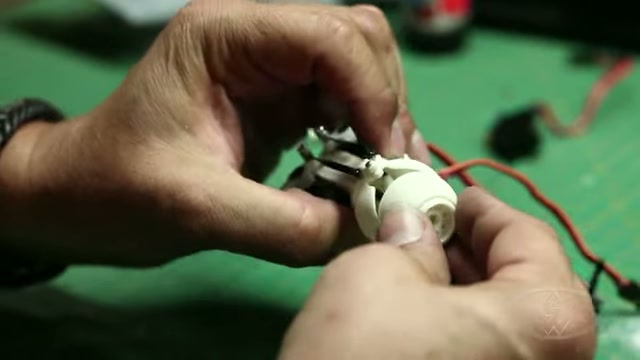

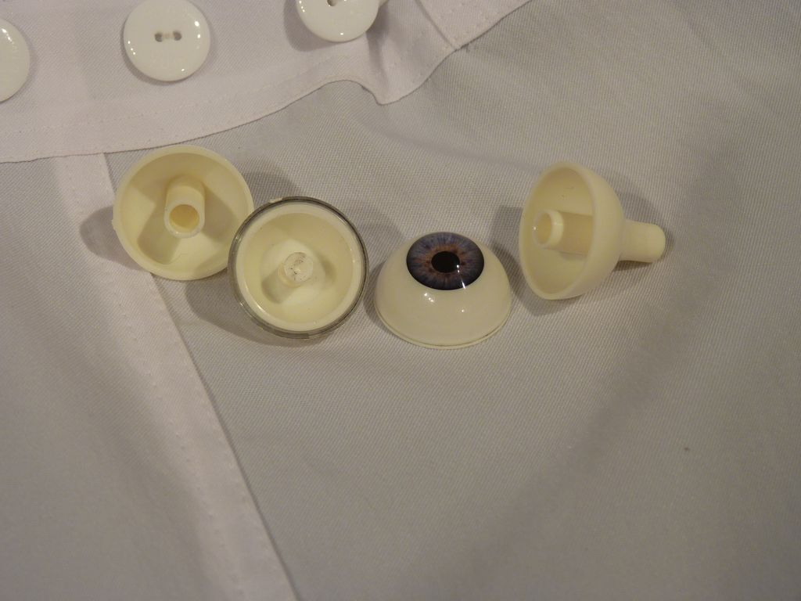

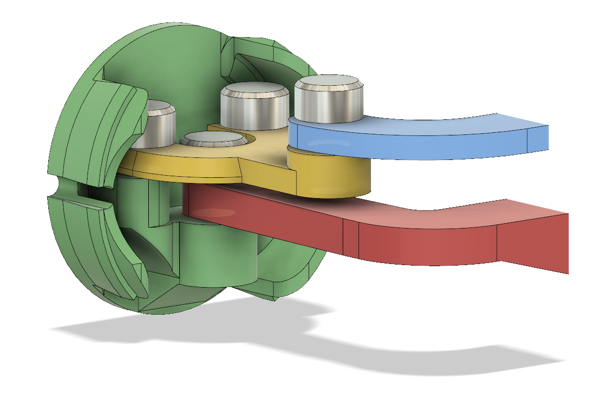

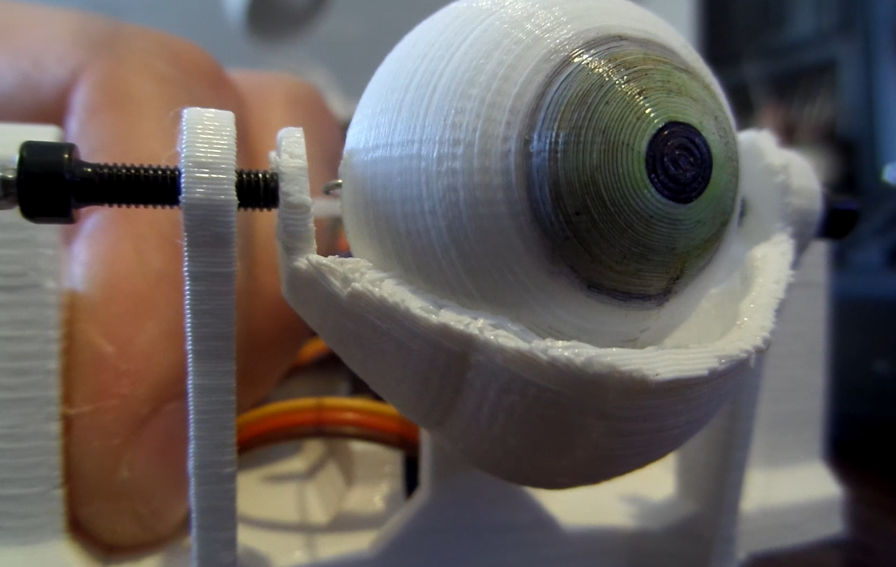

---

### 2.2. Zawieszenie i napęd Lewo–Prawo (Oś X / Yaw) dla półsfery $\varnothing 70\text{–}80\text{ mm}$

Przy średnicy półsfery $70\text{–}80\text{ mm}$ wnętrze czaszy ma średnicę wewnętrzną aż **$65\text{–}75\text{ mm}$** i głębokość **$35\text{–}40\text{ mm}$**. Daje to ogromny atut konstrukcyjny: **cały mechanizm łożyskowania (a nawet samo serwo osi lewo–prawo!) można schować całkowicie wewnątrz obrysu półsfery gałki ocznej**.

Na podstawie przeanalizowanych filmów wyróżniamy 3 najlepsze metody zawieszenia i napędu takiej półsfery:

#### Rozwiązanie 1A (Najprostsze – tylko ruch Lewo–Prawo): Pionowa oś w środku sfery + sztywny drukowany popychacz (wzorowane na *Will Cogley V2* i *Polymaker*)
* **Łożyskowanie:**
  * Od wewnętrznej strony półsfery (na górze i na dole, dokładnie w osi pionowej przechodzącej przez środek geometryczny sfery $(0,0,0)$) znajdują się dwa gniazda łożyskowe.
  * Dla skali $\varnothing 70\text{–}80\text{ mm}$ zamiast cienkich śrubek M2 stosuje się **śruby M3 lub M4** współpracujące z nieruchomym wspornikiem C-kształtnym (`Eye-Holder`) wchodzącym do wnętrza półsfery od tyłu.
  * **Patent z filmu *Polymaker* (`polymaker_tut_00_03_15.jpg`, `polymaker_tut_00_08_55.jpg`):** Przy większych siłach i średnicach w gniazda osi obrotu wstawia się podczas druku (metodą *pause-and-insert*) standardowe miniaturowe **łożyska kulkowe 13×4×4 mm (lub 623ZZ 10×3×4 mm / 604ZZ 12×4×4 mm)** na śrubie M3/M4. Zapewnia to zerowe tarcie i całkowity brak luzu poosiowego (brak kołysania się dużej półsfery).
* **Napęd Lewo–Prawo:**
  * Z wewnętrznego żebra półsfery (lub z widełek `Fork` trzymających półsferę) wyprowadzone jest w bok ramię korby o długości **$r_X = 20\text{–}25\text{ mm}$** od osi pionowej.
  * Ramię to jest połączone **płaskim, sztywnym popychaczem wydrukowanym w 3D** (przekrój np. $3\times 6\text{ mm}$, 50% wypełnienia, jak `Conrod X.STL` w *Polymaker* lub `Three-point Connector` w *Cogley V2*) z orczykiem serwa.
  * Ponieważ ruch odbywa się wyłącznie w płaszczyźnie poziomej (1-DOF), **nie są potrzebne żadne przeguby kulowe (ball-links)** – wystarczą dwie pionowe śruby M3 łączące popychacz z orczykiem serwa i ramieniem półsfery!

#### Rozwiązanie 1B (Kompaktowe 1-DOF): Napęd bezpośredni (*Direct Drive*) z serwa ukrytego wewnątrz półsfery
* Ponieważ promień wewnętrzny półsfery wynosi $33\text{–}38\text{ mm}$, w jej geometrycznym środku bez trudu mieści się pionowo ustawione serwo (zarówno mikroserwo **MG90S** o wymiarach $22,8 \times 12,2 \times 28,5\text{ mm}$, jak i serwo standardowe **S3003 / MG996R** o wymiarach $40 \times 20 \times 36\text{ mm}$!).
* Korpus serwa jest nieruchomy (zamocowany do tylnej ramy), jego wał wyjściowy pokrywa się z pionową osią obrotu półsfery (od góry), a od dołu półsfera jest podparta współosiowym czopem łożyskowym M4. Orczyk serwa przykręcony jest bezpośrednio do górnego żebra wewnętrznego półsfery. Eliminuje to popychacz i daje przełożenie $1:1$.

#### Rozwiązanie 1C (Rozbudowane 2-DOF – Lewo–Prawo + Góra–Dół): Wewnętrzny Kardan (*Cogley V3*) lub Regulowana Kula ze *Swash Plate* (*Stan Winston School* / *Paul's Bots*)
* Jeżeli w przyszłości półsfera $\varnothing 70\text{–}80\text{ mm}$ ma poruszać się również w osi Góra–Dół:
  * **Wariant bez części RC (*Will Cogley V2 / V4*):** Zachowujemy pionową oś obrotu półsfery na widełkach (Lewo–Prawo), a cały wspornik z serwem osi X zawieszamy na dwóch poziomych śrubach M3/M4 jako wahliwą kołyskę (`Sub_Base`), poruszaną drugim serwem przez sztywne łukowe ramię `Y-Arm.stl` (`cogley_v2_vid_frame008.jpg`).
  * **Wariant ze *Swash Plate* (*Stan Winston School*, `stanwinston_00_01_25.jpg`, `stanwinston_00_04_05.jpg`):** W środku geometrycznym półsfery umieszczamy kulę ($\varnothing 12\text{–}16\text{ mm}$) osadzoną na gwintowanym trzpieniu M5/M6 wkręcanym w tylny blok. Na kulę zatrzaskujemy wewnętrzną tarczę sterującą (*swash plate*), do której podłączamy dwa popychacze z przegubami kulowymi M2/M3, a zewnętrzną półsferę oka $70\text{–}80\text{ mm}$ wciskamy na obwód tarczy. **Pokręcenie gwintowanym trzpieniem kuli pozwala po złożeniu wyregulować wysunięcie półsfery w przód/tył z dokładnością do $0,1\text{ mm}$ względem powiek!**

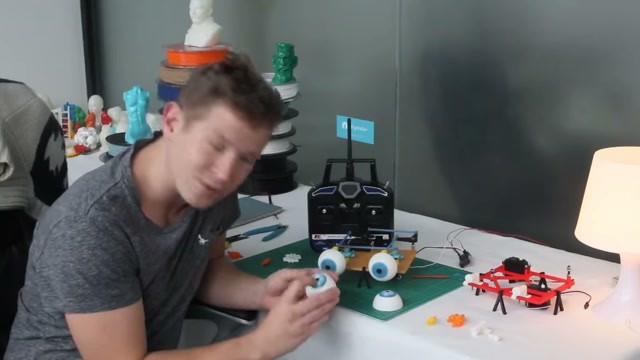

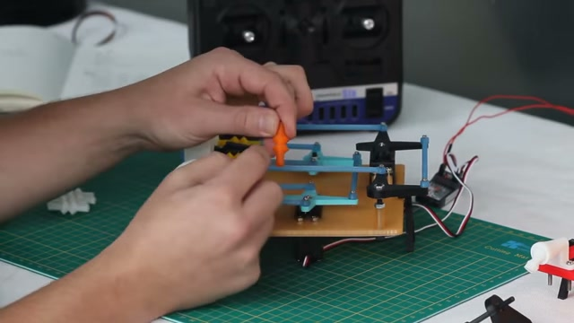

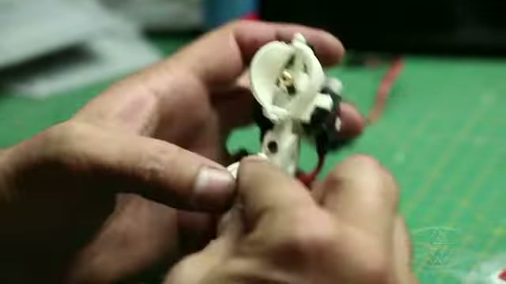

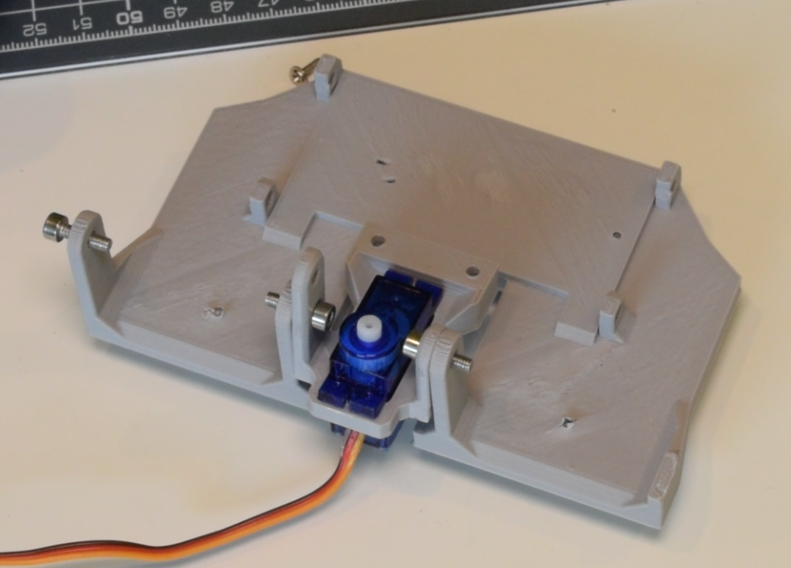

---

### 2.3. Projektowanie i Kinematyka Powiek dla Półsfery $\varnothing 70\text{–}80\text{ mm}$

Przy dużej gałce ocznej ($\varnothing 70\text{–}80\text{ mm}$) czasza powieki jest sporym cienkościennym wydrukiem, który przy złym doborze luzów łatwo ulega deformacji termicznej lub ociera o gałkę. Poniżej zestawiono dokładne parametry wymiarowe dla tej skali:

#### 1. Wymiary geometryczne czaszy powieki (dla gałki $\varnothing 70\text{ mm}$ oraz $\varnothing 80\text{ mm}$)

| Parametr geometryczny | Symbol i wzór | Wartość dla gałki $\varnothing 70\text{ mm}$ ($R = 35\text{ mm}$) | Wartość dla gałki $\varnothing 80\text{ mm}$ ($R = 40\text{ mm}$) | Uzasadnienie inżynieryjne (na bazie analizowanych projektów) |
| :--- | :--- | :--- | :--- | :--- |
| **Promień zewnętrzny gałki ocznej** | $R_{\text{oka}}$ | $35,0\text{ mm}$ | $40,0\text{ mm}$ | Półsfera przedłużona o $8\text{–}10\text{ mm}$ za równik |
| **Luz promieniowy pod powieką** | $\Delta c$ | **$1,0\text{–}1,2\text{ mm}$** | **$1,2\text{–}1,5\text{ mm}$** | Przy średnicy $70\text{–}80\text{ mm}$ mniejszy luz grozi tarciem po szlifowaniu/malowaniu i przy lekkiej owalizacji czaszy FDM |
| **Promień wewnętrzny powieki** | $R_{\text{wewn}} = R_{\text{oka}} + \Delta c$ | **$36,0\text{–}36,2\text{ mm}$** ($\varnothing 72,0\text{–}72,4\text{ mm}$) | **$41,2\text{–}41,5\text{ mm}$** ($\varnothing 82,4\text{–}83,0\text{ mm}$) | Koncentryczna powierzchnia wewnętrzna czaszy powieki |
| **Grubość ścianki powieki** | $t_{\text{pow}}$ | **$2,0\text{–}2,4\text{ mm}$** (5–6 obrysów dyszą $0,4\text{ mm}$) | **$2,4\text{–}2,8\text{ mm}$** (6–7 obrysów dyszą $0,4\text{ mm}$) | Przy rozpiętości łuku $80\text{ mm}$ ścianka $1,2\text{ mm}$ (stosowana w małych oczach $32\text{ mm}$) byłaby zbyt wiotka i sprężynowałaby przy ciągnięciu z jednej strony |
| **Promień zewnętrzny powieki** | $R_{\text{zewn}} = R_{\text{wewn}} + t_{\text{pow}}$ | **$38,0\text{–}38,6\text{ mm}$** ($\varnothing 76,0\text{–}77,2\text{ mm}$) | **$43,6\text{–}44,3\text{ mm}$** ($\varnothing 87,2\text{–}88,6\text{ mm}$) | Zewnętrzny obrys ruchomej czaszy powieki |
| **Średnica osi obrotu powieki** | $d_{\text{oś}}$ | Śruba **M3 lub M4** (w tulejce o gr. ścianki $4\text{ mm}$) | Śruba **M4** (lub czop drukowany $\varnothing 5\text{–}6\text{ mm}$) | Oś pozioma musi przechodzić dokładnie przez $(0,0,0)$ środka półsfery |
| **Długość ramienia dźwigni powieki** | $r_{\text{dźwigni}}$ | **$20\text{–}24\text{ mm}$** (pod kątem $28^\circ$) | **$24\text{–}28\text{ mm}$** (pod kątem $28^\circ$) | Zapewnia pełne zamknięcie powieki (kąt obrotu $\sim 65^\circ\text{–}75^\circ$) przy ruchu orczyka serwa na promieniu $14\text{–}18\text{ mm}$ |

> [!CAUTION]
> **Zasada montażu wkrętów osi powiek (*Stan Winston School*, `stanwinston_00_02_52.jpg`):**
> Śruby M3/M4 wkręcane od zewnątrz przez boczne uszy powieki w słupki ramy nośnej **pod żadnym pozorem nie mogą wystawać poza wewnętrzną powierzchnię czaszy powieki w głąb szczeliny $\Delta c$**. Nawet $0,5\text{ mm}$ wystającego gwintu wewnątrz ucha powieki wyżłobi rysę na obracającej się półsferze oka i zablokuje ruch mrugania!

#### 2. Trzy warianty napędu powiek w dużym oku ($\varnothing 70\text{–}80\text{ mm}$)

1. **Układ z jedną ruchomą powieką górną i stałą powieką dolną (1 serwo na powieki):**
   * Powieka dolna jest nieruchoma (stanowi część przedniej oprawy lub jest zablokowana na stałe nieco poniżej równika, np. $15^\circ$ w dół).
   * Powieka górna obraca się na dwóch bocznych śrubach M4 współosiowych ze środkiem półsfery. Jej tylne ucho napędowe (wyprowadzone z jednej strony lub symetrycznie po obu stronach jako pałąk tylny) jest połączone sztywnym drukowanym popychaczem z serwem.
   * **Uwaga dla skali $\varnothing 80\text{ mm}$:** Ponieważ czasza o średnicy ponad $82\text{ mm}$ jest szeroka, przy napędzie tylko z jednego boku (np. tylko przy lewym uchu) cienka czasza może lekko przekoszać się podczas szybkiego mrugania. Aby temu zapobiec, pogrubia się przedni rant powieki (tzw. brzeg rzęsowy) do **$3,5\text{–}4,0\text{ mm}$** (tworząc sztywne żebro łukowe) lub wyprowadza dźwignię napędową na środku grzbietu powieki (jak w modelu *Tioh v3* – `tioh_95892_eyelid.jpg`).
2. **Układ z dwiema powiekami sprzężonymi mechanicznie na jednym serwie (1 serwo porusza górną i dolną powieką jednocześnie):**
   * Obie powieki (górna i dolna) są ułożyskowane na tej samej poziomej osi M4 przechodzącej przez środek półsfery (uszko powieki górnej nachodzi od zewnątrz na uszko powieki dolnej, jak w *Cogley V1* `cogley_v1_assembly2.png` i *Paul's Bots* `paulsbots_00_08_15.jpg`).
   * **Sposób sprzężenia nr 1 (Dwuramienny orczyk serwa):** Popychacz powieki górnej podłączony jest do górnego ramienia orczyka serwa (np. na promieniu $16\text{ mm}$), a popychacz powieki dolnej – do przeciwległego (dolnego) ramienia tego samego orczyka (np. na promieniu $8\text{–}10\text{ mm}$). Obrót serwa o $45^\circ$ powoduje jednoczesne opuszczenie powieki górnej (większy skok) i podniesienie powieki dolnej (mniejszy, naturalny skok) aż do ich zetknięcia!
   * **Sposób sprzężenia nr 2 (Boczna płytka trójkątna / rewersor):** Stosowany w przemyśle kukiełkowym – jedno serwo ciągnie łącznik, który poprzez małą dźwignię dwustronną na boku ramy zbliża do siebie tylne ogony obu powiek.
3. **Układ z dwiema całkowicie niezależnymi powiekami (2 osobne serwa na powieki – *Paul's Bots*, *Cogley V1/V2/V4*):**
   * Daje najwyższy realizm (mruganie, przymykanie oczu, asymetryczny ruch oraz programowe podążanie powiek za ruchem wzroku).
   * Aby popychacze górnej i dolnej powieki nie kolidowały ze sobą po tej samej stronie oka, wyprowadza się napęd powieki górnej z prawej strony, a powieki dolnej z lewej strony, **lub** stosuje się dźwignie o różnej długości i kącie (krótka dźwignia powieki górnej + długa dźwignia powieki dolnej, jak na klatce `cogley_v4_vid_044.jpg`).

#### 3. Dobór serwomechanizmów dla skali $\varnothing 70\text{–}80\text{ mm}$
* W małych oczach ($\varnothing 32\text{–}40\text{ mm}$) wystarczają najtańsze plastikowe mikroserwa **SG90** ($1,2\text{–}1,6\text{ kg}\cdot\text{cm}$).
* Przy półsferze **$\varnothing 70\text{–}80\text{ mm}$** (masa wydrukowanej półsfery $\sim 35\text{–}55\text{ g}$, masa czaszy powieki $\sim 20\text{–}30\text{ g}$, dłuższe ramiona dźwigni $25\text{ mm}$) plastikowe zębatki SG90 mogą ulec ścięciu przy gwałtownym mrugnięciu (które wymaga pokonania bezwładności powieki w czasie $\sim 0,15\text{ s}$).
* **Rekomendacja z analizowanych projektów (*Cogley V3/E31*, *Paul's Bots*, *Polymaker*):**
  * Minimum: mikroserwa z metalową przekładnią **MG90S** ($2,2\text{ kg}\cdot\text{cm}$), lub serwa klasy mini **Hitec HS-85BB / HS-85MG** ($3,0\text{–}3,5\text{ kg}\cdot\text{cm}$, używane przez *Paul's Bots*), albo standardowe serwa **Futaba S3003 / TowerPro MG996R** ($3,5\text{–}10\text{ kg}\cdot\text{cm}$, używane w projekcie *Polymaker*).

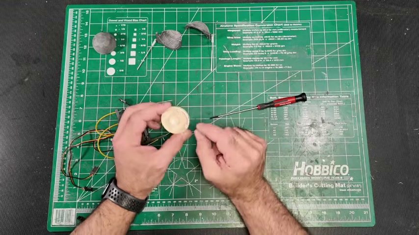

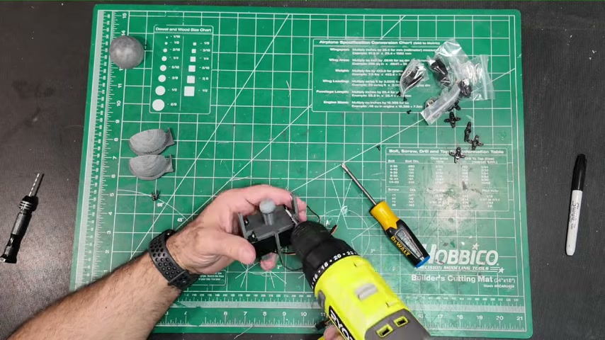

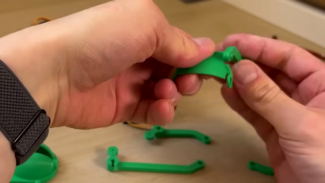

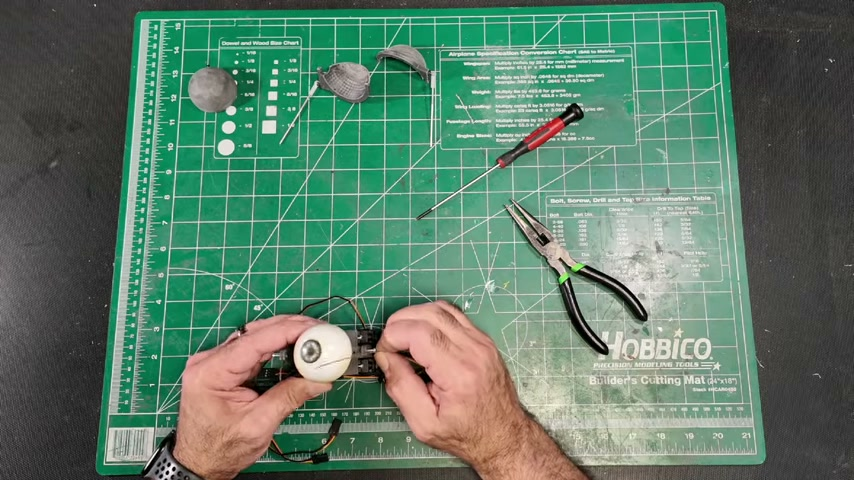

---

## 3. Dokumentacja Wariantu 2: Uproszczone Mechanizmy z Piłeczką Pingpongową ($\varnothing 40,0\text{ mm}$)

Drugi, całkowicie niezależny nurt konstrukcyjny wykorzystuje gotową piłeczkę do tenisa stołowego jako gałkę oczną. Piłeczka regulaminowa ITTF ma średnicę **$\varnothing 40,0\text{ mm}$ ($R = 20,0\text{ mm}$)**, masę zaledwie **$2,7\text{ g}$** oraz cienką ściankę **$\sim 0,38\text{–}0,40\text{ mm}$** z ABS lub celuloidu.

Główną zaletą tego podejścia jest fakt, że **odpada konieczność wielogodzinnego drukowania, szlifowania i szpachlowania sfery gałki ocznej**, a dzięki znikomej masie ($2,7\text{ g}$) do jej błyskawicznego poruszania wystarcza najtańsze mikroserwo 9g (**SG90**). Cała sztuka inżynieryjna polega na prawidłowym ułożyskowaniu cienkościennej kuli i podłączeniu do niej popychacza bez wyrwania ścianki $0,4\text{ mm}$.

### 3.1. Wyznaczanie osi symetrii na piłeczce pingpongowej (Baza pomiarowa)

1. **Wykorzystanie fabrycznego szwu równikowego (*New Animatronic Eyes: Rock On!* – `rockon_s4_Assembling_the_Eyes.jpg`):**
   * Każda piłeczka pingpongowa powstaje ze zgrzania dwóch półkul i posiada wyraźny, płaski **szew obwodowy (joint line)** o obwodzie $\pi \cdot 40\text{ mm} = 125,66\text{ mm}$.
   * Szew ten stanowi darmową, idealnie dokładną bazę pomiarową: wyznacza płaszczyznę główną kuli, na której odmierzamy punkty biegunowe co $1/4$ obwodu ($31,4\text{ mm}$ po łuku, czyli dokładnie co $90^\circ$) lub centrujemy tylny otwór montażowy.
2. **Metoda gumki recepturki do wyznaczania osi prostopadłej (*Cat's Menagerie* – `grid_cats_menagerie_01.jpg`):**
   * Aby wyznaczyć dwa punkty dokładnie po przeciwnych stronach piłeczki (antypody) bez suwmiarki, nakłada się na piłeczkę płaską gumkę recepturkę tak, aby przecinała fabryczny szew pod kątem $90^\circ$.
   * Gumka pod wpływem napięcia sama układa się dokładnie na kole wielkim kuli. Zaznaczając punkty na przecięciu gumki ze szwem, otrzymujemy idealnie współosiowe punkty pod wiercenie osi obrotu.

### 3.2. Cztery Sprawdzone Konstrukcje Zawieszenia i Napędu Piłeczki Pingpongowej

#### Metoda 2A: Przelotowy kołek/wałek z zewnętrzną szpilką napędową (Patent *Cat's Menagerie* – `gDrjgVRJONA`)
* **Budowa (`grid_cats_menagerie_01.jpg` – `grid_cats_menagerie_03.jpg`, `yt_gDrjgVRJONA_f08.jpg`):**
  * W dwóch przeciwległych punktach na równiku (lub na biegunach góra–dół dla ruchu lewo–prawo) wierci się otwory $\varnothing 3,0\text{–}3,2\text{ mm}$ dopasowane z lekkim wciskiem do drewnianego kołka (lub pręta z włókna węglowego / wydrukowanego wałka).
  * Kołek przechodzi na wylot przez piłeczkę, a jego wystające końce spoczywają w otworach dwóch wsporników (w oryginale patyczki laryngologiczne lub mała drukowana ramka U-kształtna).
  * **Jak uniknięto wyrwania ścianki $0,4\text{ mm}$:** Tuż obok ścianki piłeczki kołek jest przewiercony poprzecznie wiertłem $\varnothing 1\text{ mm}$, a przez otwór przechodzi **mały gwóźdź lub szpilka**, tworząc ramię korby o długości $\sim 8\text{–}10\text{ mm}$ (`yt_gDrjgVRJONA_f08.jpg`).
  * Popychacz z drutu (z zagiętym haczykiem na końcu) ciągnie i pcha ten gwóźdź, a przed zsunięciem z gładkiego gwoździa zabezpieczają go **małe gumki ortodontyczne** nawinięte na gwóźdź po obu stronach drutu (`grid_cats_menagerie_03.jpg`). Cienka ścianka piłeczki nie przenosi żadnych sił od popychacza!

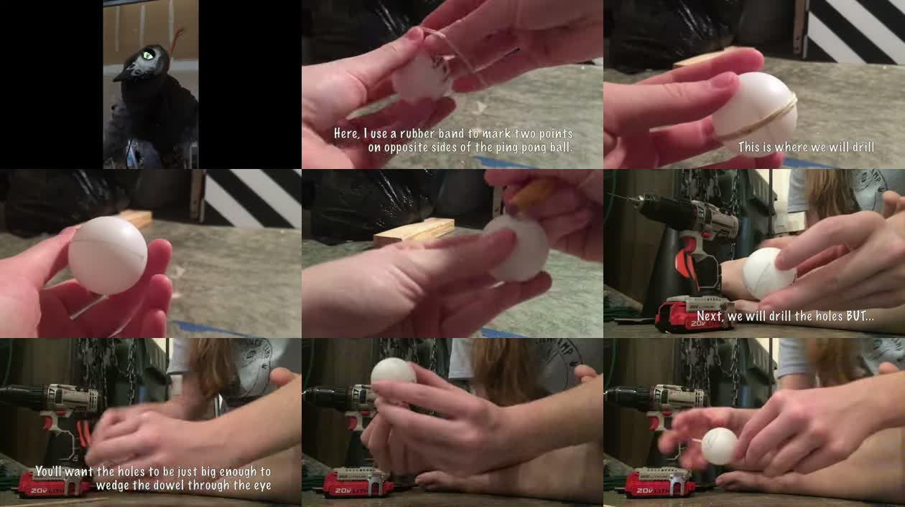

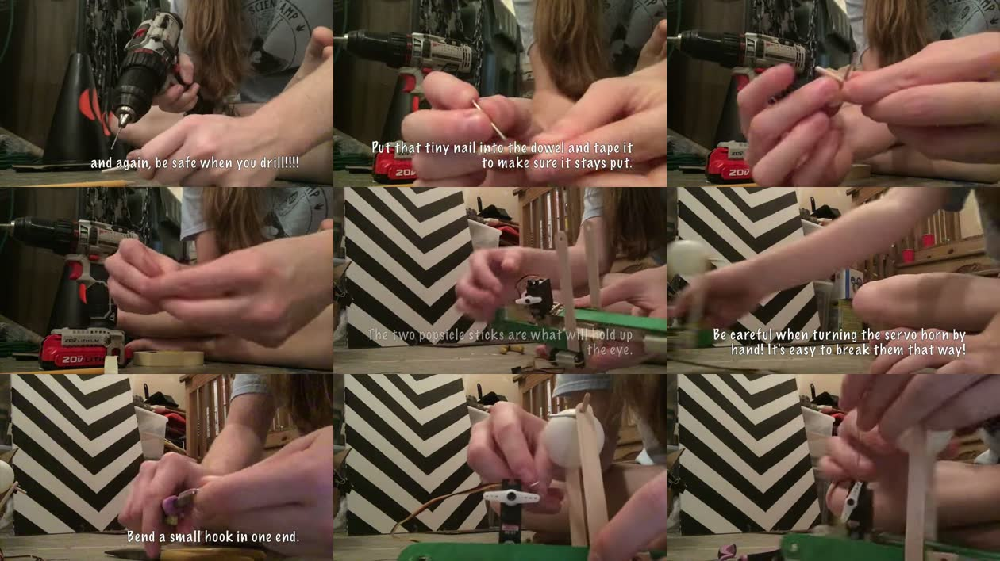

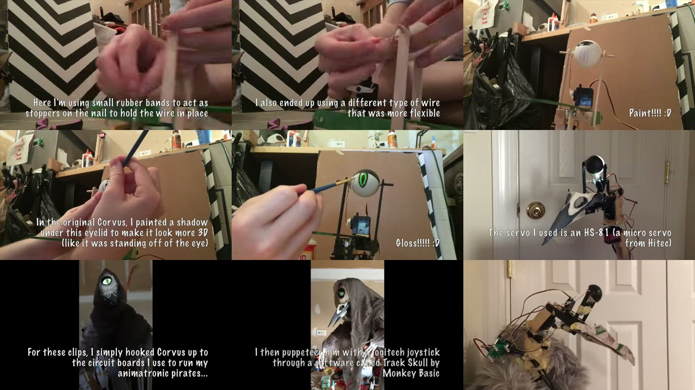

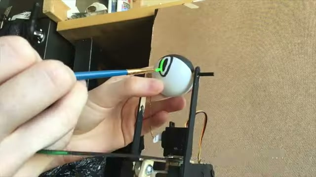

#### Metoda 2B: Zewnętrzne czopy ze śrub M3 przyklejonych czołowo do biegunów (Patent *Eyes in a Box*)
* **Budowa (`eyes_box_s2_Create_a_Inner_Frame_for_the_Eyes.jpg`, `eyes_box_s3_Create_the_Outer_Frame.jpg`):**
  * Zamiast przewiercać piłeczkę na wylot, do jej górnego i dolnego bieguna przykleja się na gorąco (Hot Glue) lub na epoksyd **łby dwóch śrub M3** (gwintami skierowanymi na zewnątrz).
  * Gwinty M3 przechodzą przez otwory $\varnothing 3,2\text{ mm}$ w górnej i dolnej półce ramki (z blachy aluminiowej $0,6\text{ mm}$ lub wydrukowanej w 3D).
  * Na wystający od góry lub od dołu gwint śruby M3 nakleja się **plastikowy orczyk serwa**, który pełni rolę zwrotnicy (steering arm) połączonej spinaczem biurowym z serwem.
  * **Zaleta:** Wnętrze piłeczki jest w 100% puste (brak przelotowego wałka), dzięki czemu przez otwór z tyłu piłeczki można włożyć do środka **diodę RGB LED 5 mm** podświetlającą oko od wewnątrz!

#### Metoda 2C: Drukowane widełki C-kształtne na wale serwa + elastyczny łącznik 3D (Patent *LOOK MUM NO COMPUTER – Kosmo Eye*, `fufVeOHFu5Q`)
* **Budowa (`yt_fufVeOHFu5Q_f06.jpg`, `kosmo_flexure_link_top.jpg`, `grid_kosmo_01.jpg`):**
  * Najbardziej eleganckie połączenie piłeczki pingpongowej z prostym wydrukiem 3D:
    1. Dolne (lub górne) mikroserwo SG90 ma przykręcone bezpośrednio do swojego wieloklinu wydrukowane w 3D **widełki w kształcie litery C** (półpierścień o promieniu wewnętrznym $\sim 21\text{ mm}$).
    2. Końce ramion widełek C są przykręcone do boków piłeczki pingpongowej dwiema śrubami **M3** wkręconymi w otwory $\varnothing 3\text{ mm}$.
    3. Jeżeli potrzebny jest tylko ruch 1-osiowy (Lewo–Prawo), widełki C obracają piłeczkę bezpośrednio na wale serwa bez żadnych popychaczy!
    4. Jeżeli potrzebny jest ruch 2-osiowy (Lewo–Prawo + Góra–Dół), drugie serwo SG90 montuje się prostopadle i łączy z małym wkrętem na szczycie piłeczki (otwór $\varnothing 1\text{ mm}$) za pomocą **cienkiego, płaskiego paska wydrukowanego w 3D (`Flexure Link`, grubość $0,6\text{ mm}$, czas druku 2 minuty – `kosmo_flexure_link_top.jpg`)**. Pasek ten zgina się i skręca sprężyście przy ruchach bocznych, więc nie wyłamuje wkrętu z cienkiej ścianki piłeczki i zastępuje przeguby kulowe!

#### Metoda 2D: Dwuosiowy gimbal pierścieniowy z wewnętrznym kątownikiem L na epoksyd (Patent *PyroElectro* – `4xEqbry2gFk`)
* **Budowa (`pyro_img_5_robotic_eyes.jpg`, `pyro_img_6_robotic_eyes.jpg`, `pyro_img_13_robotic_eyes.jpg`):**
  * Z tyłu piłeczki wycina się okno rewizyjne na ok. $1/3$ obwodu.
  * Piłeczka jest zawieszona na pionowej stalowej szpilce (oś Lewo–Prawo) wewnątrz pierścienia z rury PVC, który z kolei wisi na dwóch poziomych śrubach 0-80 (oś Góra–Dół) w płycie czołowej.
  * Aby drut popychacza (**22 AWG**) nie rozerwał ścianki piłeczki, od wewnątrz (przez tylne okno) do bocznej ścianki piłeczki przykleja się dwuskładnikowym klejem epoksydowym (**Loctite 5-min Epoxy**) mały **metalowy kątownik L** z otworem pod drut (`pyro_img_13_robotic_eyes.jpg`). Duża powierzchnia stopy kątownika rozkłada naprężenia na skorupie piłeczki.

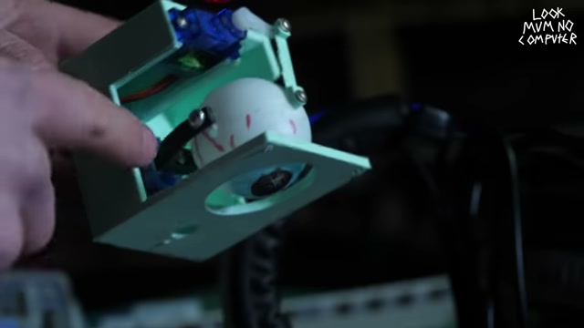

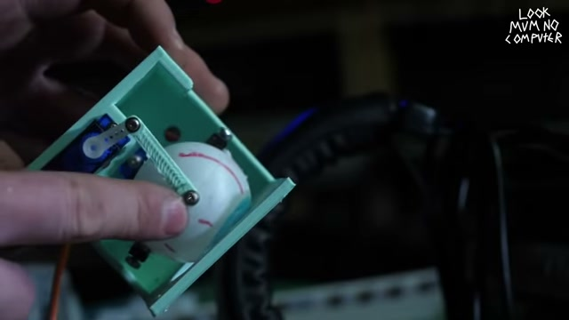

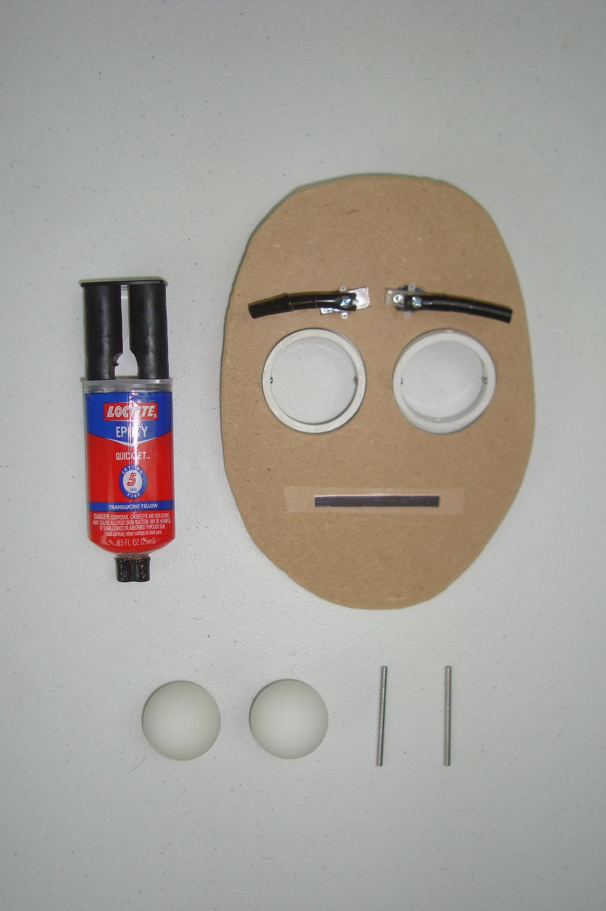

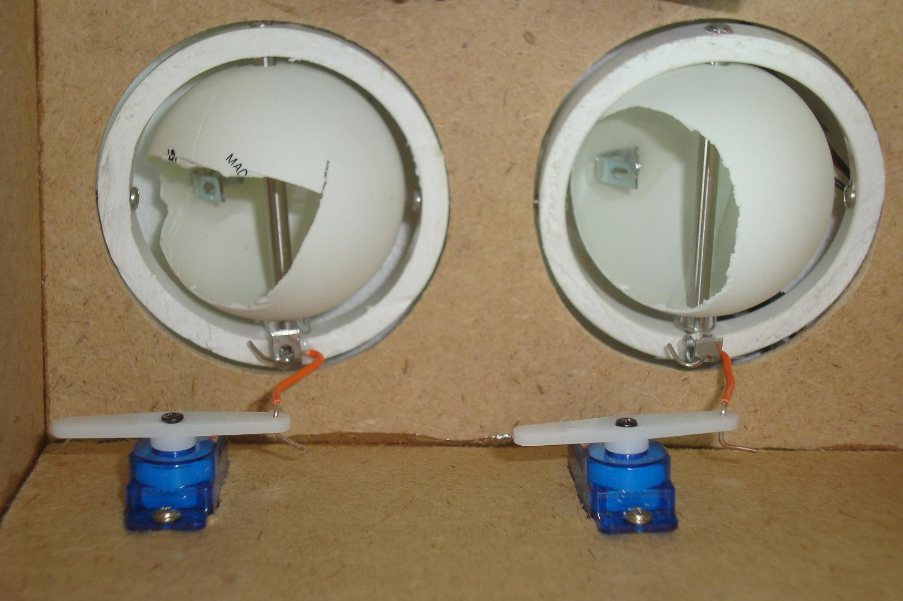

### 3.3. Opcjonalna Ruchoma Powieka dla Piłeczki Pingpongowej $\varnothing 40\text{ mm}$ (*Tioh v3* oraz *Rock On!*)
Jeżeli w wariancie z piłeczką pingpongową chcemy dodać również mrugającą powiekę, w literaturze funkcjonują dwa gotowe wzorce wymiarowe:
1. **Model 3D *Tioh – Movable Eyelid for 4cm Ping Pong Ball v3* (Printables `95892`, `tioh_95892_holder.jpg`, `tioh_95892_eyelid.jpg`):**
   * Składa się z nieruchomego pałąka (`holder.obj`) obejmującego piłeczkę od tyłu oraz półkulistej czaszy powieki (`PUPPETEYELID3.obj`) o średnicy wewnętrznej **$\varnothing 41,5\text{ mm}$** (luz promieniowy $0,75\text{ mm}$) i ściance **$1,2\text{–}1,5\text{ mm}$**.
   * Powieka zatrzaskuje się swoimi bocznymi czopami w okrągłych gniazdach pałąka i posiada z tyłu trójkątne ucho napędowe pod popychacz z serwa lub linkę Bowdena ze sprężynką powrotną.
2. **Układ dźwigniowy z projektu *Rock On!* (`rockon_s3_Planning.jpg`, `rockon_s11_Final_Linkage_.jpg`):**
   * Wykorzystuje ramię powieki o długości **$15,28\text{ mm}$ ($0,6014\text{"}$)** odchylone pod kątem **$27^\circ\text{–}30^\circ$** w dół/tył, połączone wyprostowanym spinaczem biurowym z orczykiem mikroserwa o promieniu czynnym **$10,87\text{ mm}$ ($0,4278\text{"}$)**, przy odległości osi serwa od osi powieki równej **$61,46\text{ mm}$ ($2,4196\text{"}$)**.

---

## 4. Technologia Druku 3D (DFAM / DFA), Kalibracja Otworów i Montaż

Niezależnie od wybranej skali, analiza filmów *Willa Cogleya (V1–V4/E31)*, *Paul's Bots*, *Polymaker*, *Aqua Cat* i *Kevina McAleera* wskazuje na zestaw kluczowych praktyk warsztatowych decydujących o płynności działania wydrukowanego mechanizmu:

### 4.1. Orientacja wydruków na stole i parametry slicera
* **Półsfera gałki ocznej i czasze powiek:**
  * Półsferę oka drukuje się zawsze **źrenicą skierowaną pionowo do góry** na wysokości warstwy **$0,10\text{–}0,15\text{ mm}$** (dla dużej półsfery $\varnothing 70\text{–}80\text{ mm}$ można użyć zmiennej wysokości warstwy *Adaptive Layer Height* w Bambu Studio / PrusaSlicer: $0,20\text{ mm}$ u podstawy równika i $0,08\text{–}0,10\text{ mm}$ na szczycie kopuły wokół tęczówki).
  * Czasze powiek drukuje się pionowo z ustawionym mnożnikiem ekstruzji **$1,1\times$ ($110\%$)**, szerokością ścieżki **$160\%$** i minimum **3–5 obrysami (Perimeters)** (*Will Cogley V3*), aby na szczycie sklepienia powieki nie powstały prześwity między warstwami.
* **Płaskie popychacze i dźwignie (`Conrods`, `Forks`, `Eyelid Connectors`):**
  * Drukowane płasko na stole roboczym z wypełnieniem **$35\%\text{–}50\%$** (zapobiega uginaniu się dźwigni pod obciążeniem, które wiotczy ruch oka – *Polymaker*).

### 4.2. Zasada dwóch średnic otworów pod połączenia śrubowe (Bez nakrętek)
W mechanizmach drukowanych w 3D nie stosuje się luźnych nakrętek na ruchomych przegubach (nakrętki zwiększają szerokość przegubu i odkręcają się podczas pracy). Zamiast tego każdy przegub składa się z pary otworów o różnych średnicach pod tę samą śrubę (*Will Cogley V2/V3* – `cogley_v2_holes_xaxis.png`, `cogley_v3_holes_inner.png`):

| Rozmiar śruby | Otwór ciasny (Samogwintujący – śruba wkręca się na sztywno) | Otwór luźny (Łożysko ślizgowe – element obraca się na śrubie) | Zastosowanie w mechanizmie oka |
| :--- | :--- | :--- | :--- |
| **Śruba M2** | **$\varnothing 1,5\text{–}1,8\text{ mm}$** | **$\varnothing 2,0\text{–}2,1\text{ mm}$** | Małe popychacze, przykręcanie popychacza do rozwierconego orczyka serwa |
| **Śruba M3** | **$\varnothing 2,5\text{–}2,8\text{ mm}$** | **$\varnothing 3,0\text{–}3,2\text{ mm}$** | Osie obrotu gałki $\varnothing 40\text{ mm}$, popychacze główne, mocowanie widełek |
| **Śruba M4** | **$\varnothing 3,5\text{–}3,7\text{ mm}$** | **$\varnothing 4,1\text{–}4,2\text{ mm}$** (lub łożysko 604ZZ / 13×4×4 mm) | Główne osie obrotu dużej półsfery $\varnothing 70\text{–}80\text{ mm}$ i osie szerokich powiek |

### 4.3. Konstrukcje Bezśrubowe (*Zero Fasteners* – Zatrzaski Snap-Fit i Print-in-Place)
W najnowszych konstrukcjach (*Will Cogley V4 Zero Fasteners* `uzPisRAmo2s` oraz *EyeMech E31*) śruby zastępuje się elementami sprężystymi zoptymalizowanymi pod kątem anizotropii druku FDM:
1. **Rozcięte tulejki sworzniowe o przekroju „C” (`Hollow C-Shaped Split Pins` – `cogley_v4_vid_018.jpg`):** Pionowy czop osi obrotu jest wydrążony w środku i przecięty wzdłużnie w kształt litery „C” z małym kołnierzem zatrzaskowym na szczycie. Podczas wciskania oczka popychacza ścianka „C” ugina się promieniowo w płaszczyźnie warstw `XY` (czyli wzdłuż ciągłych włókien filamentu), dzięki czemu zatrzask nigdy nie pęka między warstwami.
2. **Klamry U-kształtne mocujące serwa (`Servo Retainers` – `cogley_v4_vid_013.jpg`, `cogley_v4_vid_014.jpg`):** Drukowane na płasko na stole obejmy w kształcie litery „U”, które przechodzą przez szczeliny w podstawie i blokują serwa bez użycia wkrętów montażowych.

### 4.4. Procedura Kalibracji Serw na $90^\circ$ przed Montażem Orczyków
We wszystkich analizowanych wideo (*Kevin McAleer* `kevin_00_05_45.jpg`, *Aqua Cat*, *Will Cogley E31*) obowiązuje bezwzględna procedura uruchomieniowa:
1. Przed przykręceniem jakiegokolwiek orczyka lub popychacza należy podłączyć serwa do mikrokontrolera (Arduino / Raspberry Pi Pico / testera serw) i wgrać funkcję ustawiającą wszystkie serwa na kąt **$90^\circ$ (impuls $1500\ \mu\text{s}$)**.
2. Przy włączonym zasilaniu nakłada się orczyki na wielowypusty serw tak, aby:
   * Ramię orczyka serwa osi Lewo–Prawo stało **prostopadle ($90^\circ$)** do popychacza, gdy półsfera gałki ocznej patrzy idealnie na wprost ($0^\circ$). Zapewnia to symetryczny rozkład prędkości i kąta obrotu w lewo i w prawo.
   * W układzie z dwiema powiekami – obie powieki w punkcie $90^\circ$ stykały się w pozycji zamkniętej na równiku oka (`kevin_00_05_45.jpg`), a w układzie z jedną powieką – znajdowały się dokładnie w połowie kąta otwarcia.
3. Dopiero po mechanicznym złożeniu układu w punkcie $90^\circ$ dobiera się programowo bezpieczne limity skrajne (`servo_limits`, np. $50^\circ\text{–}130^\circ$), tak aby serwo na końcach ruchu nie napierało na mechaniczny opór ramy (co objawia się buczeniem serwa i poborem prądu rzędu $0,8\text{–}1,2\text{ A}$ na serwo).

---

## 5. Podsumowanie Zestawcze obu Wariantów (Ściąga Konstrukcyjna)

| Cecha / Parametr | Wariant 1: Duże Oko Drukowane w 3D (Półsfera + Powieki) | Wariant 2: Uproszczone Oko z Piłeczką Pingpongową |
| :--- | :--- | :--- |
| **Geometria i wymiar gałki ocznej** | Wydrukowana w 3D półsfera **$\varnothing 70\text{–}80\text{ mm}$** ($R = 35\text{–}40\text{ mm}$), zalecane przedłużenie ścianki o $8\text{–}10\text{ mm}$ poza równik (kąt czaszy $\sim 210^\circ$) | Gotowa piłeczka pingpongowa **$\varnothing 40,0\text{ mm}$** ($R = 20,0\text{ mm}$, masa $2,7\text{ g}$, ścianka $0,4\text{ mm}$) |
| **Grubość ścianki gałki** | **$2,0\text{–}2,5\text{ mm}$** (z wewnętrznymi żebrami i gniazdami pod oś obrotu) | **$0,38\text{–}0,40\text{ mm}$** (wymaga odciążenia sił skupionych) |
| **Rekomendowane łożyskowanie (Lewo–Prawo)** | Pionowa oś przechodząca przez środek sfery $(0,0,0)$ na śrubach **M3/M4** (opcjonalnie z łożyskami kulkowymi $13\times 4\times 4\text{ mm}$ lub $604\text{ZZ}$) albo serwo umieszczone bezpośrednio wewnątrz półsfery | **Opcja A:** Przelotowy kołek/szpilka $\varnothing 3\text{ mm}$ przez bieguny (*Cat's Menagerie*) **Opcja B:** Śruby M3 wklejone na biegunach (*Eyes in a Box*) **Opcja C:** Drukowane widełki C bezpośrednio na wale serwa (*Kosmo Eye*) |
| **Podłączenie popychacza do gałki** | Sztywny, płaski popychacz drukowany w 3D przykręcony śrubą M3 do wewnętrznego ramienia mimośrodowego ($r = 20\text{–}25\text{ mm}$) wewnątrz półsfery | **Opcja A:** Poprzeczny gwóźdź/szpilka w kołku przelotowym tuż obok piłeczki **Opcja B:** Wklejony od wewnątrz kątownik L / drukowany pierścień oporowy **Opcja C:** Podatny pasek fleksyjny 3D (*Flexure Link*, gr. $0,6\text{ mm}$) |
| **Geometria powiek(i)** | Czasza koncentryczna o średnicy wewn. **$\varnothing 72,4\text{–}83,0\text{ mm}$** (luz promieniowy $\Delta c = 1,2\text{–}1,5\text{ mm}$), ścianka **$2,2\text{–}2,8\text{ mm}$**, usztywniony rant przedni $3,5\text{ mm}$, oś obrotu M4 w linii środka sfery | Opcjonalna czasza drukowana bez podpór o średnicy wewn. **$\varnothing 41,5\text{ mm}$** (luz $\Delta c = 0,75\text{ mm}$), ścianka **$1,2\text{–}1,5\text{ mm}$**, czopy boczne na pałąku (*Tioh v3* / *Rock On!*) |
| **Napęd powiek(i)** | Sztywny popychacz drukowany w 3D podłączony do tylnego ucha powieki ($r = 22\text{–}28\text{ mm}$, odchylenie $28^\circ$); przy 2 powiekach napęd z 1 serwa (orczyk dwuramienny) lub z 2 osobnych serw | Popychacz z wyprostowanego spinacza biurowego lub płaski łącznik 3D ($r = 15\text{ mm}$, odchylenie $27^\circ\text{–}30^\circ$) napędzany z mikroserwa SG90 |
| **Zalecane serwomechanizmy** | Serwa z metalowymi trybami **MG90S** ($2,2\text{ kg}\cdot\text{cm}$), mini **HS-85BB/MG** ($3,5\text{ kg}\cdot\text{cm}$) lub standard **S3003 / MG996R** (ze względu na masę i bezwładność czaszy $\varnothing 80\text{ mm}$) | Zwykłe mikroserwa **9g TowerPro SG90** (ponad 100-krotny zapas momentu dla piłeczki $2,7\text{ g}$) |
