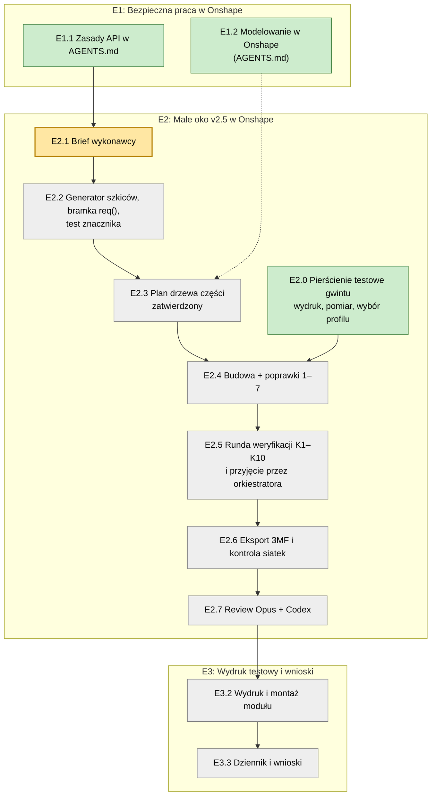

# Teraz: epiki, zadania, parking

Jedyna agenda projektu. Cel i kolejność zmienia tylko użytkownik. Agent na starcie sesji podaje bieżące zadanie, a temat spoza niego dopisuje do „Parkingu” (zasady w `AGENTS.md`, „Sposób współpracy”).

Podgląd z diagramem: `teraz.html`. Po każdej zmianie tego pliku agent uruchamia `python3 30-projekt/teraz_html.py`.

**Bieżące zadanie:** E3.2, wydruk i montaż modułu v2.5 na stole.

Kolory: zielone zrobione, żółte bieżące, szare czeka.

## E1: Bezpieczna praca w Onshape

Gotowe, gdy wykonawca ma sprawdzalne zasady, które nie pozwalają zablokować API ani zbudować modelu na liczbach zamiast parametrów.

- [x] E1.1 Zasady API w `AGENTS.md` („Praca z API Onshape”).
- [x] E1.2 Sekcja „Modelowanie w Onshape” w `AGENTS.md`: kolejność budowy, kontrola szkicu znacznikiem w drzewie, runda weryfikacji K1–K10 (źródło: `20-analizy/2026-10-19-metodyka-modelowania-parametrycznego.md`). Po review Opusa i Astry (`20-analizy/review/2026-10-19-agents-md-*.md`), zaakceptowana 19.10.

## E2: Małe oko v2.5 w Onshape

Gotowe, gdy v2.5 jest w SimpleEye, przeszła kontrolę wyjścia i review, a 3MF leży w `40-cad/3mf/`.

- [x] E2.0 Wynik: `luzGwint` = 0,20 (dziennik 19.10). Model gotowy 19.10 w dokumencie „Probka gwintu 45” (TMP), weryfikacja `40-cad/onshape/weryfikacja-probka-gwintu-45.md`; czeka na eksport 3MF, wydruk i ocenę użytkownika. Próbka gwintu 45°, skok 5: pierścień i nakrętki z luzem 0,2 / 0,25 / 0,3 / 0,35 / 0,4, zaprojektowane przez wykonawcę w nowym dokumencie Onshape w folderze TMP (pilotaż zasad), wydruk na docelowej drukarce, wybór luzu dla gniazda i nakrętki v2.5. Brief: `30-projekt/brief-e2.0-probka-gwintu-45.md`.
- [x] E2.1 Model v2.5 w nowym dokumencie Onshape „Oko F v2.5” (folder Halloween): 10 części, 11 folderów; spis elementów v2.4, plan, weryfikacja K1–K11 (`40-cad/onshape/e2.1-*.md`, `weryfikacja-v2.5.md`). Otwarte: K6 (53 szkice zamiast 40) i ukrycie płaszczyzn/szkiców – osobne zadanie.
- [x] E2.1b Nazwy części i eksport 3MF (eksport ręczny przez użytkownika; API ma za niski licznik eksportu), `40-cad/onshape/e2.1b-eksport.md`.
- [x] E2.1d Review v2.5 (Opus, Codex): `20-analizy/review/2026-10-19-v2.5-*.md`.
- [x] E2.1c Poprawki po review: szczelina zaczepu 213°, kula jarzma (klej 0,5), fazka sanek 2 mm; testy na siatkach zaliczone (`40-cad/onshape/e2.1c-poprawki.md`). Wszystkie 10 części do druku.
- [ ] E2.2 Porządki w modelu: scalenie szkiców (K6), ukrycie płaszczyzn i szkiców po użyciu.
- [ ] E2.3 Złożenie (Assembly) z mate'ami w Onshape, ruch ±33°, wsuwanie.

## E3: Wydruk testowy i wnioski

Gotowe, gdy moduł v2.5 jest wydrukowany, złożony, a wnioski są w `70-budowa/dziennik.md`.

- [ ] E3.1 Instrukcja montażu: `70-budowa/montaz-v2.5.md` (galeria części, lista śrub, kroki z obrazkami Blendera; po review nietechnicznym).
- [ ] E3.2 Wydruk i montaż modułu v2.5 (19.10: wydrukowane gniazdo, nakrętka, ramię, cięgno, tulejki, pokrywa).
- [x] E3.4 Test elektroniki (19.10): ESP32-C3 SuperMini + PCA9685 + 1 × SG90; Blink, skan I²C (0x40) i ruch ±30° zaliczone. Połączenia i szkice: `50-elektronika/polaczenia.md`.
- [ ] E3.3 Wpis w dzienniku i wnioski do następnej wersji.

## Epiki później

Seria ~10 modułów i rozmieszczenie w dyni; firmware ESP32 z kalibracją przez telefon; pudełko na elektronikę; duże oko.

## Parking

- `AGENTS.md` (wnioski 19.10, do zatwierdzenia): status OK szyku nie dowodzi powielenia wszystkich operacji; po eksporcie test symetrii (obrót/odbicie) i porównanie powierzchni z poprzednią wersją; kontrola szkicu przez filtr nazw w drzewie; ukrywanie płaszczyzn i szkiców po użyciu; zlecenia dla agentów jako osobne, widoczne sesje.
- Instrukcja montażu: kolejność przyrządu centrowania przy Ramieniu (plan v2.2: przyrząd przed Ramieniem); śruby M2/M3 użytkownika mają łby krzyżakowe – poprawić nazwy i wkrętak PH1.
- Eksport 3MF: Bambu nie pokazuje „ę” w nazwie obiektu.
- `AGENTS.md`: stan OK z odpowiedzi zapisu nie wyłapuje ostrzeżeń (np. „missing selection”); kontrola musi czytać też ikony ostrzeżeń w drzewie.
- `30-projekt/plan-powrot-do-onshape.md`: obaj recenzenci uznali go za nie do realizacji; dopisać adnotację albo usunąć.
- Dublety w `30-projekt/decyzje.md`.
- Oś oka: zamówione M3×6 (19.10); przy M3×6 otwory Ø4 w biegunach piłeczki albo pogłębienie łba w modelu (`lebH`) – do decyzji po teście.
- Napęd symetryczny (pomysł użytkownika), po wydruku modułu.
- Kopia researchu Gemini na dysk sieciowy.
