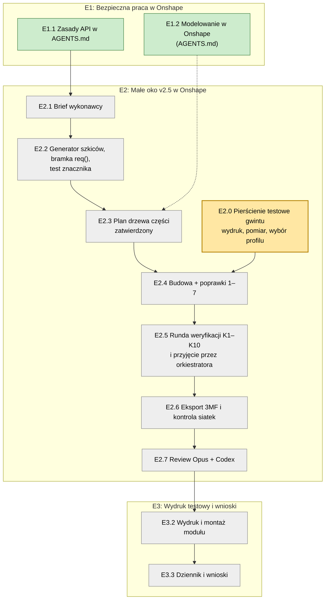

# Teraz: epiki, zadania, parking

Jedyna agenda projektu. Cel i kolejność zmienia tylko użytkownik. Agent na starcie sesji podaje bieżące zadanie, a temat spoza niego dopisuje do „Parkingu” (zasady w `AGENTS.md`, „Sposób współpracy”).

Podgląd z diagramem: `teraz.html`. Po każdej zmianie tego pliku agent uruchamia `python3 30-projekt/teraz_html.py`.

**Bieżące zadanie:** E2.0, eksport 3MF i wydruk próbki gwintu (użytkownik).

Kolory: zielone zrobione, żółte bieżące, szare czeka.

## E1: Bezpieczna praca w Onshape

Gotowe, gdy wykonawca ma sprawdzalne zasady, które nie pozwalają zablokować API ani zbudować modelu na liczbach zamiast parametrów.

- [x] E1.1 Zasady API w `AGENTS.md` („Praca z API Onshape”).
- [x] E1.2 Sekcja „Modelowanie w Onshape” w `AGENTS.md`: kolejność budowy, kontrola szkicu znacznikiem w drzewie, runda weryfikacji K1–K10 (źródło: `20-analizy/2026-10-19-metodyka-modelowania-parametrycznego.md`). Po review Opusa i Astry (`20-analizy/review/2026-10-19-agents-md-*.md`), zaakceptowana 19.10.

## E2: Małe oko v2.5 w Onshape

Gotowe, gdy v2.5 jest w SimpleEye, przeszła kontrolę wyjścia i review, a 3MF leży w `40-cad/3mf/`.

- [ ] E2.0 Model gotowy 19.10 w dokumencie „Probka gwintu 45” (TMP), weryfikacja `40-cad/onshape/weryfikacja-probka-gwintu-45.md`; czeka na eksport 3MF, wydruk i ocenę użytkownika. Próbka gwintu 45°, skok 5: pierścień i nakrętki z luzem 0,2 / 0,25 / 0,3 / 0,35 / 0,4, zaprojektowane przez wykonawcę w nowym dokumencie Onshape w folderze TMP (pilotaż zasad), wydruk na docelowej drukarce, wybór luzu dla gniazda i nakrętki v2.5. Brief: `30-projekt/brief-e2.0-probka-gwintu-45.md`.
- [ ] E2.1 Brief wykonawcy: przebudowa według tabeli „Do v2.5” (`20-analizy/review/2026-10-18-v2.4-polaczone.md`), wzorzec wymiarów v2.4 z SolidCrafta. Pokazany użytkownikowi przed wysłaniem.
- [ ] E2.2 Wykonawca, przed pierwszym zapisem modelu: nowy generator szkiców (wymiary `#zmienna`, więzy do layoutu, bez `Fix`; klasa `Sk` z v2.2 emituje gotowe współrzędne i się nie nadaje), bramka `req()` z twardym stopem i test progu, test znacznika szkicu na jednym szkicu zapisanym przez API. W `40-cad/onshape/oko-f-v2.2-build.js`: usunąć `fs()` i `sleep(350)`, `sketchW()` przerobić na jeden POST na szkic, w `circ()` jeden odczyt `bodydetails` zamiast ośmiu, `OS.zmienne()` wysyła zmienne raz, nie przyrostowo, stan z `localStorage` przenieść do `40-cad/onshape/stan-api.json`, sprawdzenie znacznika szkicu po każdym szkicu.
- [ ] E2.3 Wykonawca: plan drzewa każdej części; zatwierdza orkiestrator.
- [ ] E2.4 Wykonawca: budowa części i poprawki 1–7.
- [ ] E2.5 Runda weryfikacji modelu K1–K10 (wykonawca) i niezależne sprawdzenie K1–K8 przez orkiestratora.
- [ ] E2.6 Eksport 3MF (użytkownik), kontrola siatek, luzy z tabeli, wsuwanie z sąsiednimi częściami (wykonawca).
- [ ] E2.7 Review dwoma recenzentami.

## E3: Wydruk testowy i wnioski

Gotowe, gdy moduł v2.5 jest wydrukowany, złożony, a wnioski są w `70-budowa/dziennik.md`.

- [ ] E3.2 Wydruk i montaż modułu v2.5.
- [ ] E3.3 Wpis w dzienniku i wnioski do następnej wersji.

## Epiki później

Seria ~10 modułów i rozmieszczenie w dyni; firmware ESP32 z kalibracją przez telefon; pudełko na elektronikę; duże oko.

## Parking

- `AGENTS.md`: stan OK z odpowiedzi zapisu nie wyłapuje ostrzeżeń (np. „missing selection”); kontrola musi czytać też ikony ostrzeżeń w drzewie.
- `30-projekt/plan-powrot-do-onshape.md`: obaj recenzenci uznali go za nie do realizacji; dopisać adnotację albo usunąć.
- Dublety w `30-projekt/decyzje.md`.
- Śruby osi ISO 7380 M3: skrócić do 4 mm albo kupić M3×5/6.
- Napęd symetryczny (pomysł użytkownika), po wydruku modułu.
- Kopia researchu Gemini na dysk sieciowy.
