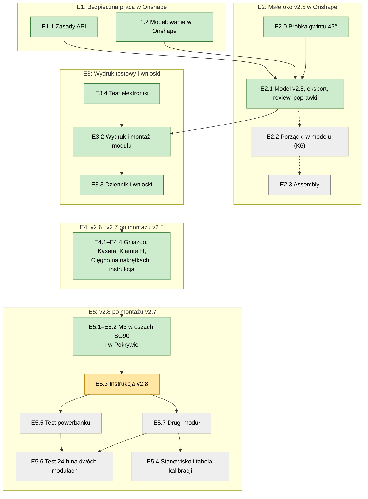

# Teraz: epiki, zadania, parking

Jedyna agenda projektu. Cel i kolejność zmienia tylko użytkownik. Agent na starcie sesji podaje bieżące zadanie, a temat spoza niego dopisuje do „Parkingu” (zasady w `AGENTS.md`, „Sposób współpracy”).

Podgląd z diagramem: `teraz.html`. Po każdej zmianie tego pliku agent uruchamia `python3 30-projekt/teraz_html.py`.

**Bieżące zadanie (25.10):** Epik Dynia na środę 28.10 – plan i stany zadań w `30-projekt/plan.html` (tory: Podstawka, Duże oko v9, Małe oczy, Software). Dynia kupiona, podstawka z drewna wykonana. Sekcja niżej (E1–E6) jest historyczna.

Kolory: zielone zrobione, żółte bieżące, szare czeka.

## E1: Bezpieczna praca w Onshape

Gotowe, gdy wykonawca ma sprawdzalne zasady, które nie pozwalają zablokować API ani zbudować modelu na liczbach zamiast parametrów.

- [x] E1.1 Zasady API w `AGENTS.md` („Praca z API Onshape”).
- [x] E1.2 Sekcja „Modelowanie w Onshape” w `AGENTS.md`: kolejność budowy, kontrola szkicu znacznikiem w drzewie, runda weryfikacji K1–K10 (źródło: `20-analizy/2026-10-19-metodyka-modelowania-parametrycznego.md`). Po review Opusa i Astry (`20-analizy/review/2026-10-19-agents-md-*.md`), zaakceptowana 19.10.

## E2: Małe oko v2.5 w Onshape

Gotowe, gdy v2.5 jest w SimpleEye, przeszła kontrolę wyjścia i review, a 3MF leży w `40-cad/3mf/`.

- [x] E2.0 Wynik: `luzGwint` = 0,20 (dziennik 19.10). Model gotowy 19.10 w dokumencie „Probka gwintu 45” (TMP), weryfikacja `40-cad/onshape/weryfikacja-probka-gwintu-45.md`; czeka na eksport 3MF, wydruk i ocenę użytkownika. Próbka gwintu 45°, skok 5: pierścień i nakrętki z luzem 0,2 / 0,25 / 0,3 / 0,35 / 0,4, zaprojektowane przez wykonawcę w nowym dokumencie Onshape w folderze TMP (pilotaż zasad), wydruk na docelowej drukarce, wybór luzu dla gniazda i nakrętki v2.5. Brief: `30-projekt/brief-e2.0-probka-gwintu-45.md`.
- [x] E2.1 Model v2.5 w nowym dokumencie Onshape „Oko F v2.5” (folder Halloween): 10 części, 11 folderów; spis elementów v2.4, plan, weryfikacja K1–K11 (`40-cad/onshape/e2.1-*.md`, `weryfikacja-v2.5.md`). Otwarte: K6 (53 szkice zamiast 40) i ukrycie płaszczyzn/szkiców – osobne zadanie.
- [x] E2.1b Nazwy części i eksport 3MF (eksport ręczny przez użytkownika; API ma za niski licznik eksportu), `40-cad/onshape/e2.1b-eksport.md`.
- [x] E2.1d Review v2.5 (Opus, Codex): `20-analizy/review/2026-10-19-v2.5-*.md`.
- [x] E2.1c Poprawki po review: szczelina zaczepu 213°, kula jarzma (klej 0,5), fazka sanek 2 mm; testy na siatkach zaliczone (`40-cad/onshape/e2.1c-poprawki.md`). Wszystkie 10 części do druku.
- [ ] E2.2 Porządki w modelu: scalenie szkiców (K6), ukrycie płaszczyzn i szkiców po użyciu.
- [ ] E2.3 Złożenie (Assembly) z mate'ami w Onshape, ruch ±33°, wsuwanie.

## E3: Wydruk testowy i wnioski

Gotowe, gdy moduł v2.5 jest wydrukowany, złożony, a wnioski są w `70-budowa/dziennik.md`.

- [x] E3.1 Instrukcja montażu: `70-budowa/montaz-v2.5.md` (zastąpiona przez `montaz-v2.7.md` i `montaz-v2.8.md`) (galeria części, lista śrub, kroki z obrazkami Blendera; po review nietechnicznym).
- [x] E3.2 Wydruk i montaż modułu – zrobione w wersji v2.7 (21.10): moduł złożony, skalibrowany (środek 1500 µs), działa z `oczy-ruch`; Gniazdo w dyni jeszcze nie.
- [x] E3.4 Test elektroniki (19.10): ESP32-C3 SuperMini + PCA9685 + 1 × SG90; Blink, skan I²C (0x40) i ruch ±30° zaliczone. Połączenia i szkice: `50-elektronika/polaczenia.md`.
- [x] E3.5 Zamknięte 21.10 jako niepotrzebne: od v2.8 moduł nie ma wkładek. Próbka gniazd wkładek M3 (Ø4,0–4,8): model gotowy (dokument „Probka wkladek M3”, commit `c7e0350`, gałąź wykonawcy scalona w `134eba8`; K2–K4 bez niezależnego odczytu orkiestratora). `wkladkaD` = 4,4 ustalone 20.10 pomiarem stopnia wkładki, więc wydruk próbki opcjonalny. Brief: `30-projekt/brief-e3.5-probka-wkladek-m3.md`.
- [x] E3.3 Wpis w dzienniku i wnioski do następnej wersji: montaż v2.5 (20.10) i v2.7 (20/21.10) w `70-budowa/dziennik.md`, wnioski poszły do E4 i E5; dalsze prace w E5.

## E4: v2.6 po montażu v2.5

- [x] E4.1 Gniazdo i Cięgno: `wkladkaD` 4,4 (rozdęte piasty Cięgna), rant Gniazda 67,5, ząbki przy ściance przodu, bruzdy pod łby śrub osi. Brief całego E4: `30-projekt/brief-e4-v2.6.md`.
- [x] E4.2 Kaseta, osadzenie serwa (zamiast luźnych Sanek, których nic nie trzymało i które wpadały do środka Kasety). **Najpierw decyzja użytkownika o kierunku serwa:** model v2.5 ma wałek (z −66) i wyjście kabla z tyłu Kasety; użytkownik złożył serwo wałkiem do przodu – wtedy wałek wypada ok. z −55,3, Ramię (27 mm) nie trafia nad przegub H i trzeba by przeprojektować napęd. Koncepcja: (a) przód: przednie ucho przykręcone wkrętem M2 do bloku na końcu szyn wzdłuż szczeliny (siedzisko uszu jak w Sankach, y −17,6); wkręt wstępnie w uchu, więc blok potrzebuje kanału od tyłu na jego końcówkę; dokręcany przez otwór montażowy w górnej ściance (owal ok. 9 mm, jak otwór górny, nad wkrętem przy z −46,75; łączy się z otworem górnym) – bez gniazda blokującego ucho, bo jego luz zależy od producenta serwa; blok nie może wejść na otwór dolny H i kołnierz tulejki H; (b) tył: klamra w przekroju H przykręcona na stole do tylnego ucha serwa – ramię wewnętrzne po ściance wewnętrznej, ramię zewnętrzne wystaje poza Kasetę po ściance zewnętrznej, oba szersze niż szczelina (13,2); łącznik w szczelinie (12,7, luz 0,25/str.), ściana Kasety (3,0) między ramionami z luzem ślizgowym 0,25–0,3 na stronę; grubość ramienia zewnętrznego uzgodnić z drogą kabla; druk profilem H na stole. Serwo z klamrą wsuwa się od tyłu; klamra blokuje ruch serwa do środka i na zewnątrz, wkręt przedni – osiowo; (c) otwory uszu: rozdzielić otwór przelotowy w uchu od otworu pod wkręt w bloku/klamrze (dziś drukowany Ø1,8 wychodzi ok. 1 mm), krótka próbka; (d) Pokrywa: okno na kabel, zacisk i język zbędne, jeśli kabel nie idzie przez Pokrywę – zależy od (kierunek serwa). Sanki znikają z listy części. Kontrola: przejście skręconego napędu przez tył Kasety i nasadzenie Ramienia na wałek. (e) Jarzmo wsuwane od przodu Kasety (krótsza droga, tył wolny dla szyn i klamry H): użytkownik przy montażu v2.5 włożył Jarzmo bez korzystania z kanałów kołków – luz wystarczył od przodu i od tyłu, kołki stoją w łukowych szczelinach. Kanały kołków są zbędne (do usunięcia albo pozostawienia – bez wpływu); sprawdzić przejście skręconego napędu od przodu.
- [x] E4.2b Mocowanie Pokrywy: ucha z wkładkami przenieść z zewnątrz Kasety (teraz wystają poza obrys, 40° i 140°, r do 33,7) do środka, po bokach, tam gdzie zaznaczył użytkownik (zdjęcia 20.10); w Pokrywie same otwory; poza obrys Kasety wystaje wtedy tylko klamra H z E4.2. Warunek: Jarzmo i napęd wsuwane od przodu (E4.2 e) – przy wsuwaniu od tyłu ucho po stronie korby (+X) zatrzymałoby Jarzmo (r 21,9–24,8; analiza Fable 5.8, Astra 13). Sprawdzić obwiednię wsuwania i ruch ±33°.
- [x] E4.4 Cięgno na nakrętkach samohamujących (v2.7), brief `30-projekt/brief-e4.4-ciegno-nakretki.md`.
- [x] E4.3 Instrukcja montażu: napęd (Jarzmo, Cięgno, Ramię, tulejki, śruby przegubów) skręcany na stole, w Kasecie tylko Ramię na wałek i wkręt środkowy przez otwór górny; otwory dolne zostają (decyzja użytkownika). Przyrząd centrowania: jego trzpień nie wejdzie w otwór Ramienia zajęty przez tulejkę – nowy sposób ustawienia środka. Temperatura grota 210–215 °C dla PLA (238 °C rozlało piastę).

## E5: v2.8 po montażu v2.7

- [x] E5.1 Kaseta (blok przedni) i Klamra H: otwory ciasne Ø2,6 na całą długość pod M3×10 do uszu SG90, bez kanału na wkręt wstępny (decyzja 21.10).
- [x] E5.2 Kaseta: ucha Pokrywy bez wkładek – otwór ciasny Ø2,6 pod M3×8 przez Pokrywę (decyzja 21.10).
- [ ] E5.3 Instrukcja v2.8: M3×10 w uszach serwa, M3×8 Pokrywy w plastik (bez wtapiania), piłeczka na M3×10 w nawierconych biegunach + CA z primerem (jak wiercić bieguny). Napisana w `70-budowa/montaz-v2.8.md`, poprawki z audytu (`20-analizy/2026-10-21-audyt-dokumentacji-sesji.md`, I1–I6) naniesione; do commita po „ok”. Otwarte: średnica wiertła do biegunów (dziś założenie Ø2,5).
- [ ] E5.4 Stanowisko kalibracji na stole (przed montażem w dyni): ESP32 + PCA9685, każdy moduł po kolei – Ramię nasadzane przy 1500 µs w pozycji „otwarte V”, płynny test ±300 µs, zapis środka i krańców; numer modułu (naklejka/wytłoczenie na Pokrywie) i tabela `50-elektronika/kalibracja-oczu.md`, z której czyta firmware.
- [ ] E5.5 Test podtrzymania powerbanku (`50-elektronika/test-powerbank`, ok. 20–25 min z udziałem użytkownika): Baseus naładowany, ESP zasilany z powerbanku przez USB-C, 1 × SG90 na kanale 0; 7 faz po 3 min (sam ESP; Wi-Fi AP; serwo trzyma; ruch co 10/20/30/60 s); po zgaśnięciu przycisk powerbanku, test idzie od następnej fazy; odczyt z NVS przez port. Wynik: najmniejsze obciążenie, przy którym powerbank nie gaśnie. Przed testem 24 h.
- [ ] E5.6 Test 24 h mechaniki (`50-elektronika/test-24h`): dwa moduły na kanałach 0 i 1, zasilacz USB (nie powerbank, chyba że E5.5 wykaże, że trzyma), tryb stale aktywny (ostrzej niż na wystawie). Przed startem środki z kalibracji każdego modułu: `k0 <µs>`, `k1 <µs>` (zapis w NVS), potem `z`. Główne ryzyko według użytkownika: mechanika i serwo, nie elektronika. Po teście: dziennik z NVS (`l`: czas, ruchy, starty, przyczyna restartu), luz oka, drganie na postoju, temperatura serwa, nakrętki przegubów.
- [ ] E5.7 Drugi moduł: wydruk Kasety i Klamry H v2.8 (reszta z posiadanych części – do potwierdzenia), montaż według `montaz-v2.8.md`, kalibracja na kanale 1 (dźwigienka przy 1500 µs z programu `kalibracja`, „otwarte V”, płynny test ±300 µs); wynik w dzienniku i w tabeli E5.4.

## E6: Duże oko 2c

Gotowe, gdy duże oko 2c jest zbudowane w dokumencie „Duże oko v1”, przeszło weryfikację K1–K11, review, próbki i wydruk testowy. Podstawa: `20-analizy/2026-10-22-duze-oko-2c-koncepcja-v2.md` (zastępuje analizę 18.10), decyzje z 22–23.10.

- [ ] E6.1 Koncepcja: brief (`30-projekt/brief-e6-duze-oko-koncepcja.md`, v2 `…-v2.md`) po review Fable i Astry; koncepcja v1 (Opus) – review Fable, Astra, Opus: NIE (napęd powiek jednym serwem); koncepcja v2 z 4 × MG90S – druga runda review. Pomiary kardana 5/5, MG90S i orczyka (wykonawca z użytkownikiem 22.10) w koncepcji v2.
- [ ] E6.2 Brief CAD dla wykonawcy (orkiestrator, z rolą wykonawcy na początku). Brief `30-projekt/brief-e6-duze-oko.md` z 22.10 (na bazie analizy 18.10) i plan `40-cad/onshape/e6-plan.md` na gałęzi wykonawcy są nieaktualne.
- [ ] E6.3 Plan drzewa części zatwierdzony przez orkiestratora; budowa w „Duże oko v1”; Assembly z ruchem ±27° / ±17° i obu powiek.
- [ ] E6.4 Runda weryfikacji K1–K11, eksport 3MF (użytkownik autoryzował orkiestratora i wykonawcę 23.10), kontrola siatek, review.
- [ ] E6.5 Próbki (pasowania, przeguby, mocowanie w miąższu), wydruk, montaż, kalibracja.

## Epiki później

Seria ~10 modułów i rozmieszczenie w dyni; firmware ESP32 z kalibracją przez telefon; pudełko na elektronikę.

## Parking

- Duże oko v9, usztywnienie Uchwytu serw: (1) ramki SG/SD – nieaktualne, to był błąd wydruku; (2) łuki/żebra u podstawy 3 ramion – następna iteracja; (3) ścianki łączące wieże („gwiazda”) – **robione teraz** przez projektanta (żebra trójkątne + żebro 6 mm do S2), czeka na kontrolę kolizji i review.
- Podstawka: mocowanie PIR HC-SR501 w przedniej ściance nie do końca pasuje – do analizy (projektant podstawki).
- Podstawka: model w repo opisuje wariant 48 mm/bez dna; zaktualizować do wykonanego (dno 6, ścianki 40, Ø60, bez listew) – zrobione 25.10.
- Gniazdo/breakout USB-C do zasilania z powerbanku: czy jest w warsztacie.

- E6: obszary szkiców w całym drzewie „Duże oko v1” wybierane przez `qClosestTo(qSketchRegion…)` zamiast `qContainsPoint` z punktów startowych – przy zmianie zmiennych (K9 `pktRY`, `pretY`) 5 operacji dało ERROR; poprawione tylko te 5.
- E6: foldery (K11) Uchwyt, Łapa, Ramię X/Y, Komplet Y, Płyta–stopy – założyć w UI przy widocznym panelu.

- E6: przypora nadlewu M3 Gałki przy 330° (łączy się ze ścianką tylko na łuku 70° po wycięciu X) – jeśli test 30 N po druku nie przejdzie; do sprawdzenia przez realizatora razem z łapami Uchwytu.

- `AGENTS.md` (wnioski 19.10, do zatwierdzenia): status OK szyku nie dowodzi powielenia wszystkich operacji; po eksporcie test symetrii (obrót/odbicie) i porównanie powierzchni z poprzednią wersją; kontrola szkicu przez filtr nazw w drzewie; ukrywanie płaszczyzn i szkiców po użyciu; zlecenia dla agentów jako osobne, widoczne sesje.
- Instrukcja montażu: kolejność przyrządu centrowania przy Ramieniu (plan v2.2: przyrząd przed Ramieniem); śruby M2/M3 użytkownika mają łby krzyżakowe – poprawić nazwy i wkrętak PH1.
- Eksport 3MF: Bambu nie pokazuje „ę” w nazwie obiektu. Pojedyncze 3MF części z archiwum zip z Onshape wieszają Bambu Studio przy imporcie (20.10); działa eksport całego Part Studio do jednego 3MF i import jako geometria – do druku używać pliku całego zestawu (`… - FullProject.3mf`), pojedyncze pliki zostają do kontroli siatek.
- Sesja Onshape wygasa po kilkudziesięciu minutach bezczynności; otwarta karta jej nie podtrzymuje. Przed każdym zleceniem sprawdzić logowanie, a zlecenia planować tak, żeby wykonawca kończył pracę, zanim użytkownik wyjdzie (20.10). Logowanie zdalne: `wayvnc 127.0.0.1 5900` na pulpicie + tunel SSH przez Tailscale, klient VNC na `localhost:5900`; logować się w panelu przeglądarki sesji wykonawcy.
- `AGENTS.md`: stan OK z odpowiedzi zapisu nie wyłapuje ostrzeżeń (np. „missing selection”); kontrola musi czytać też ikony ostrzeżeń w drzewie.
- `30-projekt/plan-powrot-do-onshape.md`: obaj recenzenci uznali go za nie do realizacji; dopisać adnotację albo usunąć.
- Dublety w `30-projekt/decyzje.md`.
- Napęd symetryczny (pomysł użytkownika), po wydruku modułu.
- Firmware, koncepcja zachowania (użytkownik 20.10): spoczynek – duże oko zamknięte, co ok. 5 s rusza się jedno małe oko; ktoś bliżej niż ok. 1 m (czujnik zbliżeniowy zamiast radaru) – rusza się więcej oczu, najwyżej 2 małe mechanizmy naraz, na zmianę, a duże oko otwiera się i rusza losowo góra–dół i lewo–prawo (2 serwa jednocześnie) – razem do 3 serw w ruchu, plus serwo powieki dużego oka przy otwieraniu. Opcjonalnie sterowanie dużym okiem z telefonu (strona na ESP32, Wi-Fi). Zasilanie: powerbank przez gniazdo USB-C (breakout z 5,1 kΩ na CC) do V+ PCA9685 i 5V ESP; szacunek średnio ok. 0,3–0,4 A, chwilowo do ok. 1 A przy 3–4 serwach w ruchu (port 3 A wystarcza), Baseus 20 000 mAh na ok. 30–40 h. Wymaganie: wystawa przez kilka dni po ok. 8 h – zasilanie wymienne bez narzędzi (USB-C); decyzja 20.10 w `decyzje.md`.
- Kopia researchu Gemini na dysk sieciowy.
- Kalibracja początkowa (21.10, poza E5.4): (1) znak „pozycji zero” na Kasecie i Jarzmie do nasadzania dźwigienki; (2) kształt części, który nie pozwala złożyć czworoboku w drugim położeniu (przegub H złożony), albo przynajmniej kontrola na rysunku; (3) firmware: zapisany środek każdego oka (NVS / tabela E5.4) i łagodny rozruch – dziś `oczy-ruch` i `test-24h` po włączeniu skaczą od razu na środek, a SG90 nie zna swojej pozycji (`test-24h` ma już środki w NVS, 21.10).
- `AGENTS.md` (wnioski 20–21.10, propozycje do zatwierdzenia przez użytkownika):
  (a) microversion zmienia się bez zmian modelu (rozwijanie folderów, Show/Hide, eksport użytkownika) – zadanie wykonawcy zaczyna od jednego `GET /features` jako stanu wyjściowego i porównania z ostatnim odbiorem, w budżecie (`stan-api.json` → `e5.uwaga`); dziś zasada „inna rozbieżność = cudza edycja, stop” zatrzymała wykonawcę 2 razy bez zmiany modelu (20.10 E4.4, 21.10 E5);
  (b) przeglądarki sesji nie dzielą profilu – Onshape zalogowany u wykonawcy nie jest zalogowany u orkiestratora; odbiór K2–K4 orkiestrator robi na surowych danych wykonawcy (`odbior-v2.6/`: `features.json` z encjami, `znaczniki-szkicow.json`, `variable-studio.json`);
  (c) review Codeksa (Astra) na siatkach trwa > 10 min, więc musi iść w tle, a `AGENTS.md` mówi „codex … nigdy w tle”;
  (d) recenzent „Fable” zamiast „Opus” (użytkownik 20.10: „wrzuć proszę do analizy Fable’owi oraz Astrze”);
  (e) „Źródło prawdy: dokument SimpleEye” → dokument „Oko F v2.5” (zawiera dziś v2.8);
  (f) eksport 3MF robi użytkownik ręcznie, całe Part Studio jednym plikiem do `40-cad/`, a kontrola siatek rozdziela bryły (`3mf_do_stl.py --rozdziel`); `AGENTS.md` mówi „eksport przez API, jeden plik na część”.
  (g) 23.10: użytkownik zgodził się na Astrę (codex) w tle z limitem 60 min bez pytania za każdym razem; `codex exec` w tle trzeba uruchamiać z `< /dev/null`, inaczej czeka na wejście i nic nie robi;
  (h) 23.10, test znacznika E6: encje pomocnicze (construction) nie liczą się do znacznika niedookreślenia – szkic z samymi encjami pomocniczymi nie pokazuje ikony, choć jest niedookreślony; layout z encjami zwykłymi albo K4 z JSON; `document.visibilityState` w panelu przeglądarki aplikacji jest zawsze „hidden”, więc nie świadczy o ukrytym panelu;
  (i) 22–23.10: wykonawca bez briefu z rolą zaczął działać jak orkiestrator (commity na `main`, decyzje z rozmowy z użytkownikiem) – każde zlecenie zaczyna się od roli wykonawcy; użytkownik decyduje o funkcji, rozstrzygnięcia techniczne ustalają agenci.
- Przed serią modułów zmierzyć SG90 każdego dostawcy (MicroChip, OMEGA_ZONE, nowa dostawa): długość korpusu, odległość oś otworu ucha → czoło korpusu z obu stron, grubość ucha. Kieszeń v2.8 ma 0,4 z każdej strony (`luzKorpusSerwa`).
- Onshape, do ręcznego usunięcia przez użytkownika: „Assembly 1” i BOM w dokumencie „Probka wkladek M3”; „Part Studio 1” w „Probka gwintu 45” (`stan-api.json` → `etap2`).
- `40-cad/onshape/oko-f-v2.5-build.js` nie zawiera zmian E4/E4.4/E5 (Fable 20.10, uwaga 12).
- Strzałka GÓRA w Gnieździe 0,5 mm drukuje się jako sufit nad stołem; w następnej wersji 0,8 (Fable, review siatek, uwaga 3).
- `~/.arduino15` zajmuje 7,7 GB (rdzeń esp32 3.x z toolchainami dla wszystkich układów); odchudzenie z toolchainów Xtensa (19.10).
- Gniazdo USB-C (breakout z 5,1 kΩ na CC): czy jest w warsztacie – pytanie z 20.10 bez odpowiedzi (`50-elektronika/sprzet.md`, „Brakuje”).
