# Montaż modułu małego oka v2.5

Źródła: `30-projekt/plan-v2-modul-oka.md` (v2.4 i v2.2), `30-projekt/decyzje.md` (18–19.10), `40-cad/onshape/e2.1-specyfikacja.md`, review v2.5 (`20-analizy/review/2026-10-19-v2.5-opus.md`, `-codex.md`). Siatki: `40-cad/3mf/Oko F v2.5/` (10 części) oraz przyrządy i bryły podglądowe z `Oko F v2.4/`.

**Przed drukiem kasety, jarzma i sanek przeczytaj „Znane ograniczenia”.** Te trzy części są teraz poprawiane (E2.1c), a ich obrazki zostaną przeliczone po nowym eksporcie.

Układ: oś modułu Z (+Z na zewnątrz dyni), **+Y = GÓRA**, oś oka pionowa. „Od tyłu” znaczy od strony pokrywy, „od spodu” od strony SG90.
Obrazki: szare części są już złożone, niebieska to część nowa, odsunięta w kierunku wsuwania. Złote to śruby i wkładki, zielony to przyrząd, przezroczysta to kaseta, a czerwona strzałka pokazuje ruch.

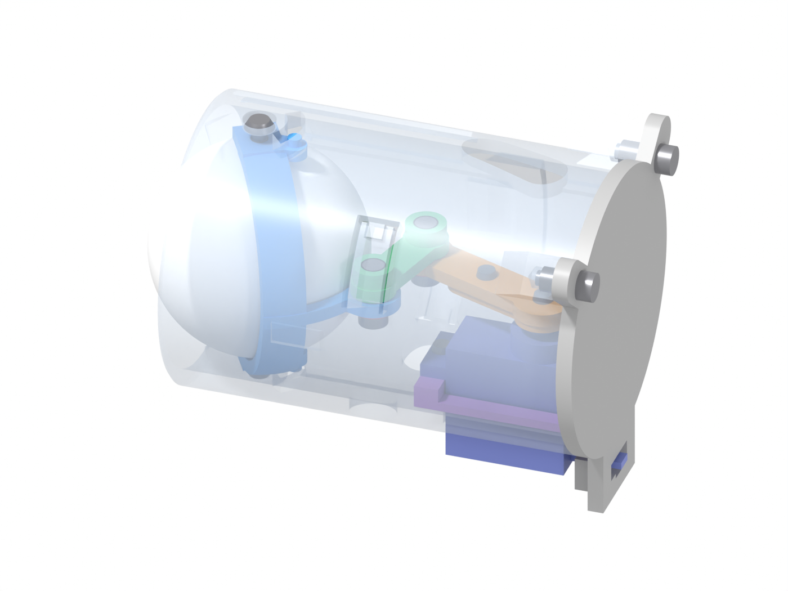
*Kaseta złożona (kolory tylko na tym obrazku): jarzmo niebieskie, cięgno zielone, ramię pomarańczowe, sanki fioletowe, SG90 granatowe, tulejki czerwone.*

## 1. Części

### Do druku (1 moduł)

Pliki są w pozycji złożonej, więc w slicerze trzeba je obrócić. Wszystko mieści się na A1 mini i drukuje się bez podpór.

| Część | Plik | Szt. | Wymiary [mm] | Na stół | Uwagi |
|---|---|---|---|---|---|
| Gniazdo | v2.5 | 1 | Ø74 × 45,7 | wierzch rantu (strzałka GÓRA) | gwint 45°, skok 5, `luzGwint` 0,20, jak próbka E2.0; mostki nad okienkami 7 mm i strzałką |
| Nakrętka | v2.5 | 1 | Ø74 × 6,8 | tył (wycięcia na klucz) | radełko 24 rowki; nad wycięciami na klucz mostek 4 mm |
| Kaseta | v2.5 | 1 | 57,8 × 54,5 × 76 | czoło (rura pionowo) | mostki ok. 15 mm nad zaczepami; **obecny eksport: patrz pkt 6** |
| Jarzmo z miską | v2.5 | 1 | 28 × 49,5 × 35 | płaski bok miski **bez** korby (korba pionowo w górę) | brim; **obecny eksport: patrz pkt 6** |
| Sanki serwa | v2.5 | 1 | 19,2 × 32,8 × 4,35 | prowadnicami | **obecny eksport: patrz pkt 6** |
| Ramię orczyka | v2.5 | 1 | 19,7 × 36 × 4 | wierzch (kieszeń orczyka do góry) | – |
| Cięgno | v2.5 | 1 | 25 × 13 × 5,6 | spód (podniesienia do góry) | – |
| Tulejka przegubu korby / ramienia | v2.5 | 1 + 1 | Ø8 × 3,5 | kołnierzem | identyczne |
| Pokrywa tylna | v2.5 | 1 | 59,3 × 65,3 × 6,5 | ścianą zewnętrzną (prowadnice kabla do góry) | – |
| Przyrząd do wklejania piłeczki | **v2.4** | 1 na komplet | 28 × 62 × 34 | dnem z okienkiem na źrenicę | w v2.5 go nie ma; pasuje do jarzma v2.5 (oczko w kieszeni 0,20) |
| Przyrząd centrowania orczyka | **v2.4** | 1 na komplet | 22 × 28,6 × 14 | płytką | pasuje do v2.5 (płytka 0,40 pod kasetą, trzpień 0,30 w ramieniu) |
| Widelec do zaczepów | **v2.4** | 1 na komplet | – | płasko | opcja do wyjmowania kasety |

Pliki `PODGLAD …` (piłeczka, SG90, orczyk) tylko do kolizji, nie drukować.

### Kupne (1 moduł)

| Element | Szt. | Gdzie | Uwagi |
|---|---|---|---|
| SG90 z orczykiem jednoramiennym | 1 | sanki | szerokość korpusu ≤ 12,2 (sanki 12,7) |
| Piłeczka 40 mm (pingpong) | 1 | jarzmo | 39,5–40,5 mm; źrenica namalowana przed klejeniem |
| ISO 7380 M3×4 (grzybkowa) | 2 | oś oka | albo M3×8 skrócona do 4 mm, zadziory zeszlifowane; DIN 912 się nie zmieści; imbus 2,0 |
| DIN 912 M3×8 | 4 | przeguby C i H, pokrywa ×2 | imbus 2,5 |
| Wkładka M3 do wtapiania pod otwór Ø4,0, dł. 4 | 4 | 2 w cięgnie, 2 w uchach kasety | gniazdo w cięgnie ma 4,6 + 1,0 dna, w uchu 5,6 |
| M2×6 do plastiku | 1 | ramię → orczyk (otwór 13 mm od osi) | – |
| M2×6 (wkręt środkowy orczyka, zamiast wkrętu z kompletu) | 1 | ramię + orczyk → wałek | ramię dokłada 2,5 mm; założenie: wkręt z kompletu SG90 ma ok. 3–4 mm |
| M2×5 albo M2×6 (zamiast wkrętów uszu z kompletu SG90) | 2 | SG90 → sanki | **≤ 6 mm pod łbem** (ucho 2,5 + otwór 3,75; dno 0,6) |
| Klej akrylowy 2K, wypełniający | ok. 0,3 ml | piłeczka w misce | szczelina 0,5 × pas 8 mm × 180° |
| DIN 912 M3×10 | 2 na komplet | przyrząd do wklejania | wielokrotnego użytku |

## 2. Przygotowanie

### 2.1 Wkładki (4 szt.)

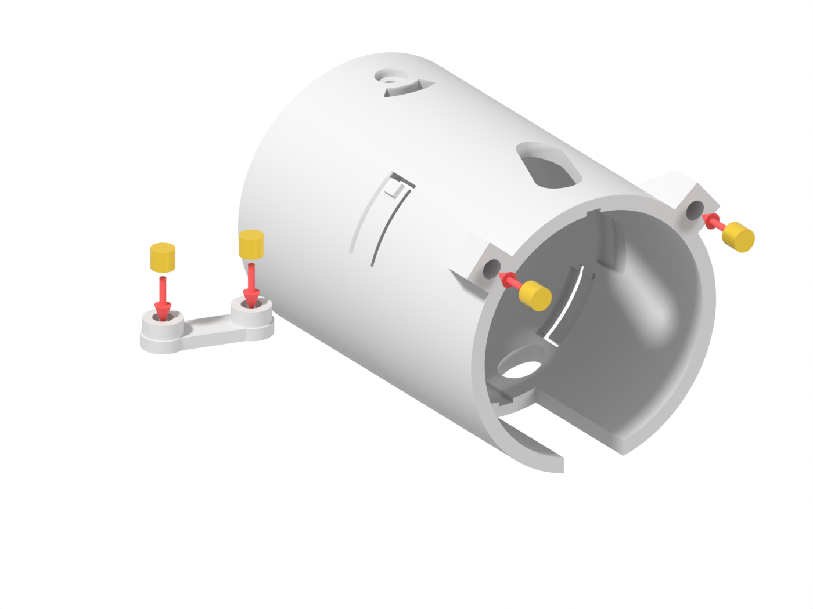

- **Kaseta, 2 szt.:** od tyłu w ucha pokrywy (2 × Ø4 na r 29,5, 40° i 140°), na równo z tylną ścianą.
- **Cięgno, 2 szt.:** od strony podniesień (góra), na równo z podniesieniem. Pod wkładką zostaje 1,0 mm dna, nie dociskaj dalej.
- Kontrola: M3 wkręca się prostopadle, wkładka nie obraca się pod kluczem.

### 2.2 Wklejenie piłeczki (przyrząd v2.4)

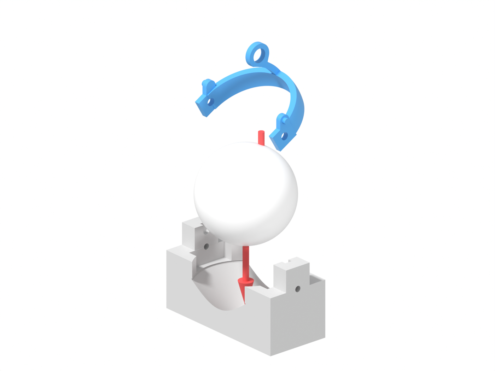

1. Przyrząd dnem na stół. Piłeczka źrenicą w dół w stożek 90°: stożek centruje piłeczki 39,5–40,5 na osi, a źrenica ma być widoczna w okienku.
2. Klej na pas miski jarzma, z dala od oczek i otworów osi.
3. Jarzmo oczkami na słupki, kołki ogranicznika w gniazdach (blokada 0°), 2 × M3×10 przez oczka w słupki.
4. Odczekaj pełny czas wiązania kleju, wykręć śruby.
- Kontrola: oczka leżą w kieszeniach bez szczeliny, kołki ogranicznika i otwory Ø3,3 bez kleju. Piłeczka 39,5 siedzi ok. 0,7 mm bliżej przodu niż 40,5, co przy kołnierzyku Ø41 nie przeszkadza.

## 3. Kaseta na stole

Kolejność jest wymuszona geometrią (decyzja 18.10), bo każda inna blokuje drogę następnej części: **jarzmo → sanki z SG90 → ramię → cięgno → przeguby C i H → pokrywa**.

### 3.1 Jarzmo z piłeczką: od tyłu

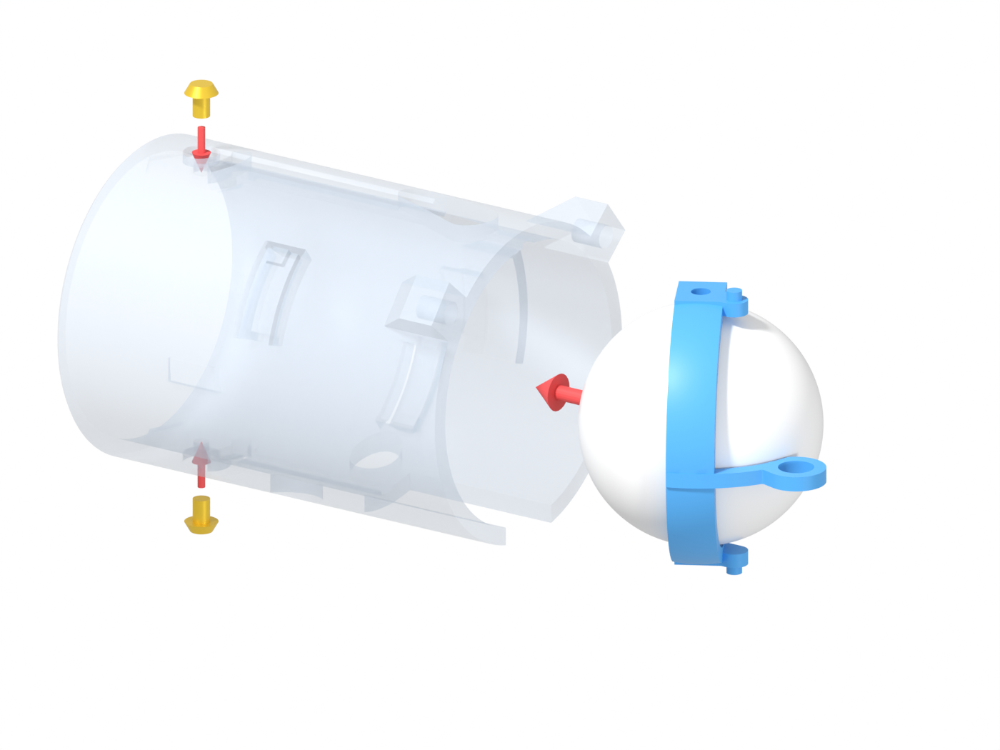

- **Wsuwanie:** od tyłu kasety, piłeczką naprzód, oko na wprost (0°). Kołki ogranicznika jadą kanałami (3,2 mm) u góry i u dołu, a na końcu wchodzą w szczeliny łukowe. Luz przejścia 0,29.
- **Mocowanie:** 2 × ISO 7380 M3×4, od góry i od dołu, w otwory Ø2,6 występów (gwint w plastiku 2,1 mm). Przed wkręceniem nagwintuj otwory śrubą na sucho. Wkręcaj do oparcia łba w pogłębieniu Ø6,2 × 2,45, bez dociągania.
- **Uwaga:** łeb nie może wystawać ponad kasetę, bo luz do gniazda to tylko 0,25. Koniec śruby pracuje jako czop: 1,6 mm w oczku Ø3,3.
- **Kontrola:** oko obraca się ręką lekko do obu stopów **±33°**, luz osiowy ok. 0,3, nic nie ociera.

### 3.2 Sanki z SG90: od tyłu

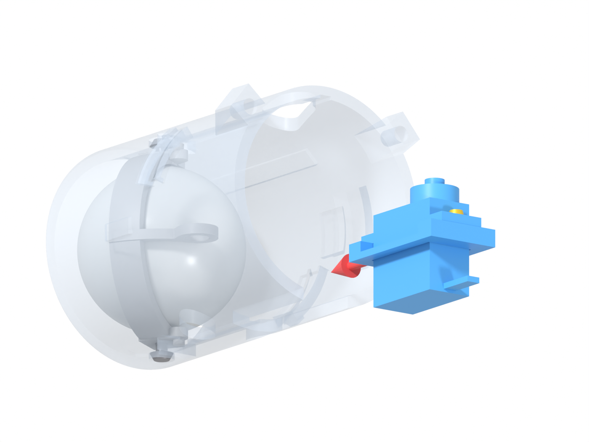

- **Najpierw na stole:** SG90 uszami na słupki sanek, 2 wkręty **≤ 6 mm**. Wałek i wyjście kabla mają być od strony tyłu kasety.
- **Wsuwanie:** od tyłu, korpus SG90 przez szczelinę w spodzie kasety (13,2), prowadnice sanek po krawędziach szczeliny (luz 0,25–0,29). Pchaj, aż przód serwa oprze się o koniec szczeliny (w modelu 0,20 przed nim).
- **Uwaga:** przy ciasnym przejściu zmierz szerokość serwa. Sanki są na 12,2 + 2 × 0,25.
- **Kontrola:** sanki leżą płasko na ściance, serwo nie kiwa się na boki.

### 3.3 Ramię z orczykiem: przez tył

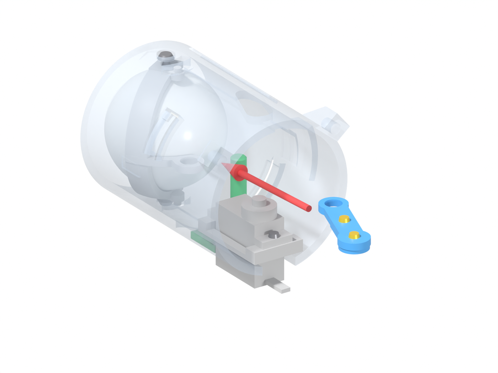

1. Na stole: orczyk jednoramienny w kieszeń ramienia (od spodu ramienia). Kieszeń sięga 19,8 mm od osi, więc dłuższy orczyk trzeba przyciąć. Przykręć M2×6 od wierzchu w otwór orczyka 13 mm od osi.
2. Serwo na środek: 1500 µs z testera albo z ESP32, potem odłącz.
3. Ramię wsuń od tyłu, uniesione ok. 3 mm (orczyk nad wielowypustem, luz > 2,5), i ustaw nad wałkiem.
4. Od spodu załóż **przyrząd centrowania** (zielony): płytka pod kasetą, trzpień Ø5,4 przez otwór dolny H (Ø8,7) w otwór H ramienia (Ø6,0). Opuść ramię na wielowypust. Jeśli ząb nie trafia, obróć wałek ręką o mniej niż pół zęba (skok ok. 14°). Resztę wyrówna kalibracja środka w ESP32.
5. Wkręt środkowy przez owalny otwór górny kasety w wałek. Zdejmij przyrząd.
- **Uwaga:** wkręt środkowy przechodzi przez 2,5 mm ramienia nad piastą orczyka. Jeśli wkręt z kompletu łapie wałek na mniej niż 2 zwoje, trzeba użyć dłuższego.
- **Kontrola:** ramię bez luzu na wałku, do SG90 1,3, do kasety 0,76 przy ±30°.

### 3.4 Cięgno: od tyłu

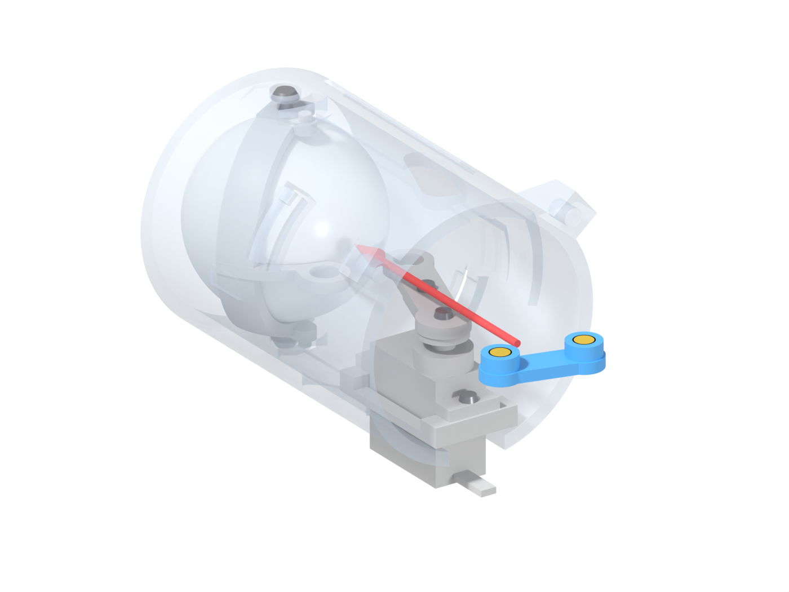

- **Wsuwanie:** od tyłu, wkładkami do góry. Cięgno jedzie 0,2 mm nad ramieniem i korbą jarzma, aż jego otwory staną nad przegubami C (korba) i H (ramię).
- **Uwaga:** oko na 0°, serwo na środku. Wtedy otwory C i H w korbie, ramieniu i cięgnie stoją nad oboma otworami dolnymi kasety.
- **Kontrola:** przez otwory dolne widać gwint wkładki współosiowo z otworami Ø6,0.

### 3.5 Przeguby C i H: od spodu

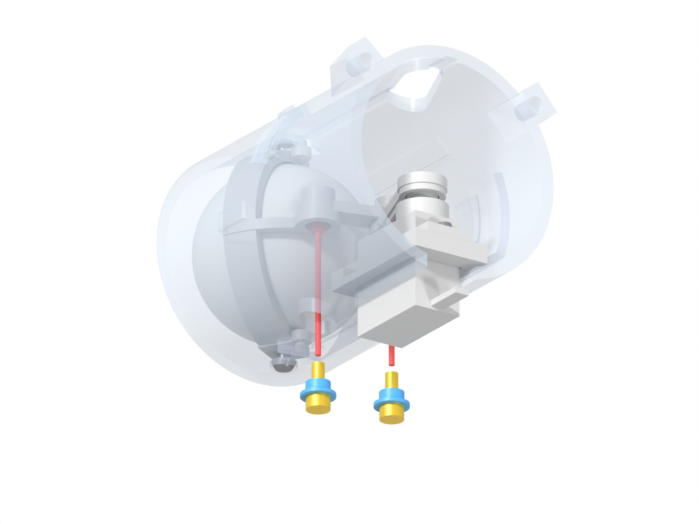

- **Co:** tulejka nasadzona na DIN 912 M3×8, kołnierzem do łba.
- **Wsuwanie:** od spodu przez otwór dolny Ø8,7 (kołnierz Ø8, luz 0,35), przez otwór korby C (ramienia H) Ø6,0 do wkładki cięgna. Łeb jest ok. 21 mm nad spodem kasety, więc potrzebny długi imbus 2,5, który trzyma śrubę.
- **Mocowanie:** do oporu. Tulejka zaciska się na cięgnie, a korba (ramię) obraca się na tulejce Ø5,6 w Ø6,0 (0,2 na stronę).
- **Uwaga H:** w obecnym eksporcie kołnierz tulejki H mija naroże sanek o 0,023 mm, więc może ocierać (pkt 6).
- **Kontrola:** przy powolnym ruchu serwa ±30° (tester) przeguby nie zacinają się, cięgno nie dotyka jarzma ani ramienia.

### 3.6 Pokrywa: od tyłu

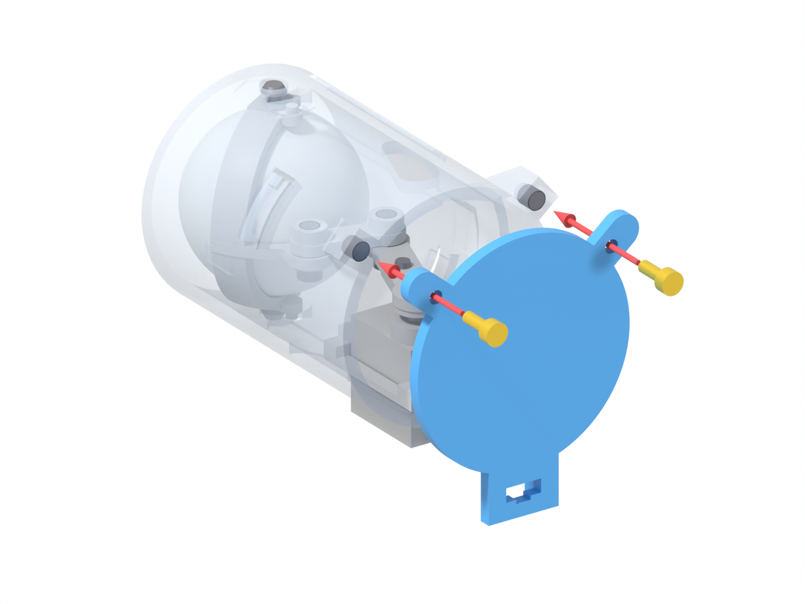

- **Co:** wtyczkę 3-pin przełóż od środka przez okno pokrywy 9 × 3,4. Pokrywę załóż uchami do góry, językiem nad sankami.
- **Mocowanie:** 2 × DIN 912 M3×8 w wkładki uch.
- **Kabel:** taśmę wciśnij w przewężenie 3,8 × 1,0 pod oknem, między prowadnicami (x ±4,7). Taśma 1,4 zgniata się tam o ok. 29%.
- **Uwaga:** pokrywa nie dociska sanek (0,10 osiowo), trzyma je tylko przed wysunięciem.
- **Kontrola:** pociągnij za kabel. Taśma nie może się przesunąć, a izolacja nie może być nacięta.

## 4. Dynia

### 4.1 Otwór i gniazdo (raz, rodzic)

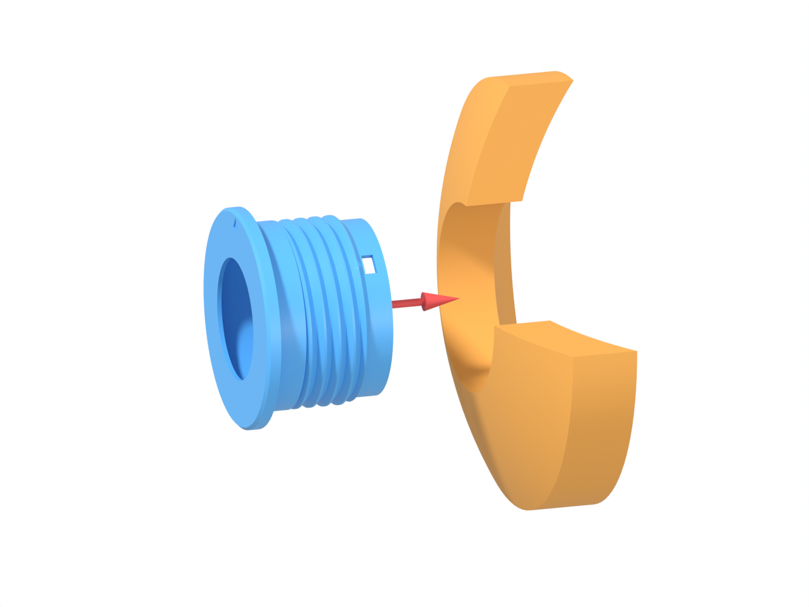

- **Otwór:** Ø63,5 (otwornica 2½", nastawna do 64), prostopadle do skórki. Zmierz go: przy Ø63 luz jest 0, przy Ø64 0,5 na stronę. Ścianka dyni 15–25 mm.
- **Rozstaw środków:** poziomo **≥ 125 mm**, pionowo **≥ 145 mm** (dynia R 150; przy mniejszej więcej).
- **Gniazdo:** wkładasz je **od zewnątrz**, strzałką GÓRA pionowo do góry, bo oś oka ma być pionowa. Rant Ø74 opiera się o skórkę.

### 4.2 Nakrętka: od środka

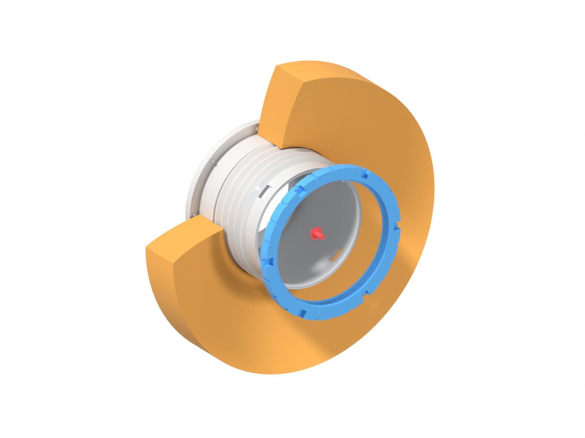

- **Nakręcanie:** od środka dyni, czołem R130 do ścianki, wycięciami na klucz do siebie. Gwint prawy, czyli kręcisz zgodnie z ruchem wskazówek zegara, patrząc od środka.
- **Dokręcenie:** ręką, aż 8 ząbków rantu (1,25 mm) wejdzie w skórkę. Gwint ma pełny zarys od 15 do 35,5 mm pod rantem.
- **Kontrola:** gniazdo się nie obraca, strzałka jest w pionie, a okienka zaczepów (38–42 mm pod rantem) są odsłonięte. Przy ściance 25 mm między nakrętką a okienkami zostaje 3,3 mm.

### 4.3 Kaseta: od środka (syn)

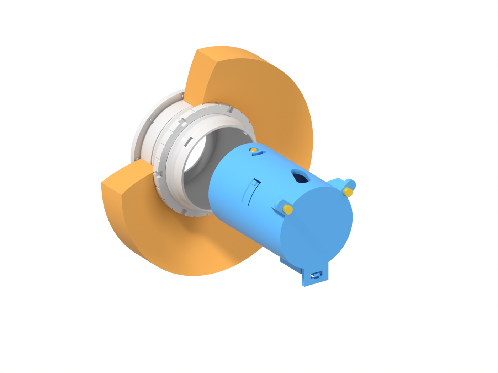

- **Ustawienie:** ucha pokrywy do góry (GÓRA), SG90 na dole. Rowek kasety na żebro gniazda, patrząc od środka dyni u góry po prawej, 45° od pionu.
- **Wsuwanie:** osiowo, bez obrotu (luz 0,25 na stronę). Na ostatnich 6 mm haczyki uginają się o 0,75 mm. Pchaj, aż czoło oprze się o kołnierzyk Ø41 i **oba zaczepy klikną**.
- **Po wsunięciu:** piłeczka wystaje ok. 8 mm. Syn wpina wtyczkę.
- **Kontrola:** oba haczyki widać w okienkach (patrząc od środka u góry po lewej i u dołu po prawej), a kaseta nie wychodzi, gdy pociągniesz za pokrywę.

### 4.4 Wyjmowanie

Ściśnij oba haczyki przez okienka gniazda (7 × 4 mm, haczyk trzeba wcisnąć o ≥ 0,75 mm) i wyciągnij kasetę do tyłu. Widelec v2.4 robi to samo: bolce wchodzą w oba okienka, a ściśnięcie uchwytów o ok. 1,1 mm na stronę zwalnia zaczepy.

## 5. Kontrole końcowe

| Co | Wartość | Jak |
|---|---|---|
| Ruch oka | praca **±30°**, stop ±33° (kołek w końcu szczeliny, przy ±34° kolizja) | tester / ESP32, powoli; **firmware nie dochodzi do stopu** (limit ≤ ±30°, w razie ocierania ±25°) |
| Serwo przy ±30° oka | oko +30° → serwo −25,6°, oko −30° → +29,8° (stop: −27,3° / +34,2°) | kalibracja środka i krańców w ESP32 |
| Ramię – kaseta | 0,76 przy ±30°, **0,26 przy +33°** (zaakceptowane) | bez ocierania w ±30° |
| Cięgno – kaseta | ≥ 0,50 | bez ocierania |
| Cięgno – ramię, cięgno – jarzmo | 0,20 | bez ocierania, nie klinuje się |
| Oś oka | luz osiowy 0,3 | wyczuwalny, bez stuku |
| Przeguby C i H | 0,2 na stronę na tulejce | korba i ramię obracają się lekko |
| Kaseta – gniazdo | 0,25 na stronę, 2 kliknięcia | kaseta nie wypada |
| Kabel | taśma w przewężeniu 1,0, wtyczka swobodnie w oknie | pociągnięcie, izolacja cała |

Wynik wpisz do `70-budowa/dziennik.md`, zwłaszcza zacisk kabla, siłę zaczepów i klej.

## 6. Znane ograniczenia (review v2.5, stan 19.10)

**Czekają na E2.1c** (brief `30-projekt/brief-e2.1c-poprawki-v2.5.md`). Tych części z obecnego eksportu nie drukuj do montażu:

| Część | Problem | Skutek |
|---|---|---|
| **Kaseta** | zaczep 213° nie ma szczeliny skośnej, więc jest sztywny | kaseta stanie ok. 6 mm przed oparciem albo pęknie, a widelec go nie zwolni (**KRYTYCZNE**) |
| **Jarzmo** | piasta korby C wchodzi w szczelinę kleju: 0,007 zamiast 0,5 | piłeczka opiera się o piastę, jarzmo nie siądzie w przyrządzie |
| **Sanki** | naroże mija kołnierz tulejki H o 0,023 mm (wymagane 0,25) | najwyżej otarcie przy montażu tulejki H; doraźnie fazka ok. 2 mm pilnikiem |

Obrazki z tymi częściami (00, 01, 03–08, 11) pokazują obecny eksport. Po nowym eksporcie (te same nazwy plików w `40-cad/3mf/Oko F v2.5/`) przelicz je poleceniem:

```bash
bash 70-budowa/montaz-v2.5/renderuj.sh            # wszystkie kroki, 1400 × 1050, ok. 6 min
bash 70-budowa/montaz-v2.5/renderuj.sh --szybko   # podgląd 800 × 600
bash 70-budowa/montaz-v2.5/renderuj.sh 03 04 07   # wybrane kroki (prefiks nazwy)
```

Pliki: `3mf_do_stl.py` (3MF → binarny STL w mm, bez zależności), `renderuj.py` (Blender, Cycles CPU, kroki w tabeli `KROKI`), `renderuj.sh` (oba naraz). STL trafia do `$MONTAZ_TMP` (domyślnie `/tmp/montaz-v2.5`).

**Do sprawdzenia na wydruku** (bez zmian od v2.4):
- siła zaczepów (ok. 8 N na zaczep, wsuwanie ok. 23 N) i ich zwalnianie palcami albo widelcem,
- zacisk kabla 1,0 przy taśmie 1,4 (zgniot ok. 29%), przy taśmie ok. 1 mm może nie trzymać,
- klej 2K w szczelinie 0,5,
- długość SG90: przód 0,20 od końca szczeliny przy modelowym korpusie,
- wkręty uszu ≤ 6 mm i długość wkrętu środkowego orczyka,
- ścianka kasety przy uskoku wybrania H ma lokalnie 1,55 mm (promieniowo 2,0); odziedziczone po v2.4,
- przyrząd centrowania nie usuwa skoku wielowypustu (ok. 14°), więc kalibracja środka w ESP32 jest konieczna.
