# Montaż modułu małego oka v2.5

Instrukcja do składania we dwóch: rodzic i syn. Oko to piłeczka pingpongowa, którą serwo obraca w lewo i w prawo. Cały mechanizm siedzi w jednej obudowie (Kasecie), którą wpina się od środka w otwór w dyni.

## Galeria części

Tych nazw używa cała instrukcja. Obrazki nie są w jednej skali, dlatego pod nazwą jest przybliżony rozmiar.

### Części drukowane

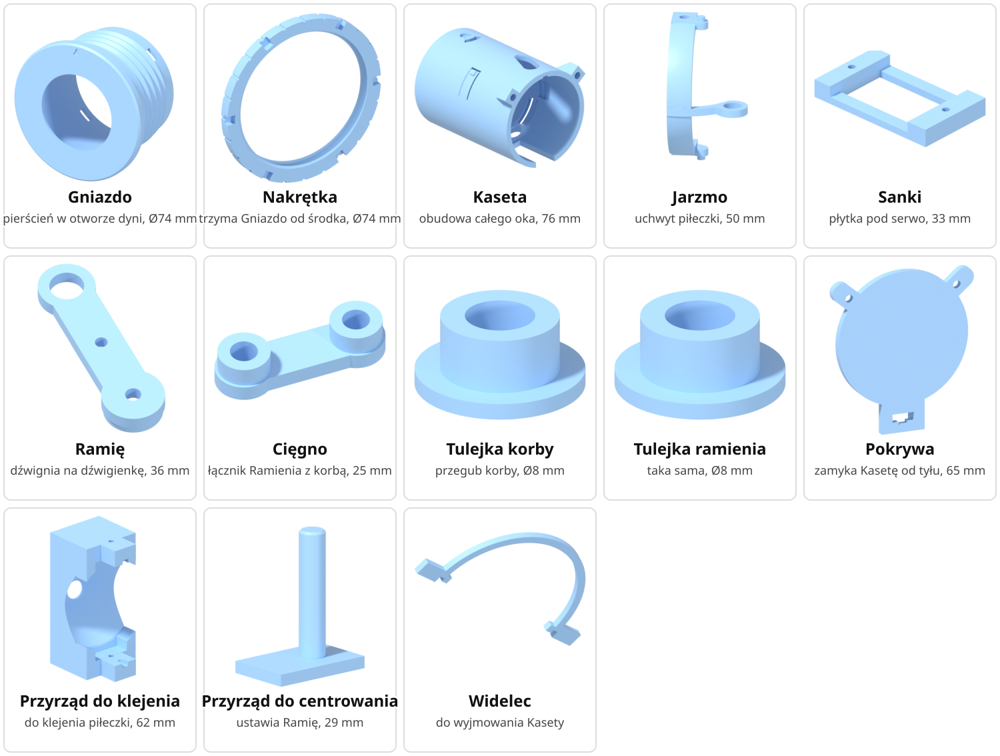

Tulejka korby i Tulejka ramienia wyglądają tak samo. Drukujesz obie, żeby mieć dwie.

### Części kupne

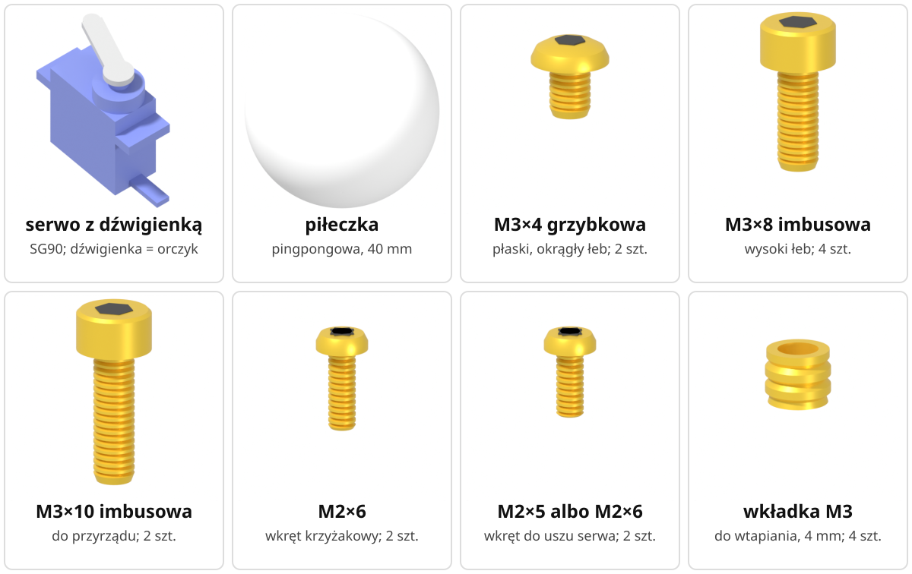

- **serwo** – mały silniczek SG90, który obraca oko. Z serwem w torebce jest kilka plastikowych dźwigienek i wkręty.
- **dźwigienka serwa (orczyk)** – plastikowe ramię nakładane na wałek serwa. Potrzebujesz dźwigienki z jednym ramieniem. Dalej nazywamy ją po prostu dźwigienką.
- **piłeczka** – pingpongowa, 40 mm.
- **klej 2K** – klej akrylowy dwuskładnikowy, wypełniający (ok. 0,3 ml), do wklejenia piłeczki.

Jak wyglądają wałek i uszy serwa, pokazuje obrazek w „Części i ich miejsca”.

### Śruby i drobne części

| Nazwa w instrukcji | Jak wygląda | Szt. | Do czego |
|---|---|---|---|
| **M3×4 grzybkowa** | płaski, okrągły łeb jak grzybek, gniazdo na imbus 2,0; **do domówienia** | 2 | oś oka |
| **M3×8 imbusowa** | zwykła śruba z wysokim, walcowym łbem, imbus 2,5 | 4 | 2 na przeguby, 2 na Pokrywę |
| **M3×10 imbusowa** | taka sama, tylko dłuższa | 2 | Przyrząd do klejenia (można używać wiele razy) |
| **M2×6** | mały wkręt z łbem krzyżakowym | 2 | dźwigienka do Ramienia i wkręt środkowy w wałek serwa |
| **M2×5 albo M2×6** | taki sam mały wkręt, 5 albo 6 mm | 2 | uszy serwa do Sanek |
| **wkładka M3** | metalowa tulejka z gwintem w środku, do wtapiania, długość 4 mm (pod otwór 4 mm) | 4 | 2 w Kasecie, 2 w Cięgnie |

Wkrętów z torebki serwa nie używaj. Zamiast nich są M2×5 albo M2×6 i M2×6 z tej listy.

Jeśli nie masz M3×4 grzybkowych, skróć dłuższą śrubę grzybkową M3 do 4 mm i zeszlifuj zadziory. Śruby imbusowej nie używaj zamiast grzybkowej, bo ma za wysoki łeb.

## Uważaj

1. **Do uszu serwa tylko M2×5 albo M2×6**, bo dłuższe wkręty przebiją dno Sanek.
2. **Oś oka przykręcaj tylko śrubami M3×4 grzybkowymi, z wyczuciem.** M3×8 imbusowa ma za wysoki łeb i Kaseta nie wejdzie do Gniazda, a gwint w plastiku ma tylko ok. 2 mm i łatwo go zerwać.
3. **Składaj w tej kolejności: Jarzmo, Sanki z serwem, Ramię, Cięgno, przeguby, Pokrywa**, i wsuwaj części od tyłu (przeguby od spodu), bo każda inna kolejność zagradza drogę następnej części.
4. **Wkładki M3 wtapiaj prosto i na równo z powierzchnią, w Cięgnie nie wciskaj ich głębiej**, bo pod nimi zostaje bardzo cienkie dno i krzywa wkładka nie przyjmie śruby.
5. **Klej nakładaj tylko na pas miski, z dala od oczek, otworów osi i kołków**, bo klej w tych miejscach zablokuje oko.

## Bezpieczeństwo

- **Lutownica (Krok 1) – tylko rodzic.** Grot ma ok. 220–240 °C. Odkładaj lutownicę na podstawkę. Wtopiona wkładka jeszcze przez chwilę parzy.
- **Klej 2K (Krok 2) – tylko rodzic.** Załóż rękawiczki jednorazowe i otwórz okno. Nie dotykaj oczu. Syn może w tym czasie patrzeć z daleka.
- **Otwornica w dyni (Krok 9) – tylko rodzic.** Dynia ma leżeć stabilnie, a druga ręka z dala od linii cięcia.
- **Obcinaczki (Krok 5) – rodzic.** Odcięty kawałek dźwigienki może odskoczyć.
- **Serwo.** Nie kręć okiem ręką, gdy serwo jest podłączone. Najpierw odłącz zasilanie. Gdy serwo pracuje, trzymaj palce z dala od Ramienia i Cięgna.

## Zanim zaczniesz

**Kto co robi.** Przy każdym kroku jest napisane: **rodzic** albo **może zrobić syn**.

**Kierunki.** „Od tyłu” znaczy od strony Pokrywy, czyli od środka dyni. „Od spodu” znaczy od strony serwa. Strzałka GÓRA na częściach ma być zawsze u góry.

**„Na sucho”** znaczy na próbę, bez dokręcania: wkręcasz śrubę tylko po to, żeby wyciąć nią gwint w plastiku, i od razu ją wykręcasz.

**Obrazki kroków.** Szare części są już złożone. Niebieska to część, którą właśnie wkładasz, odsunięta w kierunku wsuwania. Złote to śruby i wkładki, zielony to przyrząd, przezroczysta to Kaseta, a czerwona strzałka pokazuje ruch.

**Obrazki części** (rozdział „Części i ich miejsca”). Czerwona kropka pokazuje miejsce, o którym mówi podpis. Linia przerywana znaczy, że miejsce jest schowane z drugiej strony części.


*Tak wygląda gotowa Kaseta (kolory tylko na tym obrazku): Jarzmo niebieskie, Cięgno zielone, Ramię pomarańczowe, Sanki fioletowe, serwo granatowe, tulejki czerwone.*

### Narzędzia

- imbus 2,0 (do M3×4 grzybkowych),
- długi imbus 2,5, najlepiej taki, który trzyma śrubę (do M3×8 i M3×10 imbusowych),
- wkrętak krzyżakowy PH0 albo PH1 i drugi, długi (wkręt środkowy wkręcasz przez otwór górny Kasety),
- lutownica z grotem do wkładek; typowo ok. 220–240 °C dla PLA i PETG, ale najpierw sprawdź temperaturę na próbnym wydruku,
- marker (źrenica na piłeczce),
- obcinaczki (do skrócenia dźwigienki),
- rękawiczki jednorazowe (klej 2K),
- otwornica 2½" (nastawna do 64 mm),
- tester serw albo ESP32 z prostym programem testowym (niżej),
- suwmiarka, pilnik albo papier ścierny.

**Tester serw albo ESP32.** Do montażu wystarczy ustawić serwo na środek, czyli impuls 1500 µs. Zrobi to tester serw albo prosty program testowy na ESP32. Program z kalibracją ruchu oka **jeszcze nie istnieje**. Środek i krańce ruchu ustawisz w nim później.

### Części do druku (1 oko)

Pliki leżą w repozytorium projektu: 10 części w `40-cad/3mf/Oko F v2.5/`, a przyrządy i Widelec w `40-cad/3mf/Oko F v2.4/`. Pliki są w pozycji złożonej, więc w slicerze trzeba je obrócić tak, jak w kolumnie „Na stół”. Wszystko mieści się na A1 mini i drukuje się bez podpór.

| Nazwa | Plik | Szt. | Na stół |
|---|---|---|---|
| Gniazdo | `Oko F v2.5 - Gniazdo.3mf` | 1 | wierzchem rantu (strzałka GÓRA) |
| Nakrętka | `Oko F v2.5 - Nakrętka.3mf` | 1 | tyłem (wycięcia na klucz) |
| Kaseta | `Oko F v2.5 - Kaseta.3mf` | 1 | czołem (rura pionowo) |
| Jarzmo | `Oko F v2.5 - Jarzmo z miską.3mf` | 1 | płaskim bokiem miski bez korby (korba w górę), z brimem: to cienka obwódka wokół części, włączana w slicerze, żeby część lepiej trzymała się stołu; po wydruku ją odrywasz |
| Sanki | `Oko F v2.5 - Sanki serwa.3mf` | 1 | prowadnicami |
| Ramię | `Oko F v2.5 - Ramię orczyka.3mf` | 1 | wierzchem (kieszeń na dźwigienkę do góry) |
| Cięgno | `Oko F v2.5 - Cięgno.3mf` | 1 | spodem (podniesienia do góry) |
| Tulejka korby | `Oko F v2.5 - Tulejka przegubu korby.3mf` | 1 | kołnierzem |
| Tulejka ramienia | `Oko F v2.5 - Tulejka przegubu ramienia.3mf` | 1 | kołnierzem |
| Pokrywa | `Oko F v2.5 - Pokrywa tylna.3mf` | 1 | ścianą zewnętrzną (prowadnice kabla do góry) |
| Przyrząd do klejenia | `Oko F v2.4 - Przyrzad do wklejania pileczki.3mf` | 1 na komplet | dnem z okienkiem |
| Przyrząd do centrowania | `Oko F v2.4 - Przyrzad centrowania orczyka.3mf` | 1 na komplet | płytką |
| Widelec (nieobowiązkowy) | `Oko F v2.4 - Widelec do zaczepow.3mf` | 1 na komplet | płasko |

Pliki `PODGLAD …` (piłeczka, SG90, orczyk) służą tylko do podglądu. Nie drukuj ich.

### Do kupienia (1 oko)

| Co | Szt. | Do czego |
|---|---|---|
| serwo SG90 z dźwigienką jednoramienną | 1 | napęd oka |
| piłeczka pingpongowa 40 mm | 1 | oko; źrenicę namaluj przed klejeniem |
| klej 2K (akrylowy dwuskładnikowy, wypełniający) | ok. 0,3 ml | piłeczka w misce Jarzma |
| śruby, wkręty i wkładki M3 | wg listy „Śruby i drobne części” | |

## Części i ich miejsca

Każda część osobno, z podpisanymi miejscami, o których mówią kroki.

### Kaseta

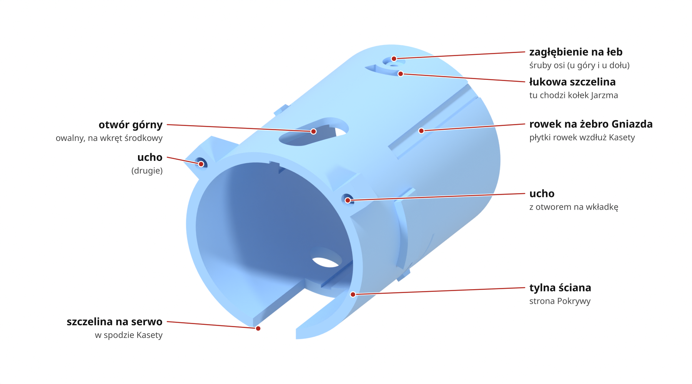
*Kaseta od tyłu i z góry.*

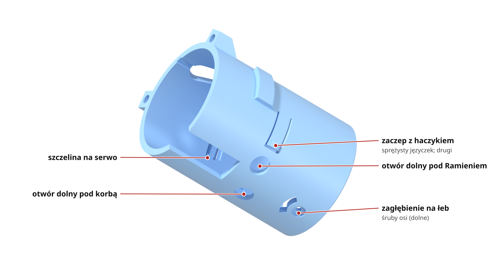
*Kaseta od spodu. Zaczepy są dwa, po przeciwnych stronach: jeden u góry, drugi u dołu.*

### Jarzmo

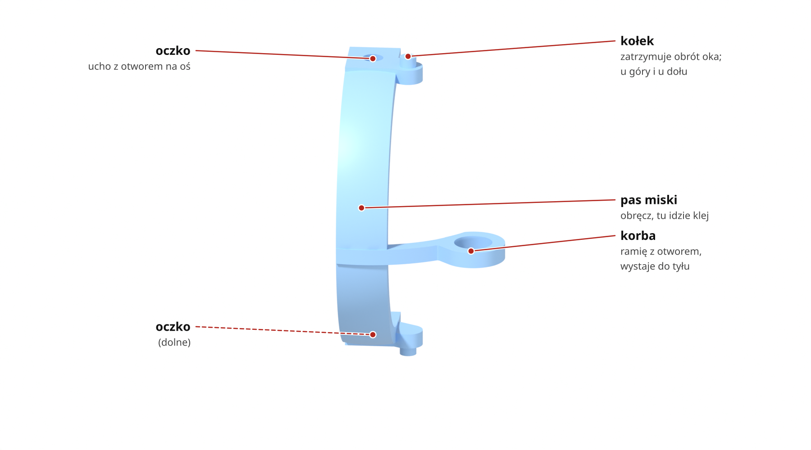
*Jarzmo widziane z boku i od tyłu. Tak ma być ustawione, gdy wkładasz je do Kasety (Krok 3).*

### Sanki

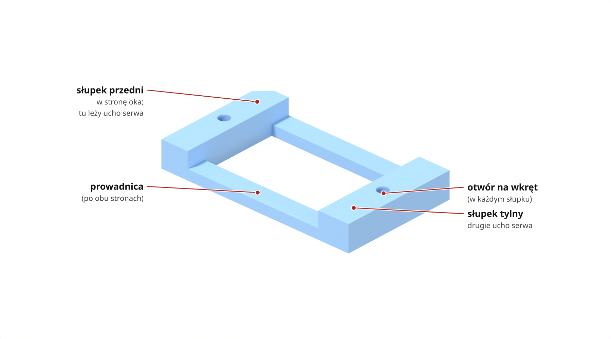

### Serwo i dźwigienka

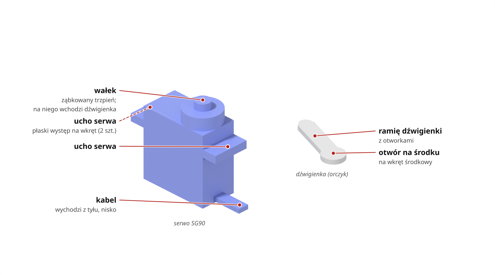

### Ramię

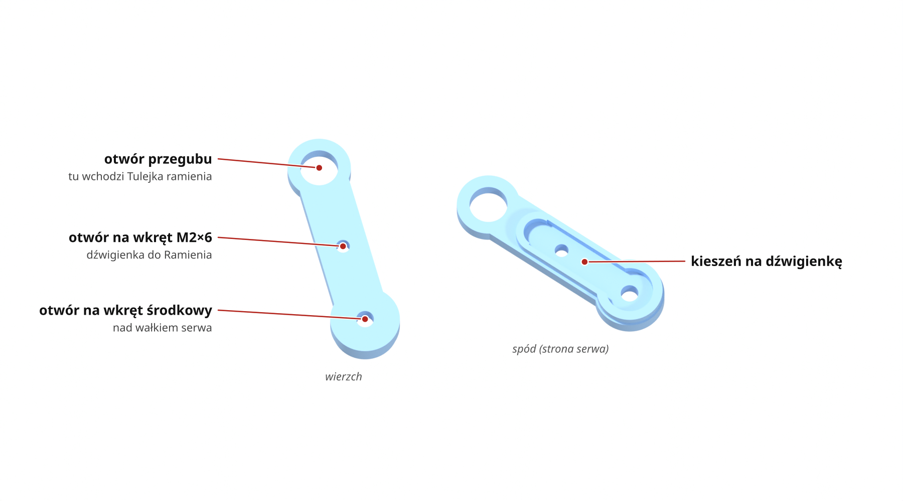

### Cięgno

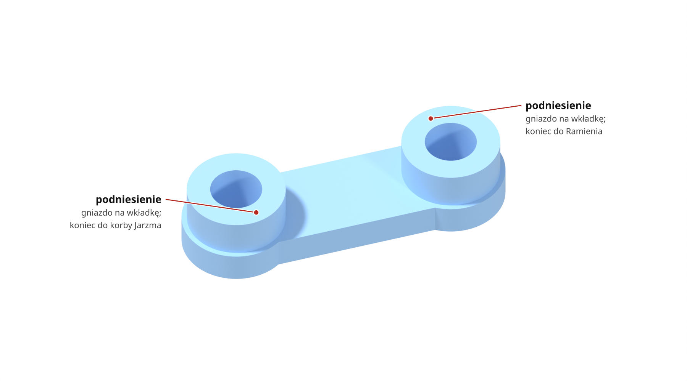
*Podniesienia są na górze. W każdym jest gniazdo na wkładkę M3.*

### Tulejka korby i Tulejka ramienia

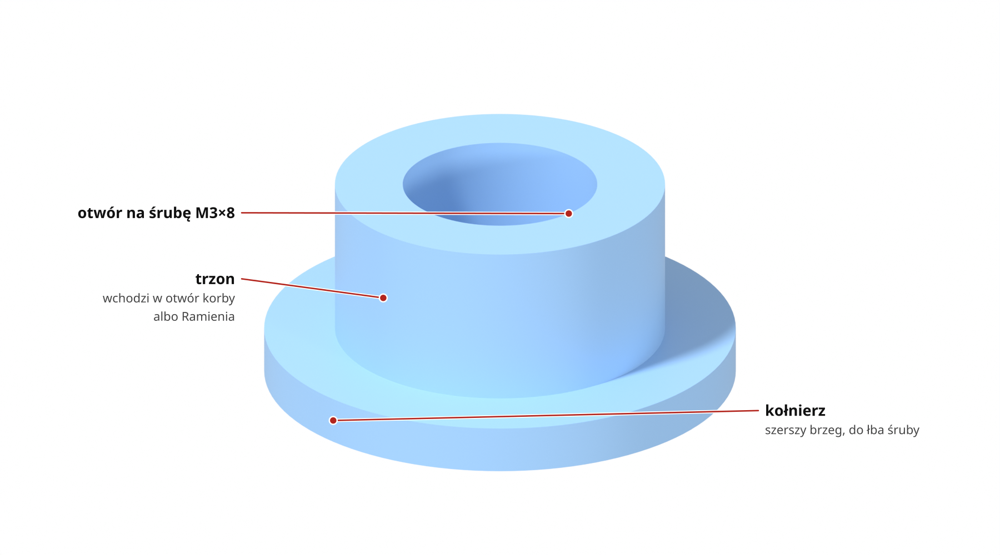
*Obie tulejki wyglądają tak samo.*

### Pokrywa

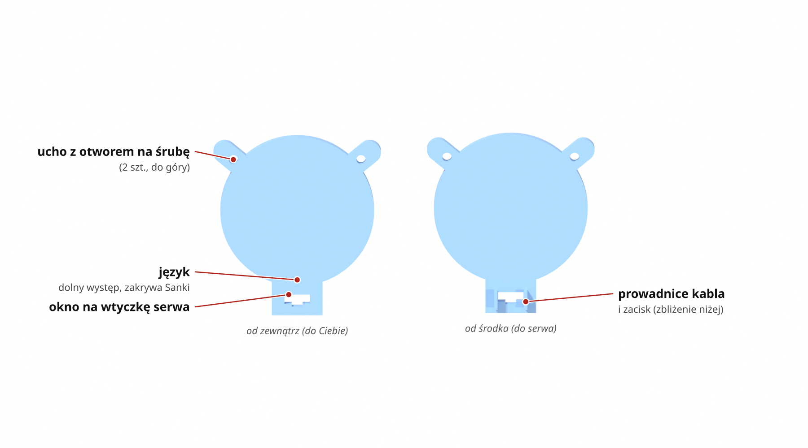

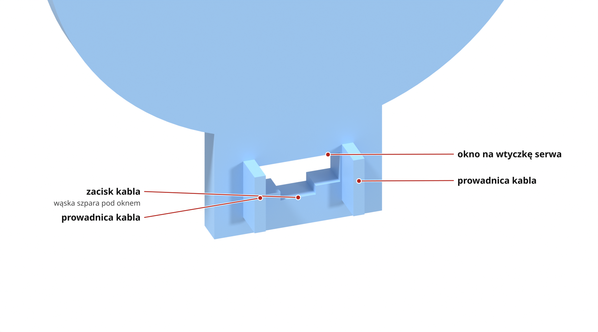
*Zbliżenie od środka: okno na wtyczkę, pod nim zacisk kabla, po bokach prowadnice kabla.*

### Gniazdo

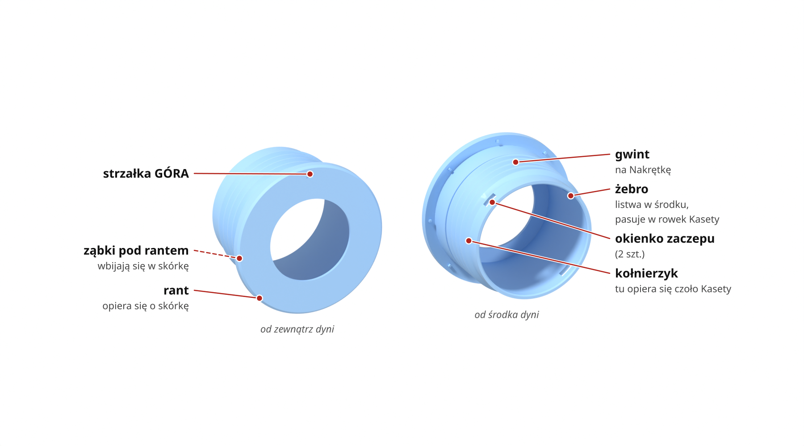
*Strzałka GÓRA to płytkie wgłębienie w rancie.*

### Nakrętka

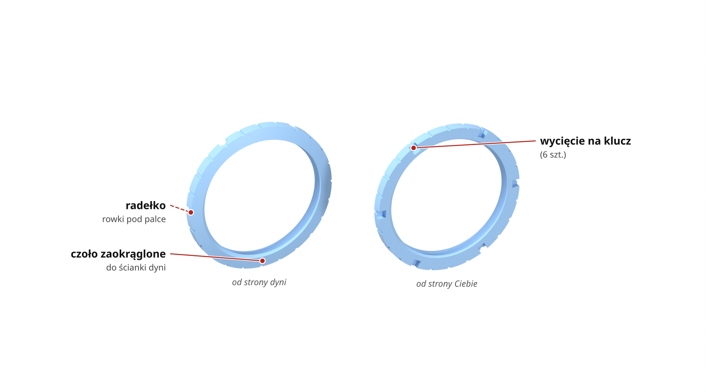

### Przyrząd do klejenia

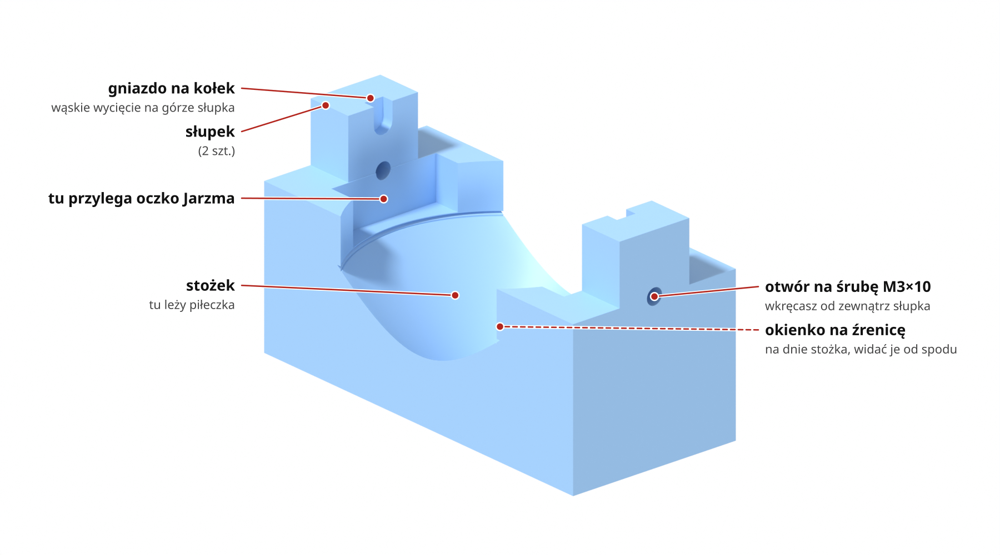
*Przyrząd stoi dnem na stole, tak jak w Kroku 2.*

### Przyrząd do centrowania

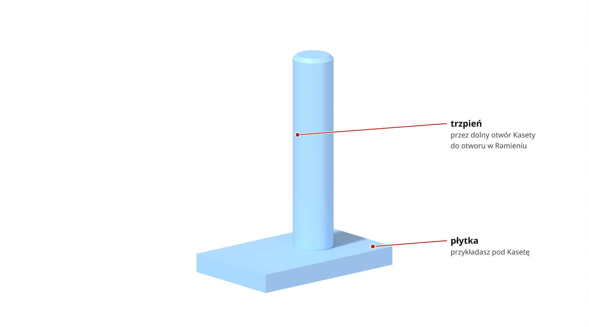

### Widelec

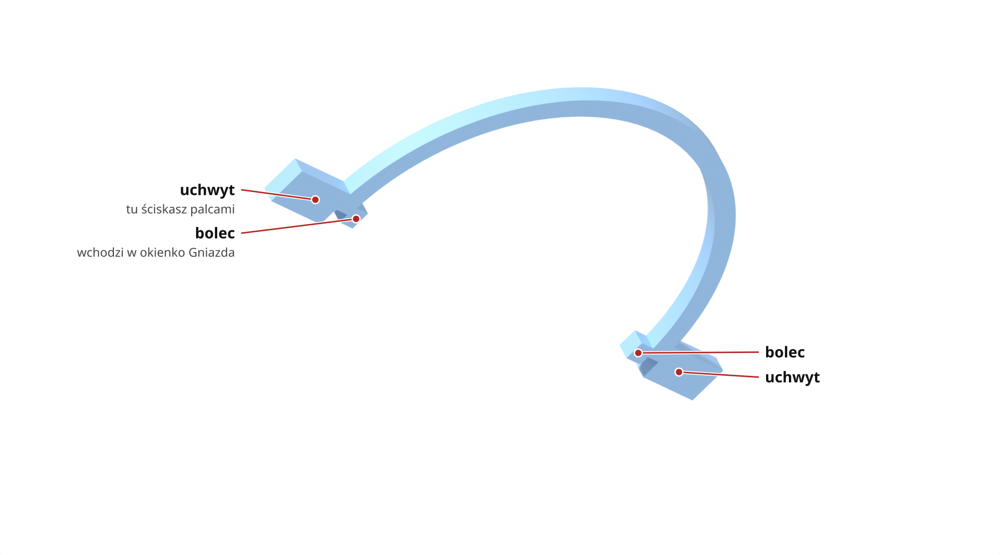

## Krok 1. Wtop wkładki (rodzic)


1. Weź Kasetę i 2 wkładki M3.
2. Nagrzej lutownicę z grotem do wkładek. Temperaturę sprawdź najpierw na próbnym wydruku (typowo ok. 220–240 °C).
3. Wtop wkładki od tyłu w otwory w obu uchach Kasety, na równo z tylną ścianą.
4. Weź Cięgno i 2 wkładki M3.
5. Wtop wkładki w gniazda w podniesieniach, od góry, na równo z podniesieniem.
6. Nie wciskaj wkładek w Cięgnie głębiej.

**Sprawdź:** M3×8 imbusowa wkręca się prosto, a wkładka nie obraca się, gdy kręcisz imbusem.

## Krok 2. Wklej piłeczkę w Jarzmo (rodzic, źrenicę może namalować syn)

Klej schnie długo, więc zrób ten krok dzień wcześniej.


1. Namaluj markerem źrenicę na piłeczce.
2. Połóż Przyrząd do klejenia dnem na stole.
3. Włóż piłeczkę źrenicą w dół w stożek przyrządu.
4. Sprawdź od spodu, że źrenica jest widoczna w okienku na źrenicę.
5. Załóż rękawiczki i otwórz okno.
6. Nałóż klej 2K na pas miski Jarzma, z dala od oczek i otworów osi.
7. Nałóż Jarzmo oczkami na słupki przyrządu, tak żeby kołki weszły w gniazda na kołki.
8. Wkręć 2 śruby M3×10 imbusowe imbusem 2,5 w otwory na śruby w słupkach, od zewnątrz, aż końce śrub wejdą w otwory oczek.
9. Odczekaj czas schnięcia podany na opakowaniu kleju (zwykle do 24 h).
10. Wykręć śruby i wyjmij Jarzmo.

**Sprawdź:** oczka przylegają do słupków bez szczeliny, a kołki i otwory osi są czyste od kleju.

## Krok 3. Włóż Jarzmo do Kasety (może zrobić syn)


1. Ustaw oko na wprost: źrenica patrzy do przodu, oczka są u góry i u dołu, a korba wystaje do tyłu, w Twoją stronę. Patrząc w tył Kasety, korba i pas miski są po lewej stronie, a korba jest w połowie wysokości (tak jak na obrazku Jarzma w „Części i ich miejsca”).
2. Włóż Jarzmo od tyłu Kasety, piłeczką naprzód. Kołki jadą kanałami (wąskimi rowkami w ściance Kasety) u góry i u dołu, a na końcu wchodzą w łukowe szczeliny.
3. Nagwintuj oba otwory osi: wkręć M3×4 grzybkową na sucho i wykręć.
4. Wkręć M3×4 grzybkową od góry w zagłębienie na łeb, imbusem 2,0, aż łeb oprze się w zagłębieniu.
5. Tak samo wkręć drugą M3×4 grzybkową od dołu.
6. Nie dociągaj śrub.

**Sprawdź:** oko obraca się ręką lekko do oporu w obie strony, łby śrub nie wystają ponad Kasetę i nic nie ociera.

## Krok 4. Przykręć serwo do Sanek i wsuń je (może zrobić syn)


1. Połóż serwo uszami na słupki Sanek, wałkiem i kablem w stronę tyłu Kasety.
2. Przykręć uszy 2 wkrętami M2×5 albo M2×6, wkrętakiem krzyżakowym. Nie używaj dłuższych.
3. Wsuń Sanki od tyłu: korpus serwa idzie przez szczelinę na serwo w spodzie Kasety, a prowadnice Sanek po jej krawędziach.
4. Pchaj, aż przód serwa dojdzie do końca szczeliny.
5. Jeśli idzie ciasno, zmierz suwmiarką szerokość korpusu serwa. Musi mieć najwyżej 12,2 mm.

**Sprawdź:** Sanki leżą płasko na ściance, a serwo nie kiwa się na boki.

## Krok 5. Załóż Ramię (rodzic)


*Ruch 7: Ramię z dźwigienką wsuwasz od tyłu, uniesione nad wałek.*

1. Weź dźwigienkę i przyłóż ją do kieszeni na dźwigienkę od spodu Ramienia.
2. Jeśli dźwigienka jest dłuższa niż kieszeń, przytnij ją obcinaczkami.
3. Włóż dźwigienkę w kieszeń.
4. Na stole przykręć dźwigienkę do Ramienia wkrętem M2×6, od wierzchu, przez otwór na wkręt M2×6 (13 mm od środka).
5. Ustaw serwo na środek: 1500 µs z testera serw albo z programu testowego na ESP32.
6. Odłącz serwo.
7. Wsuń Ramię od tyłu, uniesione o ok. 3 mm, tak żeby dźwigienka przeszła nad wałkiem serwa.
8. Ustaw Ramię nad wałkiem.

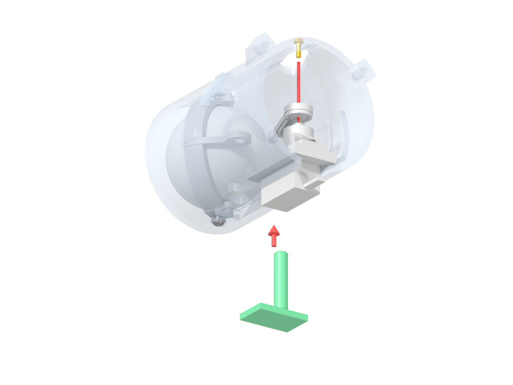
*Ruchy 9–12: Przyrząd do centrowania od spodu, potem wkręt środkowy od góry.*

9. Od spodu załóż Przyrząd do centrowania: płytka pod Kasetę, trzpień przez otwór dolny pod Ramieniem w otwór przegubu Ramienia.
10. Opuść Ramię na wałek.
11. Jeśli ząbki nie trafiają, obróć wałek ręką o mniej niż pół ząbka.
12. Wkręć wkręt środkowy M2×6 długim wkrętakiem krzyżakowym przez otwór górny Kasety w wałek. Nie używaj krótkiego wkrętu z torebki serwa, bo przez Ramię może nie złapać wałka.
13. Zdejmij przyrząd.

**Sprawdź:** Ramię siedzi na wałku bez luzu i nie ociera ani o serwo, ani o Kasetę.

Mały błąd ustawienia środka jest normalny. Poprawisz go później kalibracją w programie na ESP32 (programu jeszcze nie ma).

## Krok 6. Wsuń Cięgno (może zrobić syn)


1. Upewnij się, że oko patrzy na wprost, a serwo jest na środku.
2. Wsuń Cięgno od tyłu, podniesieniami z wkładkami do góry, nad Ramieniem i korbą Jarzma: koniec „do korby” nad korbą, koniec „do Ramienia” nad Ramieniem.
3. Pchaj, aż oba otwory Cięgna staną nad otworami korby i Ramienia.

**Sprawdź:** przez oba otwory dolne Kasety widać gwint wkładek na środku otworów.

## Krok 7. Przykręć przeguby od spodu (może zrobić syn)


1. Nasadź Tulejkę korby na M3×8 imbusową, kołnierzem do łba.
2. Włóż śrubę z tulejką od spodu przez otwór dolny pod korbą, przez otwór korby, do wkładki Cięgna.
3. Wkręć ją do oporu długim imbusem 2,5. Łeb jest ok. 2 cm w głębi.
4. Nasadź Tulejkę ramienia na drugą M3×8 imbusową, kołnierzem do łba.
5. Włóż ją od spodu przez otwór dolny pod Ramieniem, przez otwór przegubu Ramienia, do wkładki Cięgna.
6. Wkręć ją do oporu.

**Sprawdź:** przy powolnym ruchu serwa w obie strony (z testera) przeguby się nie zacinają, a Cięgno nie dotyka Jarzma ani Ramienia. Gdy serwo się rusza, trzymaj palce z daleka.

## Krok 8. Załóż Pokrywę (może zrobić syn)


1. Przełóż wtyczkę serwa od środka przez okno na wtyczkę w Pokrywie.
2. Przyłóż Pokrywę od tyłu, uchami do góry, językiem nad Sankami.
3. Przykręć ją 2 śrubami M3×8 imbusowymi (imbus 2,5) przez ucha Pokrywy do wkładek w uchach Kasety.
4. Wciśnij taśmę kabla w zacisk kabla pod oknem, między prowadnicami kabla.

**Sprawdź:** pociągnij za kabel. Taśma się nie przesuwa, a izolacja nie jest nacięta.

## Krok 9. Wytnij otwór i włóż Gniazdo (rodzic, raz)


1. Wybierz dynię o ściance grubości 15–25 mm.
2. Przy kilku oczach zaznacz środki otworów: obok siebie co najmniej 125 mm, jeden nad drugim co najmniej 145 mm. Przy mniejszej dyni daj więcej.
3. Wytnij otwór otwornicą 2½" (63,5 mm, nastawna do 64 mm), prostopadle do skórki.
4. Zmierz otwór. Powinien mieć od 63 do 64 mm.
5. Włóż Gniazdo od zewnątrz dyni, strzałką GÓRA pionowo do góry.

**Sprawdź:** rant Gniazda opiera się o skórkę, a strzałka stoi pionowo.

## Krok 10. Przykręć Nakrętkę od środka (może zrobić syn)


1. Od środka dyni nałóż Nakrętkę na Gniazdo, czołem zaokrąglonym do ścianki, wycięciami na klucz do siebie.
2. Kręć zgodnie z ruchem wskazówek zegara, patrząc od środka.
3. Dokręć ręką, aż ząbki pod rantem Gniazda wejdą w skórkę.

**Sprawdź:** Gniazdo się nie obraca, strzałka stoi pionowo, a okienka zaczepów są odsłonięte.

## Krok 11. Wepnij Kasetę w Gniazdo (może zrobić syn)


1. Ustaw Kasetę uchami Pokrywy do góry, serwem na dole.
2. Nasuń Kasetę rowkiem na żebro Gniazda. Patrząc od środka dyni, żebro jest u góry po prawej, skośnie.
3. Wsuń Kasetę prosto, bez obracania.
4. Pchaj, aż czoło Kasety oprze się o kołnierzyk Gniazda i oba zaczepy klikną.
5. Wepnij wtyczkę serwa.

**Sprawdź:** oba haczyki zaczepów widać w okienkach zaczepów Gniazda (od środka: u góry po lewej i u dołu po prawej), a Kaseta nie wychodzi, gdy pociągniesz za Pokrywę. Piłeczka wystaje z dyni na ok. 8 mm.

## Wyjmowanie Kasety (może zrobić syn)

1. Wciśnij oba haczyki zaczepów przez okienka zaczepów Gniazda.
2. Wyciągnij Kasetę do tyłu.

Można też użyć Widelca: włóż jego bolce w oba okienka zaczepów i ściśnij uchwyty.

## Sprawdzenie na koniec

- W programie na ESP32 ustaw zakres ruchu oka najwyżej 30° w każdą stronę, a jeśli coś ociera, 25°. Dalej Ramię zbliża się do Kasety, a oko dochodzi do twardego oporu, więc nie dojeżdżaj serwem do oporu. Dopóki programu nie ma, testerem ruszaj powoli i niedaleko od środka.
- W tym samym programie ustaw środek i oba krańce ruchu.
- Oko chodzi płynnie 30° w każdą stronę.
- Ramię nie ociera o Kasetę w całym zakresie ruchu.
- Cięgno nie ociera o nic i się nie klinuje.
- Oś oka ma lekko wyczuwalny luz, ale nie stuka.
- Korba i Ramię obracają się lekko na tulejkach.
- Kaseta trzyma się w Gnieździe na obu zaczepach.
- Kabel trzyma się w zacisku kabla, izolacja jest cała.

Wyniki zapisz w `70-budowa/dziennik.md`, zwłaszcza jak trzyma kabel, jak mocno trzymają zaczepy i jak sprawdził się klej.

---

## Dla dociekliwych

**Nazwy w normach:** M3×4 grzybkowa = ISO 7380 M3×4, M3×8 i M3×10 imbusowe = DIN 912. Krótkie nazwy w krokach (Gniazdo, Jarzmo, Ramię, Pokrywa, Tulejka korby i ramienia, Przyrząd do klejenia i do centrowania, Widelec, dźwigienka) odpowiadają plikom: Jarzmo z miską, Ramię orczyka, Pokrywa tylna, Tulejka przegubu korby i ramienia, Przyrzad do wklejania pileczki, Przyrzad centrowania orczyka, Widelec do zaczepow, orczyk SG90.

**Źródła:** `30-projekt/plan-v2-modul-oka.md` (v2.4 i v2.2), `30-projekt/decyzje.md` (18–19.10), `40-cad/onshape/e2.1-specyfikacja.md`, review v2.5 (`20-analizy/review/2026-10-19-v2.5-opus.md`, `-codex.md`). Siatki: `40-cad/3mf/Oko F v2.5/` (10 części) oraz przyrządy i bryły podglądowe z `Oko F v2.4/`.

**Układ osi:** oś modułu Z (+Z na zewnątrz dyni), +Y = GÓRA, oś oka pionowa. Kolejność montażu jest wymuszona geometrią (decyzja 18.10).

### Poprawki po review (E2.1c, 19.10)

Trzy usterki z review v2.5 są poprawione w modelu i w plikach 3MF (`40-cad/onshape/e2.1c-poprawki.md`), a obrazki przeliczone:

| Część | Było | Po poprawce |
|---|---|---|
| Kaseta | zaczep 213° bez szczeliny skośnej, sztywny | szczelina po obu stronach, zaczepy identyczne (odchyłka 0,0 mm) |
| Jarzmo | piasta korby w szczelinie kleju: 0,007 zamiast 0,5 | szczelina kleju 0,5 (najmniejszy promień 20,744) |
| Sanki | naroże mijało kołnierz tulejki H o 0,023 mm | fazka 2 mm, luz 0,295 |

Po każdym nowym eksporcie przelicz obrazki:

```bash
bash 70-budowa/montaz-v2.5/renderuj.sh              # wszystkie kroki + części i galerie, ok. 12 min
bash 70-budowa/montaz-v2.5/renderuj.sh --szybko     # to samo, podgląd (mniejsze obrazki)
bash 70-budowa/montaz-v2.5/renderuj.sh 03 05 07     # wybrane kroki (prefiks nazwy; 05 = 05 i 05b)
bash 70-budowa/montaz-v2.5/renderuj.sh --czesci     # tylko części z podpisami i galerie, ok. 5 min
bash 70-budowa/montaz-v2.5/renderuj.sh --czesci czesc_jarzmo min_J   # wybrane części / miniatury
```

`3mf_do_stl.py` zamienia 3MF na binarny STL w mm (bez zależności), `renderuj.py` renderuje w Blenderze (Cycles CPU, kroki w tabeli `KROKI`, części w `CZESCI`, miniatury galerii w `MINIATURY`), `podpisz.py` dokłada podpisy i linie do punktów części (położenie punktów w pikselach liczy Blender, rysunek SVG -> PNG przez `rsvg-convert`) i składa galerie, `renderuj.sh` robi wszystko naraz. Punkty podpisów są w układzie modelu w tabeli `CZESCI`; Blender sprawdza promieniem z kamery, czy punkt jest widoczny, i wtedy `podpisz.py` rysuje linię ciągłą, a w przeciwnym razie przerywaną. STL i surowe rendery części trafiają do `$MONTAZ_TMP` (domyślnie `/tmp/montaz-v2.5`).

### Wymiary części

| Część | Wymiary [mm] | Uwagi do druku |
|---|---|---|
| Gniazdo | Ø74 × 45,7 | gwint 45°, skok 5, `luzGwint` 0,20, jak próbka E2.0; mostki nad okienkami 7 mm i nad strzałką |
| Nakrętka | Ø74 × 6,8 | radełko 24 rowki; mostek 4 mm nad wycięciami na klucz |
| Kaseta | 57,8 × 54,5 × 76 | mostki ok. 15 mm nad zaczepami |
| Jarzmo z miską | 28 × 49,5 × 35 | brim |
| Sanki serwa | 19,2 × 32,8 × 4,35 | – |
| Ramię orczyka | 19,7 × 36 × 4 | – |
| Cięgno | 25 × 13 × 5,6 | – |
| Tulejki przegubu | Ø8 × 3,5 | obie identyczne |
| Pokrywa tylna | 59,3 × 65,3 × 6,5 | – |
| Przyrząd do wklejania (v2.4) | 28 × 62 × 34 | w v2.5 go nie ma; pasuje do jarzma v2.5 (oczko w kieszeni 0,20) |
| Przyrząd centrowania (v2.4) | 22 × 28,6 × 14 | pasuje do v2.5 (płytka 0,40 pod kasetą, trzpień 0,30 w ramieniu) |

### Szczegóły kroków

- **Kupne:** SG90 korpus ≤ 12,2 (sanki 12,7, czyli 12,2 + 2 × 0,25). Piłeczka 39,5–40,5. ISO 7380 jest konieczna, DIN 912 się nie zmieści. Wkładki: gniazdo w cięgnie 4,6 + 1,0 dna, w uchu kasety 5,6. Wkręty uszu ≤ 6 mm pod łbem (ucho 2,5 + otwór 3,75; dno 0,6). Wkręt środkowy: ramię dokłada 2,5 mm nad piastą orczyka; założono, że wkręt z kompletu ma ok. 3–4 mm, a powinien łapać wałek na co najmniej 2 zwoje. Klej: szczelina 0,5 × pas 8 mm × 180°.
- **Wkładki w kasecie:** 2 × Ø4 na r 29,5, pod kątem 40° i 140°. W cięgnie pod wkładką zostaje 1,0 mm dna.
- **Klejenie:** stożek 90° centruje piłeczki 39,5–40,5 na osi. Kołki ogranicznika w gniazdach przyrządu to blokada 0°. Piłeczka 39,5 siedzi ok. 0,7 mm bliżej przodu niż 40,5, co przy kołnierzyku Ø41 nie przeszkadza.
- **Jarzmo:** kanały na kołki 3,2 mm, luz przejścia 0,29. Otwory Ø2,6 w występach (gwint w plastiku 2,1 mm), pogłębienie Ø6,2 × 2,45. Łeb nie może wystawać, bo luz do gniazda to 0,25. Koniec śruby pracuje jako czop: 1,6 mm w oczku Ø3,3. Stopy ±33°, luz osiowy ok. 0,3.
- **Sanki:** szczelina w spodzie kasety 13,2, luz prowadnic 0,25–0,29. W modelu przód serwa zostaje 0,20 przed końcem szczeliny.
- **Ramię:** kieszeń orczyka sięga 19,8 mm od osi. Przy wsuwaniu orczyk nad wielowypustem, luz > 2,5. Trzpień przyrządu Ø5,4 przechodzi przez otwór dolny H (Ø8,7) w otwór H ramienia (Ø6,0). Skok wielowypustu ok. 14°; przyrząd go nie usuwa, więc kalibracja środka w ESP32 jest konieczna. Luz ramienia do SG90 1,3, do kasety 0,76 przy ±30°.
- **Cięgno:** jedzie 0,2 mm nad ramieniem i korbą. Przy oku 0° i serwie na środku otwory C (korba) i H (ramię) w korbie, ramieniu i cięgnie stoją nad otworami dolnymi kasety, współosiowo z otworami Ø6,0.
- **Przeguby C i H:** otwór dolny Ø8,7, kołnierz Ø8 (luz 0,35). Łeb ok. 21 mm nad spodem kasety. Tulejka zaciska się na cięgnie, a korba (ramię) obraca się na tulejce Ø5,6 w otworze Ø6,0 (0,2 na stronę).
- **Pokrywa:** okno na wtyczkę 3-pin 9 × 3,4. Przewężenie kabla 3,8 × 1,0 między prowadnicami (x ±4,7); taśma 1,4 zgniata się o ok. 29%. Pokrywa nie dociska sanek (0,10 osiowo), tylko chroni przed wysunięciem.
- **Otwór w dyni:** Ø63,5; przy Ø63 luz 0, przy Ø64 0,5 na stronę. Rozstaw środków dla dyni R 150. Rant Ø74.
- **Nakrętka:** czoło R130, gwint prawy. 8 ząbków rantu po 1,25 mm. Pełny zarys gwintu od 15 do 35,5 mm pod rantem, okienka zaczepów 38–42 mm pod rantem; przy ściance 25 mm między nakrętką a okienkami zostaje 3,3 mm.
- **Kaseta w gnieździe:** rowek na żebro 45° od pionu, luz 0,25 na stronę. Na ostatnich 6 mm haczyki uginają się o 0,75 mm. Czoło opiera się o kołnierzyk Ø41.
- **Wyjmowanie:** okienka 7 × 4 mm, haczyk trzeba wcisnąć o ≥ 0,75 mm. Widelec zwalnia zaczepy przy ściśnięciu uchwytów o ok. 1,1 mm na stronę.

### Kontrole końcowe w liczbach

| Co | Wartość |
|---|---|
| Ruch oka | praca ±30°, stop ±33° (kołek w końcu szczeliny, przy ±34° kolizja); firmware ≤ ±30°, przy ocieraniu ±25° |
| Serwo przy ±30° oka | oko +30° → serwo −25,6°, oko −30° → +29,8° (stop: −27,3° / +34,2°) |
| Ramię – kaseta | 0,76 przy ±30°, 0,26 przy +33° (zaakceptowane) |
| Cięgno – kaseta | ≥ 0,50 |
| Cięgno – ramię, cięgno – jarzmo | 0,20 |
| Oś oka | luz osiowy 0,3 |
| Przeguby | 0,2 na stronę na tulejce |
| Kaseta – gniazdo | 0,25 na stronę, 2 kliknięcia |
| Kabel | taśma w przewężeniu 1,0, wtyczka swobodnie w oknie |

### Do sprawdzenia na wydruku (bez zmian od v2.4)

- siła zaczepów (ok. 8 N na zaczep, wsuwanie ok. 23 N) i ich zwalnianie palcami albo widelcem,
- zacisk kabla 1,0 przy taśmie 1,4 (zgniot ok. 29%); przy taśmie ok. 1 mm może nie trzymać,
- klej 2K w szczelinie 0,5,
- długość SG90: przód 0,20 od końca szczeliny przy modelowym korpusie,
- wkręty uszu ≤ 6 mm i długość wkrętu środkowego orczyka,
- ścianka kasety przy uskoku wybrania H ma lokalnie 1,55 mm (promieniowo 2,0); odziedziczone po v2.4,
- przyrząd centrowania nie usuwa skoku wielowypustu (ok. 14°), więc kalibracja środka w ESP32 jest konieczna.
