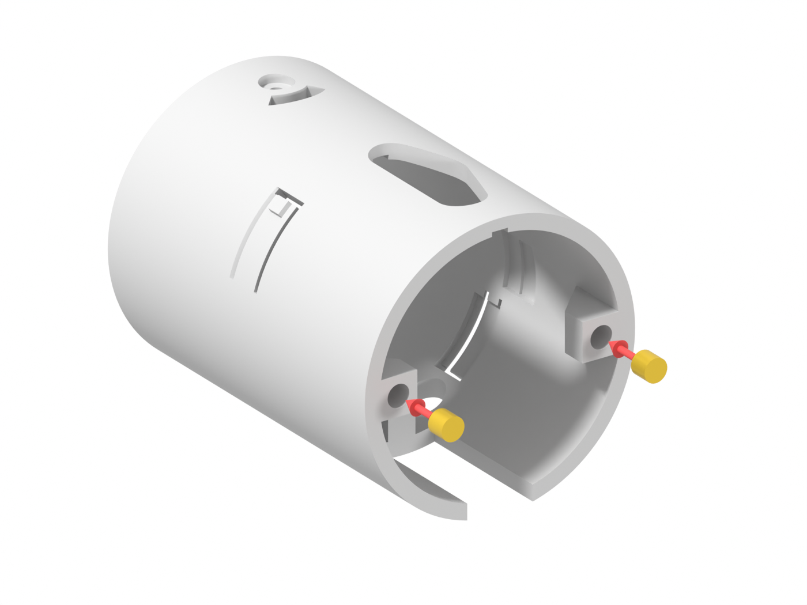

# Montaż modułu małego oka v2.7

Instrukcja do składania we dwóch: rodzic i syn. Oko to piłeczka pingpongowa, którą serwo obraca w lewo i w prawo. Cały mechanizm siedzi w jednej obudowie (Kasecie), którą wpina się od środka w otwór w dyni.

**Co nowego wobec v2.5** (po montażu 20.10, `70-budowa/dziennik.md`):
- serwo trzyma blok w Kasecie (wkręt przez okno) i nowa **Klamra H** z tyłu – **Sanek już nie ma**,
- Cięgno bez wkładek: przeguby na **śrubie M3×12, podkładce i nakrętce samohamującej**,
- **napęd skręcasz na stole** i wsuwasz od przodu Kasety, w rurze tylko nasadzasz Ramię,
- Gniazdo z mniejszym rantem (Ø67,5) i bruzdami na łby śrub osi oka,
- ucha Pokrywy są w środku Kasety, Pokrywa to płaski krążek z dwoma otworami.

## Części

### Do druku

Plik: `40-cad/3mf/Oko F v2.7/Oko F v2.7 - FullProject.3mf` – cały zestaw w jednym pliku. **Importuj go w Bambu Studio jako geometrię**; pojedyncze 3MF z archiwum Onshape wieszają Bambu. Części są w pozycji złożonej, obróć je tak jak w kolumnie „Na stół”. Wszystko bez podpór.

| Nazwa | Szt. | Na stół | Zmiana wobec v2.5 |
|---|---|---|---|
| Gniazdo | 1 | rantem (strzałka GÓRA na stole) | rant Ø67,5, ząbki przy ściance, bruzdy na łby |
| Nakrętka | 1 | tyłem (wycięcia na klucz) | bez zmian |
| Kaseta | 1 | czołem (rura pionowo) | blok i okno na wkręt serwa, ucha Pokrywy w środku |
| Klamra H | 1 | profilem H, tylną płaską stroną | nowa |
| Jarzmo z miską | 1 | płaskim bokiem miski bez korby, z brimem | bez zmian |
| Ramię orczyka | 1 | wierzchem (kieszeń na dźwigienkę do góry) | bez zmian |
| Cięgno | 1 | płytą, **nie odwracać** | bez piast, przelotowe otwory Ø3,3 |
| Tulejka korby, Tulejka ramienia | 1 + 1 | kołnierzem | bez zmian |
| Pokrywa tylna | 1 | płasko | krążek z 2 otworami |
| Przyrząd do klejenia (v2.4) | 1 na komplet | dnem z okienkiem | bez zmian (`40-cad/3mf/Oko F v2.4/`) |

Przyrząd do centrowania z v2.4 **nie pasuje** do v2.7 (otwór przegubu Ramienia jest zajęty przez tulejkę) – środek ustawiasz dźwigienką na wałku (Krok 4).

### Kupne

- serwo SG90 z dźwigienką jednoramienną,
- piłeczka pingpongowa 40 mm,
- klej: **cyjanoakryl z primerem** (sprawdzony 20.10) albo akryl 2K.

### Śruby i drobne części

| Nazwa | Szt. | Do czego |
|---|---|---|
| **M3×12 imbusowa** | 2 | przeguby C i H (od spodu, przez tulejkę) |
| **podkładka M3** (Ø7) | 2 | pod nakrętki przegubów (przy H tylko jedna) |
| **nakrętka samohamująca M3** (z nylonem), klucz 5,5 | 2 | przeguby C i H |
| **M3×8 imbusowa** | 2 | Pokrywa do wkładek w Kasecie |
| **wkładka M3×4×5** (długość 4, radełko Ø5) | 2 | ucha Pokrywy w Kasecie |
| **śruba osi oka M3**, łeb najwyżej 2,75 mm wysokości | 2 | oś oka: M3×4 grzybkowa (model) albo M3×10 wkręcona w nawiercone bieguny piłeczki (tak złożone 20.10) |
| **M2×6** krzyżakowy | 2 | dźwigienka do Ramienia, wkręt środkowy w wałek |
| **M2×5 albo M2×6** krzyżakowy | 2 | uszy serwa: tylne do Klamry H, przednie do bloku Kasety |

Wkrętów z torebki serwa nie używaj. Śruby z wysokim walcowym łbem (DIN 912, 3 mm) nie nadają się na oś oka – nie przejdą przez bruzdy Gniazda.

## Uważaj

1. **Wkładki wtapiaj w 210–215 °C (PLA)**, samym ciężarem lutownicy, na równo z powierzchnią. Przy 238 °C plastik się rozlewa.
2. **Przednie ucho serwa:** wkręt wkręcasz wstępnie tylko tyle, żeby wystawał pod uchem **najwyżej 1,2 mm**. Dłuższy zatrzyma serwo na bloku.
3. **Przegub H: jedna podkładka**, nie dwie – inaczej nakrętka zbliża się do ścianki Kasety przy skrajnym ruchu oka.
4. **Cięgno drukuj i montuj płytą do dołu**; nakrętki są na górze Cięgna, łby śrub od spodu.
5. **Nie kręć okiem ręką, gdy serwo jest podłączone.** Gdy serwo pracuje, palce z dala od Ramienia i Cięgna.

## Bezpieczeństwo

- **Lutownica (Krok 1) – tylko rodzic.** Odkładaj ją na podstawkę; wtopiona wkładka chwilę parzy.
- **Klej (Krok 2) – tylko rodzic.** Rękawiczki, otwarte okno.
- **Otwornica w dyni (Krok 9) – tylko rodzic.**

## Zanim zaczniesz

**Kierunki.** „Od tyłu” = od strony Pokrywy (środek dyni). „Od przodu” = od strony piłeczki. „Od spodu” = od strony serwa. „Góra” = strzałka GÓRA i okno w Kasecie.

**Narzędzia:** imbus 2,0 i długi imbus 2,5, klucz płaski 5,5 (nakrętki), wkrętak krzyżakowy PH0/PH1 długi (przez okno Kasety), lutownica z grotem do wkładek, ESP32 + PCA9685 z programem `50-elektronika/kalibracja` (środek 1500 µs, Krok 4), otwornica 2½", suwmiarka, nożyk.

## Części i ich miejsca

## Krok 1. Wtop wkładki w Kasecie (rodzic)

1. Weź Kasetę i 2 wkładki M3×4×5.
2. Lutownica 210–215 °C (PLA).
3. Wtop wkładki od tyłu w dwa ucha **wewnątrz** Kasety, po bokach, na równo z tylną krawędzią. Węższy stopień wkładki wchodzi w otwór na zimno i ją centruje.
4. Zdejmij nożykiem ewentualny wał plastiku wokół wkładki.

**Sprawdź:** M3×8 wkręca się prosto, wkładka się nie obraca.

## Krok 2. Wklej piłeczkę w Jarzmo (rodzic)

Jak w v2.5: źrenica, piłeczka w przyrządzie, klej na pas miski z dala od oczek i otworów osi, Jarzmo oczkami na słupki przyrządu, śruby M3×10 przyrządu. **Klej:** cyjanoakryl z primerem (20.10 trzymał; klej modelarski nie trzymał). Jeśli oś oka ma iść śrubami M3×10 w bieguny piłeczki, nawierć bieguny przez otwory oczek po związaniu kleju.

**Sprawdź:** oczka przylegają do słupków, kołki i otwory osi czyste.

## Krok 3. Serwo z Klamrą H do Kasety (może zrobić syn)

1. Na stole przykręć **Klamrę H** do **tylnego ucha** serwa (strona wałka i kabla) wkrętem M2×5/6. Wewnętrzne ramię Klamry leży pod tylnym uchem (w środku Kasety). Zewnętrzne obejmuje ściankę Kasety od spodu, za korpusem serwa; kabel serwa przechodzi pod nim.
2. W **przednie ucho** wkręć wstępnie wkręt M2×6 tak, żeby wystawał pod uchem **najwyżej 1,2 mm**.
3. Wsuń serwo od tyłu Kasety: korpus w szczelinę w spodzie, łącznik Klamry w tę samą szczelinę, ściana Kasety między ramionami Klamry. Wałek i kabel z tyłu, kabel wychodzi pod Klamrą na zewnątrz.
4. Przy ostatnich 2 mm trzymaj serwo pośrodku szczeliny – końcówka wkrętu wchodzi w kanał w bloku.
5. Pchaj, aż przednie ucho oprze się na bloku, a tył Klamry zrówna się z tylną krawędzią Kasety.
6. Dokręć przedni wkręt długim wkrętakiem **przez okno w górnej ściance**, prosto w dół (rura jest jeszcze pusta).

**Sprawdź:** serwo nie kiwa się do środka ani na zewnątrz, Klamra nie wystaje za tył Kasety.

## Krok 4. Dźwigienka na wałek, środek serwa (rodzic)

1. Podłącz serwo do kanału PCA9685 (ESP32 + PCA9685 jak w `50-elektronika/polaczenia.md`), wgraj `50-elektronika/kalibracja` z `KANAL` ustawionym na ten kanał, otwórz monitor portu i wyślij `1500`. Serwo trzyma 1500 µs, dopóki program działa. **Nie odłączaj zasilania i nie wysyłaj `off` przez cały czas nasadzania**, aż do końca Kroku 7 (dźwigienka i Ramię przykręcone). **Nie używaj `test-serwa`**: trzyma środek tylko 5 s, potem jedzie ±30° w pętli.
2. Dźwigienkę przyłóż do kieszeni od spodu Ramienia; jeśli dłuższa niż kieszeń, przytnij obcinaczkami.
3. Przy serwie trzymającym 1500 µs nasadź dźwigienkę na **goły wałek** tak, żeby wskazywała **do przodu, ok. 20° w prawo** (patrząc od tyłu Kasety) – w stronę, gdzie stanie przegub H Ramienia. To daje położenie „otwarte V, przegub H po prawej, patrząc od tyłu” z rysunku w „Pozycja zero i kalibracja”. Wałka nie obracaj ręką.
4. Wkręć wkręt środkowy M2×6 przez okno w wałek. Serwo dalej trzyma 1500 µs.

**Sprawdź:** dźwigienka siedzi bez luzu i wskazuje do przodu, ok. 20° w prawo; mały błąd środka poprawi później kalibracja w ESP32.

> **Ważne (montaż 21.10):** dźwigienkę (a przy ponownym nasadzaniu Ramię z dźwigienką) nasadzaj na **goły wałek przy serwie trzymającym 1500 µs z programu `kalibracja`** (komenda `1500`, zasilanie przez cały czas nasadzania), w położeniu z rysunku w „Pozycja zero i kalibracja”: otwarte „V” Ramienia i Cięgna z przegubem H po prawej (patrząc od tyłu). Czworobok da się złożyć na dwa sposoby; w drugim przegub H się składa, Ramię kładzie się na Cięgnie i serwo blokuje mechanizm. Jeśli po złożeniu środek wypada daleko od 1500 µs albo ruch w jedną stronę jest krótki – wyślij `1500`, zdejmij Ramię z wałka (wkręt środkowy przez okno) i nasadź ponownie według tej zasady.

## Krok 5. Skręć napęd na stole (może zrobić syn, nakrętki rodzic)

1. Weź Jarzmo z piłeczką, Cięgno, Ramię i obie tulejki.
2. **Przegub C (korba):** M3×12 od spodu → Tulejka korby kołnierzem do łba → otwór korby Jarzma → otwór C w Cięgnie (płytą do korby) → podkładka → nakrętka samohamująca.
3. **Przegub H (Ramię):** tak samo, M3×12 → Tulejka ramienia → otwór H Ramienia (kieszeń dźwigienki do dołu, od strony serwa) → otwór H w Cięgnie → **jedna** podkładka → nakrętka.
4. Dokręć obie nakrętki kluczem 5,5, trzymając łeb imbusem 2,5, do oporu: tulejka zaciska się na Cięgnie.

**Sprawdź:** korba i Ramię obracają się lekko na tulejkach, Cięgno jest płaskie (nie wygina się), śruba wystaje nad nakrętką 1–1,5 mm.

## Krok 6. Wsuń napęd od przodu Kasety (rodzic)

1. Oko na wprost: źrenica do przodu, oczka u góry i u dołu, korba do tyłu. Patrząc w tył Kasety, korba i pas miski są po lewej.
2. Wsuń Jarzmo od przodu Kasety, lekko przechylone, aż kołki ograniczników wejdą w łukowe szczeliny wokół osi oka. Ramię i Cięgno jadą przodem w głąb rury.
3. Przy końcu opuść Ramię **kieszenią na dźwigienkę** na wałku (serwo wciąż trzyma 1500 µs z Kroku 4). Mechanizm w położeniu „otwarte V”, przegub H po prawej (patrząc od tyłu); dźwigienki nie obracaj.
4. Wkręć śruby osi oka od góry i od dołu, w zagłębienia na łeb (M3×4 grzybkowe albo M3×10 w bieguny piłeczki), bez dociągania.

> **Niesprawdzone:** czy skręcony napęd daje się unieść o ok. 1,6 mm, żeby kieszeń Ramienia weszła na dźwigienkę (Fable szacuje ok. 1,7 mm z luzów przegubów). Jeśli nie wchodzi, poluzuj nakrętkę przegubu H o pół obrotu, nasadź Ramię i dokręć. Wynik zapisz w dzienniku.

**Sprawdź:** oko obraca się ręką lekko do oporu w obie strony (±33°), łby osi nie wystają ponad Kasetę więcej niż 2,75 mm.

## Krok 7. Ramię do dźwigienki (rodzic)

1. Przez okno w górnej ściance wkręć M2×6 przez otwór w Ramieniu (13 mm od wałka) w dźwigienkę.

**Sprawdź:** Ramię siedzi na dźwigience bez luzu; przy płynnym ruchu z programu `kalibracja` (`g 1350 4000`, `g 1650 6000`, `g 1500 4000`) przeguby się nie zacinają, nakrętki nie ocierają o Kasetę.

## Krok 8. Pokrywa (może zrobić syn)

1. Przyłóż Pokrywę od tyłu (obojętnie którą stroną – jest symetryczna), otworami na wkładki w uchach.
2. Przykręć 2 × M3×8 imbusem 2,5.

**Sprawdź:** Pokrywa przylega do Kasety i Klamry, kabel serwa wychodzi pod Klamrą na zewnątrz, nic się nie zgniata.

## Krok 9. Otwór w dyni i Gniazdo (rodzic, raz)

1. Ścianka dyni 15–25 mm; kilka oczu: środki co najmniej 125 mm obok siebie, 145 mm jeden nad drugim.
2. Otwornica 2½" (63,5 mm), prostopadle do skórki; otwór 63–64 mm.
3. Włóż Gniazdo od zewnątrz, strzałką GÓRA pionowo do góry. Rant wystaje tylko 2 mm poza otwór.

## Krok 10. Nakrętka od środka (może zrobić syn)

1. Od środka dyni nakręć Nakrętkę zgodnie z ruchem wskazówek zegara (patrząc od środka), czołem zaokrąglonym do ścianki.
2. Dokręć ręką, aż ząbki przy krawędzi otworu złapią skórkę. Ząbki są teraz przy samej ściance – trzymaj Gniazdo strzałką do góry, gdy dokręcasz.

## Krok 11. Kaseta do Gniazda (może zrobić syn)

1. Kaseta serwem na dole, oknem do góry.
2. Nasuń Kasetę rowkiem na żebro Gniazda (od środka dyni: u góry po prawej, skośnie). Łby śrub osi wchodzą w bruzdy Gniazda u góry i u dołu.
3. Wsuń prosto, bez obracania, aż czoło Kasety oprze się w Gnieździe i oba zaczepy klikną.
4. Wepnij wtyczkę serwa.

**Sprawdź:** haczyki zaczepów widać w okienkach Gniazda; Kaseta ma mały, wyczuwalny luz kątowy; nie wychodzi, gdy pociągniesz za Pokrywę.

## Wyjmowanie Kasety

Wciśnij oba haczyki przez okienka Gniazda i wyciągnij Kasetę do tyłu (albo Widelcem z v2.4).

## Pozycja zero i kalibracja

*Oko na wprost: Ramię od wałka do przodu i lekko w prawo, przegub H ok. 9 mm na prawo od środka, Cięgno z H w lewo do przegubu C na korbie Jarzma. „V” Ramienia i Cięgna otwarte, wierzchołek w prawo.*

Kalibracja programem `50-elektronika/kalibracja` (port szeregowy 115200; po włączeniu serwo jest bez impulsu i się nie rusza):

1. Nie przesuwaj oka ręką przy zasilonym serwie i nie używaj `off` w trakcie – serwo nie zna swojej pozycji, więc następny impuls skoczy.
2. Pierwsza komenda: `1500` (przy dźwigience nasadzonej jak w Kroku 4 oko stoi na wprost).
3. Ruch sprawdzaj płynnie: `g 1350 4000`, `g 1650 6000`, `g 1500 4000`, potem szerzej `g 1200 5000`, `g 1800 8000`.
4. Krańce: pierwszy moduł (21.10) chodził płynnie w ±300 µs wokół 1500; w programie ruchu `oczy-ruch` zakres ±25° serwa (±278 µs). Środek każdego oka zapisz (`k<nr> <µs>` w `oczy-ruch`).

## Sprawdzenie na koniec

- Zakres pracy w programie ESP32: ±25° serwa (±278 µs) wokół środka, najwyżej **±30°** oka (przy ±33° oko stoi na ograniczniku, a nakrętka przegubu H ma tylko 0,27 mm do ścianki).
- Oko chodzi płynnie, przeguby się nie zacinają, nakrętki nie ocierają.
- Serwo nie kiwa się w Kasecie.
- Kaseta trzyma się w Gnieździe na obu zaczepach.

Wyniki zapisz w `70-budowa/dziennik.md` – zwłaszcza Krok 3 (wkręt w kanale), Krok 6 (nasadzenie Ramienia) i Krok 11 (łby w bruzdach).

---

## Dla dociekliwych

- **Rendery:** `bash 70-budowa/montaz-v2.7/renderuj.sh` (`--szybko` podgląd; potok jak w v2.5, siatki z `Oko F v2.7 - FullProject.3mf` rozdzielane przez `3mf_do_stl.py --rozdziel`, podglądy SG90, piłeczki, orczyka, przyrządu i widelca z v2.4).
- **Źródła:** brief `30-projekt/brief-e4-v2.6.md` i `brief-e4.4-ciegno-nakretki.md`, raport `40-cad/onshape/weryfikacja-v2.6.md` (wykonawca), review `20-analizy/review/2026-10-20-v2.6-*.md`, decyzje z 20.10 w `30-projekt/decyzje.md`. Wymiary i luzy części bez zmian – `montaz-v2.5.md`, „Dla dociekliwych”.
- **Kluczowe luzy v2.7:** Kaseta–Gniazdo 0,25/str.; łeb osi w bruździe 1,05 z boku, 0,3 promieniowo (łeb ≤ 2,75); serwo w kieszeni 0,7 z przodu i z tyłu; wkręt przedni w kanale 0,4/str., 0,3 pod końcówką; Klamra–Kaseta 0,25; Klamra–kabel 0,9; nakrętka H–Kaseta 0,79 przy ±30°, 0,27 przy ±33°; M3×8 Pokrywy 0,6 do dna otworu.
- **Śruba przegubu M3×12:** łeb na kołnierzu tulejki, tulejka 3,5 + Cięgno 2,5 + podkładka 0,5 + nakrętka 4 → wystaje 1,5 (przy 2 podkładkach 1,0); M3×10 za krótka.
